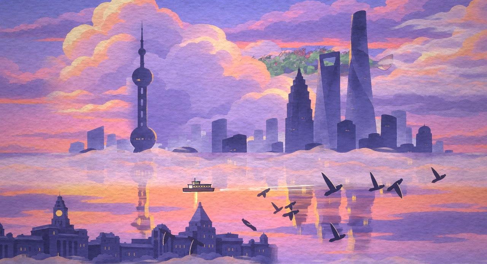
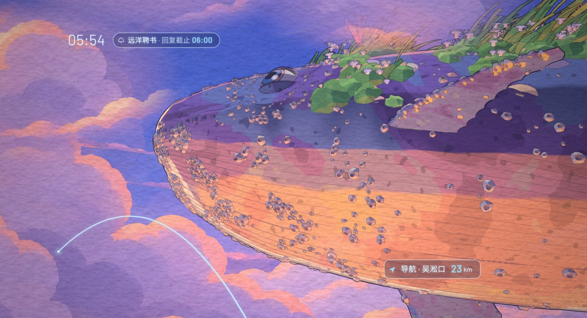
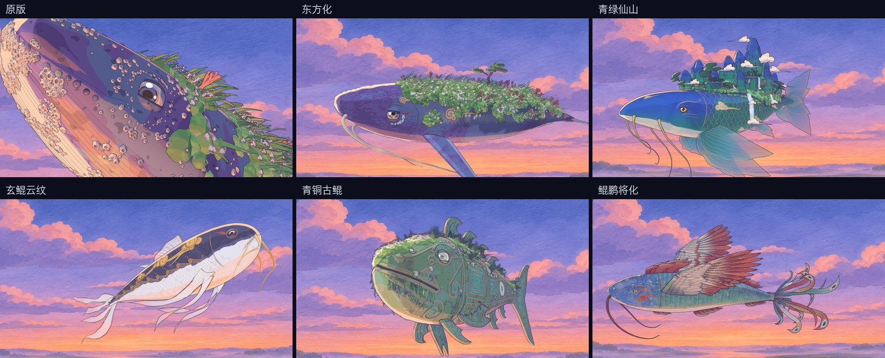

<div align="center">

# 北冥引擎

**Beiming Engine · 代码即影片**

一条三渲二 + 2.5D 的风格化渲染管线。<br>
每一帧都由代码画出：可重渲、可追溯、可以换一种画风重来。

<a href="https://github.com/cuiyucheng0104-afk/beiming-engine/releases/tag/v1.0"></a>

<sub>《北冥》概念样片 · 10 秒 · 有声完整版：<a href="https://github.com/cuiyucheng0104-afk/beiming-engine/releases/tag/v1.0">1080p 与原生 4K</a></sub>

<br>


</div>

---

## 作品

鲲把城市的灯海当成了大海。黎明前，一位轮渡水手透过 AI 眼镜看见了它。

| 雾江 · 0–3 秒 | 她 · 3–5 秒 | 鲲现 · 5–10 秒 |
|:---:|:---:|:---:|
|  |  |  |

画面分两层：现实层是手绘质感的三渲二，眼镜显示层是锐利的矢量线条与文字，叠在最上面、不过后期。
故事与视听定调见 [docs/作品.md](docs/作品.md)。

## 一套引擎，不止一种画风

画风不写死在素材里，而是由造型、着色与后期三处代码共同决定。同一条鲲，换一组参数和着色器，就是另一种气质。



<sub>六个造型都在 [src/](src) 里，各有一张自测页：`?test=kun_qinglv`、`?test=kun_bronze` ……</sub>

## 管线

```
  造型 ─┐
  着色 ─┼─▶ 三维场景 ─▶ 后期 ─▶ 显示层 ─▶ 逐帧渲染 ─▶ 编码封装
  底板 ─┘      ▲                    ▲          ▲            ▲
         分层时钟              Canvas 2D   无头浏览器     FFmpeg
```

| 层 | 做什么 | 引擎 |
|---|---|---|
| **形** | 轮廓表放样、翼型与鳍、沿脊传播的游动弯曲，程序化道具在表面上确定性散布 | `engine/form` |
| **光** | 三色分档卡通着色、量化阴影、背光与受光边缘光、下方补光，可叠斑驳与风化表面层 | `engine/shade` |
| **景** | 手绘底板作为三维空间里的面片与穹顶分层，按屏幕像素摆位，镜头一动，视差自然产生 | `engine/stage` |
| **笔** | 屏幕空间墨线（深度 + 物体 ID）、空气透视、bloom、调色、Kuwahara 颜料笔触、纸纹与颗粒 | `engine/look` |
| **人** | Canvas 2D 逐笔绘制：路径语言、可变宽墨线、轮廓光与渗色、水彩斑驳 | `engine/paint` |
| **界** | 显示层与片名，最后一层合成，永远清晰；毛笔字按笔顺落笔，带枯笔飞白 | `engine/overlay` |
| **时** | 分层时钟：角色一拍二、鲲一拍三，镜头与雾水每帧都动 | `engine/core` |
| **声** | 程序化音效、采样编配、混音与响度，全部确定性 | `engine/audio` |
| **片** | 无头浏览器逐帧截图，多路并行，FFmpeg 编码后无损拼接 | `engine/render` |

《北冥》本身只是 `src/` 里的数据与编排：色板、造型、角色、文案、镜头与时间。换一部片子，换的是这一层。

确定性贯穿始终：没有 `Date.now`，没有无种子随机。同一个时刻永远画出同一张图，任何一帧都可以单独重渲。

## 快速开始

需要 Node.js 20+、FFmpeg、Python 3.10+。

```bash
npm run setup                     # 安装依赖与无头浏览器
pip install -r requirements.txt   # 声音部分
```

```bash
sh build.sh          # 一键重建整片：静帧样张 → 混音 → 逐帧渲染 → 封装（1920×1040）
sh build.sh --4k     # 原生 4K（3840×2080）
```

只想看画面：

```bash
npx http-server -p 8080 .         # 任意静态服务器均可
# 打开 http://127.0.0.1:8080/              正片
# 打开 http://127.0.0.1:8080/?test=kun     单个模块的自测页
```

## 页面约定

任何一部影片，只要页面满足这四条，就能交给渲染器：

```js
window.DUR = 10;                 // 时长（秒）
window.render = t => { … };      // 把画面画到时刻 t，必须是确定性的
window.READY = true;             // 贴图、字体、着色器全部就绪
window.TEXTS = t => [ … ];       // 可选：该时刻画面上的文字，供检查
```

渲染器不关心页面里用的是 three.js、Canvas 2D 还是别的什么。用 `engine/stage/film.js` 搭镜头，这四条会自动兑现。

## 目录

```
engine/          北冥引擎
  core/          数学 · 噪声 · 笔触 · 分层时钟
  form/      形  放样 · 弯曲 · 道具 · 植物 · 山石 · 散布 · 距离场 · 曲线
  shade/     光  卡通着色 · 表面层 · 着色器补丁
  stage/     景  底板 · 穹顶 · 机位 · 运动 · 影片外壳
  look/      笔  物体 ID · 墨线 · 雾 · bloom · 调色 · 颜料笔触 · 纸纹 · 合成
  paint/     人  路径 · 曲线 · 墨线 · 光 · 水彩 · 发丝
  overlay/   界  文字 · 控件 · 毛笔字
  audio/     声  DSP · 合成 · 环境声 · 采样 · 编配 · 混音 · 测量
  render/    片  页面 · 静帧 · 视频 · 封装
src/             《北冥》：色板与材质预设、六种鲲、渡船、角色、显示层、三个镜头
lab/             各模块的自测页（?test=<名字>）
audio/           《北冥》的声音设计、配乐与混音编排
assets/          手绘底板与纸纹
docs/            作品说明 · 渲染与 4K 实测 · RTX 工作站指南
```

## 美术素材

底板与风格参考由 Midjourney V8 与 GPT Image 2.5 生成，经手工整理后进入管线。造型、着色、墨线与动画全部由代码完成。

## 两条创作路线

| 路线 | 创作目标 | 当前入口 |
|---|---|---|
| **北冥风格路线** | 以北冥美术体系发展独特画风，吸收 RAEA 的场景、动作与原生能力 | `engine/`、`src/`、`lab/` |
| **RAEA 原生路线** | 直接使用 RAEA 的通用二维/三维与原生 GPU 能力，自由组织作品 | `examples/raea/` |

路线决定作品怎样组织，后端决定画面怎样执行。未来 agent 从 [路线选择](ROUTES.md) 和 [AGENTS.md](AGENTS.md) 开始；RAEA 原生路线不必套用北冥的现有材质与笔触。

需要具体开工步骤，进入 [双路线工程手册](docs/routes/README.md)：包含模块与参数定位、接口模板、5090 验收和 [21 项可分派任务](docs/routes/work-breakdown.md)。`npm run routes:next -- --route beiming` 或 `--route raea` 可列出依赖已满足的下一项工作。

同一套鲲、渡船与绘画底板，已完成 RAEA / Bevy 原生 10 秒渲染实验。源码对照、资产转换、可运行示例和后续集成步骤现已入库：

| 内容 | 入口 |
|---|---|
| 调用链、材质、GPU、编码与确定性分析 | [源码对照](docs/raea/architecture.md) |
| 接口设计、文件落点、风格迁移与分阶段验收 | [技术集成指引](docs/raea/integration.md) |
| 程序化鲲 → GLB 骨骼动画 → 原生渲染 | [示例与复现命令](examples/raea/README.md) |
| 真实测量、兼容问题与剩余限制 | [实验记录](docs/raea/experiment.md) |

当前提供独立实验路径，原有 Three.js 构建保持不变。通用双后端、人物表演和原版画风等价仍是后续工作。RAEA 运行时需单独安装并遵循其许可；详细版本与边界见 [研究入口](docs/raea/README.md)。

---

## RTX 原生加速

北冥引擎的瓶颈从来不在"画什么"，而在"每一帧要画多久"。卡通着色、Kuwahara 笔触、逐像素墨线都是重着色器负载，最适合交给 RTX 的原生图形栈。

**一条 Vulkan 直通。** 无头浏览器在工作站上默认会落到核显。引擎把 ANGLE 切到 Vulkan 后端，WebGL 直接跑在 RTX 独显上：

```bash
BEIMING_ANGLE=vulkan sh build.sh --4k
```

| | 重着色器单帧 | 原生 4K 整片（240 帧） |
|---|---:|---:|
| RTX 5090 · Vulkan | **0.52 ms** | **31 秒** |
| Apple M5 Pro · Metal | 5.17 ms | 51 秒 |

1080 时两者相当（Mac 10.9 秒，工作站 13.1 秒），浏览器启动的固定开销占了大头；分辨率越高，独显的优势越明显，4K 时约快 1.6 倍。

**原生分辨率优先。** 镜头按设计尺寸摆位，渲染器、后期与显示层按实际像素工作，任何分辨率下构图一致。因此 4K 是直接算出来的，不是放大出来的。

**超分放在它该在的位置。** 我们实测了 RTX Video Super Resolution：把 1080 放大到 4K，手绘平涂区会生出不属于这幅画的纹理。所以引擎的分工是：代码画出的镜头走原生 4K；拿不到原生分辨率的素材，比如 AI 生成的视频镜头，才交给 RTX 超分。

**两台机器，同一张画。** Mac 与 RTX 工作站渲出的 4K 成片 SSIM 0.973，差异只在系统字体的光栅化边缘，肉眼不可见。日常在笔记本上迭代，出片交给工作站。

详细数据见 [docs/渲染与4K.md](docs/渲染与4K.md)，工作站配置见 [docs/RTX工作站.md](docs/RTX工作站.md)。

---

<sub>源代码以 MIT 许可开放；影片、底板与展示图保留所有权利；字体遵循 SIL OFL 1.1。详见 [LICENSE](LICENSE)。</sub>
