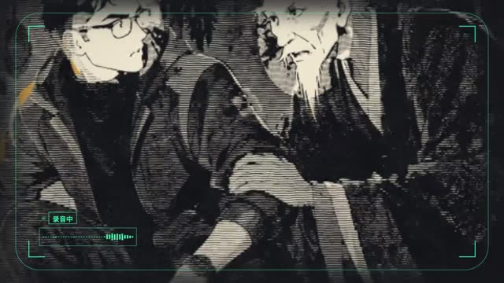
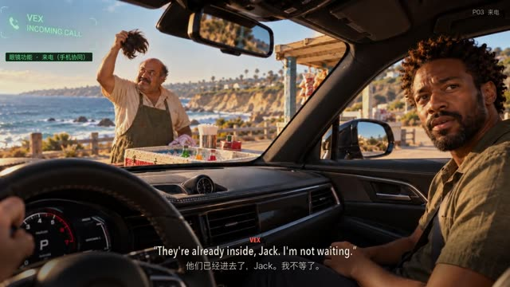
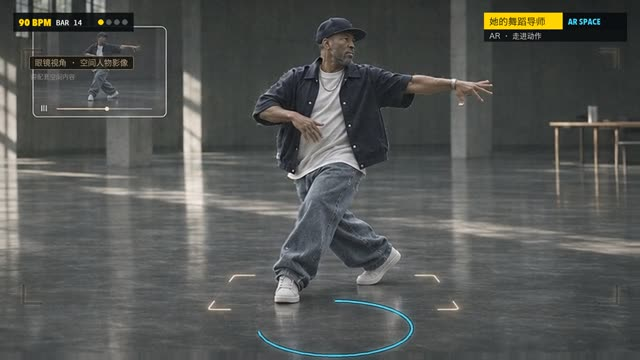

# 北冥案例库

把已经做过的作品、实验和完整风格基座收在一个入口。**作品状态、原始来源和复现条件分别记录。**

[浏览全部案例](INDEX.md) · [打开画廊](index.html) · [两库源码对比](../docs/cases/comparison.md) · [PPT动画流程](../docs/cases/ppt-animation.md) · [下载成片与素材包](https://github.com/cuiyucheng0104-afk/beiming-engine/releases/tag/casebook-2026.11)

| 内容 | 数量 | 保存方式 |
|---|---:|---|
| 本机风格实验 | 66 | 原故事/源代码、时间轴、声音程序、素材及成片 |
| PPT故事介绍片 | 7 | 原画分层、配音字幕、生成/剪辑脚本、版本与成片 |
| 发布会动画 | 6+1 | 6个工程与1组共用资源 |
| 北冥画风实验 | 4 | 40/360/九景/15s试验、完整参数、模型和成图 |
| 其他动画/预演工程 | 12 | 含豹变四版、9分钟试作、机械动画、代码讲解等 |
| SY完整基座 | 20风格 / 100示例 | [331个原仓库文件](vendor/sy-style-100/) |
| Lemo完整基座 | 66风格 | [2478个原仓库文件](vendor/lemo-opuscar/) |

## 先看PPT改编成果

| 见龙 | 目之所及 | 她的舞蹈导师 |
|---|---|---|
| [](entries/ppt-jianlong.md) | [](entries/ppt-in-sight.md) | [](entries/ppt-dance-mentor.md) |

七部作品和发布会版本完整列在 [INDEX.md](INDEX.md)。`*-preview.mp4` 是本次从历史影片转码的960像素宽观看版；原画质、手机版和其他原始版本在 `original-films-*.zip` 中保留原始字节。没有把观看版当作新的渲染成果。

## 找到代码，然后还原

```bash
python3 tools/casebook.py list --group ppt-stories
python3 tools/casebook.py check
python3 tools/casebook.py restore style-02-watercolor --source-only
```

只还原源码的目录不能用于完整出片。需要素材时，用**另一个不存在的输出目录**还原：

```bash
python3 tools/casebook.py restore style-02-watercolor --download --out out/casebook-full
# 若已经手动下载了素材包
python3 tools/casebook.py restore ppt-in-sight --packs /path/to/release-packs
```

默认还原到 `out/casebook/` 下的历史相对目录，保留跨目录关系。工具拒绝覆盖已有目录，校验包与文件SHA256，不执行安装、网络推理或渲染。`--download` 只取所需素材包，不下载全体成片；包为共享素材包，单个案例也可能需要多个包。

Lemo路径默认指向仓库内 `cases/vendor/lemo-opuscar`；已准备好另一套环境时用 `--lemo /path/to/lemo-opuscar`。原始构建方法和依赖保留，不保证换一个操作系统就直接运行全部脚本。旧脚本中的远端主机以 `@@ROG_HOST@@` 标记，只有传 `--rog-host` 才替换。

## 怎样组织与去重

- `source/`：可浏览的历史项目源文件。相同文件只有一份，案例的文件映射指向规范副本。
- `vendor/`：两个上游固定提交的全部Git跟踪文件，共2809个，逐文件Git blob / SHA256核对；完整目录、许可证、工具和资产保留。
- `catalog.json`：96条记录、2554个代码/文本文件位置、6656个唯一二进制素材、97个原始视频版本及还原映射。计数不同于独立影片数。
- `entries/`：每个案例的入口、历史状态和文件下载。
- `references.json`：SY100例和Lemo66风格的固定版本源链接，另有本机案例映射。
- `previews/`、`index.html`：小预览和无外部依赖的可筛选画廊。GitHub不直接执行HTML；克隆后可直接打开，或本地静态服务预览。
- Release：输入素材、完整实验图、原始影片和压缩观看版；源码仓库不塞视频缓存帧或虚拟环境。

素材/代码精确去重已避免约 **764 MB** 重复保存；另外137处与Lemo基座逐字一致的代码直接引用vendor快照。不同参数、不同剪辑和不同分辨率按版本保留，不误删成“重复作品”。排除了安装依赖、秘密配置、缓存帧、原始LiDAR下载分块和预演的原电影参考片；不是整块磁盘镜像。

## 继续制作前

先读案例卡的状态与入口，再读该片方案；修改还原后的副本，不改历史快照。延续北冥风格或改走RAEA，仍从 [ROUTES.md](../ROUTES.md) 选择路线。

《豹变》四版、北冥九分钟和部分15秒试验保留失败或未获认可的背景。**存在MP4、代码通过技术检查、画面被认可，是三个不同状态。**

验证记录见 [归档验收](../docs/cases/verification.md)。权利范围见 [NOTICES.md](NOTICES.md)；完整外部代码不因存入北冥仓库而变为北冥原创。
