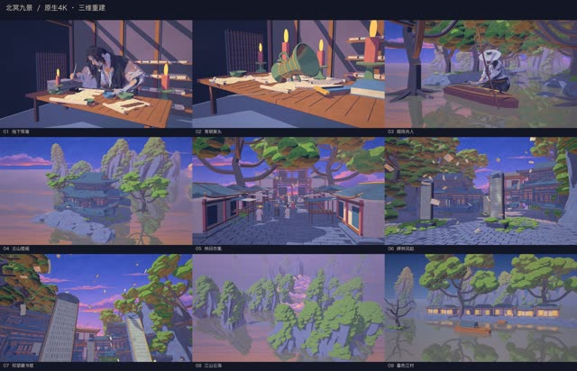

# 北冥九景 · 三维重建与画风试验

**画风实验·非正式成片** · `lab-2026-11-05-beiming-nine-3d`



三维画风实验：按九张参考的题材重建三维场景，附灰模与侧移机位，没有沿用 360 图的单视角 MoGe 网格；06、07 复用同一楼阁，天空与远云仍是二维水彩底板，人物为单图生成模型、未绑定，未验证动画时序稳定。

## 状态与权利

| 项 | 记录 |
|---|---|
| 技术状态 | 画风实验（机器 QA 未跑） |
| 用户认可 | 未审：仓库里没有用户认可的记录；上作品站不等于用户认可 |
| 权利 | 公开归档（个别素材标为内部，restore 默认不还原，见 catalog 的文件条目） |
| 登记类别 | R03（[授权登记册](../../docs/rights/register.md)） |

## 源码与还原

```bash
node tools/env/py.mjs tools/casebook.py restore lab-2026-11-05-beiming-nine-3d --download
```

还原位置：`out/casebook/beiming-style-lab/2026-11-05-beiming-nine-3d/`。只看代码可加 `--source-only`；先看要下载多少可加 `--dry-run`。命令不运行构建。

| 入口 | 归档原文件 |
|---|---|
| `delivery/index.html` | [查看](../source/lab-2026-11-05-beiming-nine-3d/delivery/index.html) |
| `lab/index.html` | [查看](../source/lab-2026-11-05-beiming-nine-3d/lab/index.html) |
| `README.md` | [查看](../source/lab-2026-11-05-beiming-nine-3d/README.md) |

运行前核对：见本工程说明与依赖文件。

历史脚本含本机路径还原标记。还原会替换工作区和Lemo库路径；网络服务、API、外部采样、Windows远端和旧版构建命令仍需按项目准备。`@@ROG_HOST@@` 需用 `--rog-host` 指定才会替换；加 `--strict` 时有未替换的标记就拒绝还原。

完整文件映射见 [catalog.json](../catalog.json)。来源与署名见 [NOTICES](../NOTICES.md)，授权状态见 [授权登记册](../../docs/rights/register.md)。
