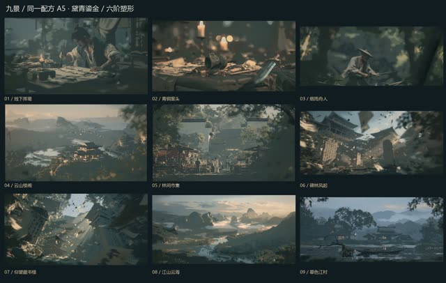

# 北冥 · 九景画风实验

**画风实验·非正式成片** · `lab-2026-11-05-nine-scenes-360`




画风实验；360图是单视角2.5D代理，不是九个完整三维世界，未证明长片时序稳定。

## 源码与还原

```bash
python3 tools/casebook.py restore lab-2026-11-05-nine-scenes-360 --download
```

还原位置：`out/casebook/beiming-style-lab/2026-11-05-nine-scenes-360/`。只看代码可加 `--source-only`。命令不运行构建。

| 入口 | 归档原文件 |
|---|---|
| `delivery/index.html` | [查看](../source/lab-2026-11-05-nine-scenes-360/delivery/index.html) |
| `lab/index.html` | [查看](../source/lab-2026-11-05-nine-scenes-360/lab/frame/index.html) |
| `README.md` | [查看](../source/lab-2026-11-05-nine-scenes-360/README.md) |

运行前核对：见本工程说明与依赖文件。

历史脚本含本机路径还原标记。还原会替换工作区和Lemo库路径；网络服务、API、外部采样、Windows远端和旧版构建命令仍需按项目准备。`@@ROG_HOST@@` 需用 `--rog-host` 指定才会替换。


完整文件映射和原始SHA256见 [catalog.json](../catalog.json)。来源见 [NOTICES](../NOTICES.md)。
