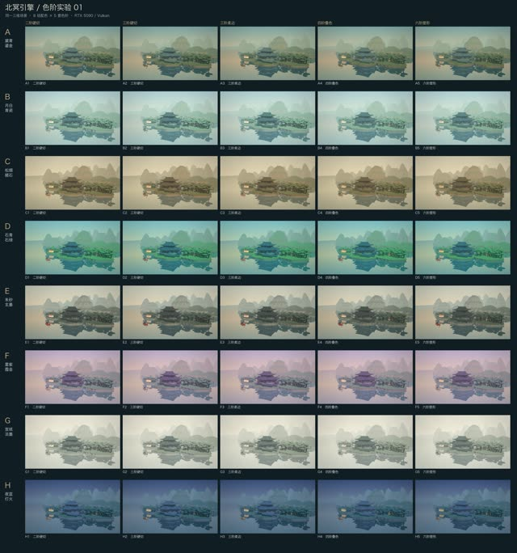

# 北冥引擎 · 色阶实验 01

**画风实验·非正式成片** · `lab-2026-11-05-tonal-40`




色阶实验：一个场景、一份 TRELLIS.2 楼阁模型，固定光向、机位与随机种子，8 种配色 × 5 种色阶方案（二阶硬切、三阶硬切、三阶柔边、四阶叠色、六阶塑形）共 40 版静帧；只是配色与色阶候选，楼阁背面几何仍有缺陷，未做跨资产与运动验证。

## 源码与还原

```bash
python3 tools/casebook.py restore lab-2026-11-05-tonal-40 --download
```

还原位置：`out/casebook/beiming-style-lab/2026-11-05-tonal-40/`。只看代码可加 `--source-only`。命令不运行构建。

| 入口 | 归档原文件 |
|---|---|
| `delivery/index.html` | [查看](../source/lab-2026-11-05-tonal-40/delivery/index.html) |
| `lab/index.html` | [查看](../source/lab-2026-11-05-tonal-40/lab/index.html) |
| `README.md` | [查看](../source/lab-2026-11-05-tonal-40/README.md) |

运行前核对：见本工程说明与依赖文件。

历史脚本含本机路径还原标记。还原会替换工作区和Lemo库路径；网络服务、API、外部采样、Windows远端和旧版构建命令仍需按项目准备。`@@ROG_HOST@@` 需用 `--rog-host` 指定才会替换。


完整文件映射和原始SHA256见 [catalog.json](../catalog.json)。来源见 [NOTICES](../NOTICES.md)。
