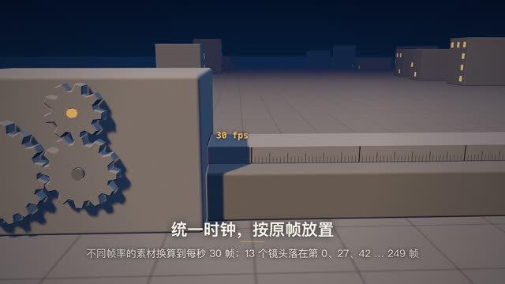

# 每一关都有证据

**历史成片·2026-11-07 归档时未重渲** · `local-hypit-pipeline-film`



[观看/下载压缩预览](https://github.com/cuiyucheng0104-afk/beiming-engine/releases/download/casebook-2026.11/local-hypit-pipeline-film-preview.mp4) · 历史成片转码，非重新渲染。

## 状态与权利

| 项 | 记录 |
|---|---|
| 技术状态 | 历史成片（归档时未重渲；机器 QA 未跑） |
| 用户认可 | 未审：仓库里没有用户认可的记录；上作品站不等于用户认可 |
| 权利 | 公开归档 |
| 登记类别 | R08（[授权登记册](../../docs/rights/register.md)） |
| AI 生成 | 含（R08；工具与版本待补） |

## 源码与还原

```bash
node tools/env/py.mjs tools/casebook.py restore local-hypit-pipeline-film --download
```

还原位置：`out/casebook/hypit-pipeline-film/`。只看代码可加 `--source-only`；先看要下载多少可加 `--dry-run`。命令不运行构建。

| 入口 | 归档原文件 |
|---|---|
| `film/index.html` | [查看](../source/local-hypit-pipeline-film/film/index.html) |
| `film/FILM.md` | [查看](../source/local-hypit-pipeline-film/film/FILM.md) |

运行前核对：见本工程说明与依赖文件。

历史脚本含本机路径还原标记。还原会替换工作区和Lemo库路径；网络服务、API、外部采样、Windows远端和旧版构建命令仍需按项目准备。`@@ROG_HOST@@` 需用 `--rog-host` 指定才会替换；加 `--strict` 时有未替换的标记就拒绝还原。

## 保留的成片版本

| 文件 | 尺寸 / 秒 | 原文件包 | SHA256 |
|---|---|---|---|
| film_upload.mp4 | 1920×1080 / 180.000 | [original-films-10.zip](https://github.com/cuiyucheng0104-afk/beiming-engine/releases/download/casebook-2026.11/original-films-10.zip)，包内 `local-hypit-pipeline-film/film_upload.mp4` | `382c67459af675219ef2867aa151e36ed880d8baa3b3c5f8889fedd257c9c0fb` |

完整文件映射见 [catalog.json](../catalog.json)。来源与署名见 [NOTICES](../NOTICES.md)，授权状态见 [授权登记册](../../docs/rights/register.md)。
