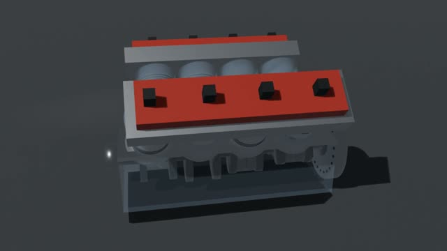

# V8引擎机械动画

**已有历史成片·本次未重渲** · `local-v8-blender`




[观看/下载压缩预览](https://github.com/cuiyucheng0104-afk/beiming-engine/releases/download/casebook-2026.11/local-v8-blender-preview.mp4) · 历史成片转码，非重新渲染。


## 源码与还原

```bash
python3 tools/casebook.py restore local-v8-blender --download
```

还原位置：`out/casebook/v8-blender/`。只看代码可加 `--source-only`。命令不运行构建。

| 入口 | 归档原文件 |
|---|---|
| `build_v8.py` | [查看](../source/local-v8-blender/build_v8.py) |

运行前核对：见本工程说明与依赖文件。

历史脚本含本机路径还原标记。还原会替换工作区和Lemo库路径；网络服务、API、外部采样、Windows远端和旧版构建命令仍需按项目准备。`@@ROG_HOST@@` 需用 `--rog-host` 指定才会替换。

## 保留的成片版本

| 文件 | 尺寸 / 秒 | 原文件包 | SHA256 |
|---|---|---|---|
| v8_engine.mp4 | 1280×720 / 6.000 | [original-films-10.zip](https://github.com/cuiyucheng0104-afk/beiming-engine/releases/download/casebook-2026.11/original-films-10.zip)，包内 `local-v8-blender/v8_engine.mp4` | `d8f3a1ecd87175318e7755507d46703545a0cc5152bfd53879d7c65638f25bd5` |

完整文件映射和原始SHA256见 [catalog.json](../catalog.json)。来源见 [NOTICES](../NOTICES.md)。
