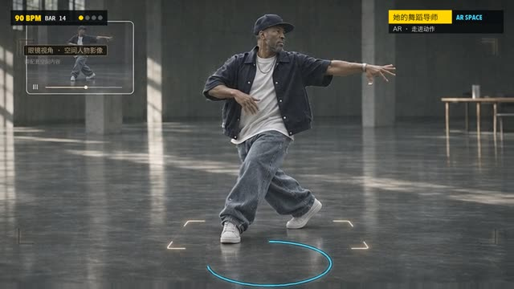

# 她的舞蹈导师

**已有历史成片·本次未重渲** · `ppt-dance-mentor`

战术板标注、冻结时刻和箭头；原画深度分层、90BPM动作与音乐。



[观看/下载压缩预览](https://github.com/cuiyucheng0104-afk/beiming-engine/releases/download/casebook-2026.11/ppt-dance-mentor-preview.mp4) · 历史成片转码，非重新渲染。

历史故事介绍片；原画、配音和配乐为项目资产。入库不等于重新渲染或品牌终审。

## 源码与还原

```bash
python3 tools/casebook.py restore ppt-dance-mentor --download
```

还原位置：`out/casebook/Desktop/上影ppt/她的舞蹈导师/`。只看代码可加 `--source-only`。命令不运行构建。

| 入口 | 归档原文件 |
|---|---|
| `build.sh` | [查看](../source/ppt-dance-mentor/build.sh) |
| `film/build.py` | [查看](../source/ppt-dance-mentor/film/build.py) |
| `方案.md` | [查看](../source/ppt-dance-mentor/方案.md) |

运行前核对：Python/Pillow/NumPy + FFmpeg；Prepared narration, original slides and depth maps

历史脚本含本机路径还原标记。还原会替换工作区和Lemo库路径；网络服务、API、外部采样、Windows远端和旧版构建命令仍需按项目准备。`@@ROG_HOST@@` 需用 `--rog-host` 指定才会替换。

## 保留的成片版本

| 文件 | 尺寸 / 秒 | 原文件包 | SHA256 |
|---|---|---|---|
| 乐奇AR_她的舞蹈导师_故事介绍_手机版.mp4 | 1280×720 / 162.667 | [original-films-04.zip](https://github.com/cuiyucheng0104-afk/beiming-engine/releases/download/casebook-2026.11/original-films-04.zip)，包内 `ppt-dance-mentor/乐奇AR_她的舞蹈导师_故事介绍_手机版.mp4` | `07406159ec0a73ea83eb6133f21685aa3580f76b79393f789de91343c4664781` |
| 乐奇AR_她的舞蹈导师_故事介绍.mp4 | 1920×1080 / 162.667 | [original-films-05.zip](https://github.com/cuiyucheng0104-afk/beiming-engine/releases/download/casebook-2026.11/original-films-05.zip)，包内 `ppt-dance-mentor/乐奇AR_她的舞蹈导师_故事介绍.mp4` | `7a1f7d2de83c63e704d23f77929a09610c12f4891a66e5de227757be16f72a8e` |

完整文件映射和原始SHA256见 [catalog.json](../catalog.json)。来源见 [NOTICES](../NOTICES.md)。
