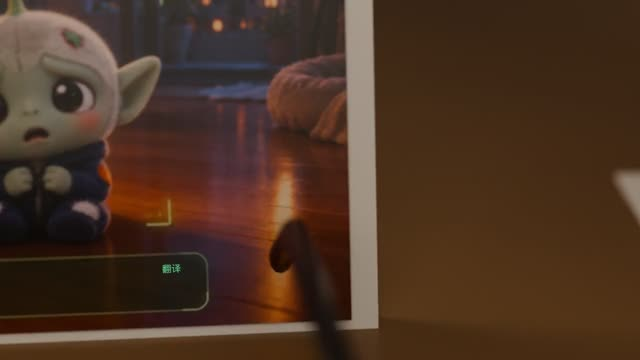

# 懂你的人

**历史成片·2026-11-07 归档时未重渲** · `ppt-understands-you`

后续书桌版：Blender Cycles一镜到底，照片浮雕和投影HUD；旧版入口仍是历史文件，不应误当书桌版。



[观看/下载压缩预览](https://github.com/cuiyucheng0104-afk/beiming-engine/releases/download/casebook-2026.11/ppt-understands-you-preview.mp4) · 历史成片转码，非重新渲染。

历史故事介绍片；原画、配音和配乐为项目资产。入库不等于重新渲染或品牌终审。
书桌版为后续版本，film/build.py 同时保留旧版；以 tools/desk_film.py 和技术说明为入口。

## 状态与权利

| 项 | 记录 |
|---|---|
| 技术状态 | 历史成片（归档时未重渲；机器 QA 未跑） |
| 用户认可 | 未审：仓库里没有用户认可的记录；上作品站不等于用户认可 |
| 认可经过 | 旧版被退回后改为书桌版（docs/cases/ppt-animation.md:50）；书桌版是否获认可没有记录 |
| 权利 | 内部：含客户材料、第三方 IP 或参考图，权利方 乐奇 / Rokid（法律主体名称待补）；restore 默认不还原其素材，产物不得用进新作品或对外物料 |
| 登记类别 | R02、R06、R08、R09（[授权登记册](../../docs/rights/register.md)） |
| 署名 | Piano: "Salamander Grand Piano V3" by Alexander Holm, licensed under CC BY 3.0 (https://creativecommons.org/licenses/by/3.0/) |
| AI 生成 | 含（R08、R09；工具与版本待补） |

## 源码与还原

```bash
node tools/env/py.mjs tools/casebook.py restore ppt-understands-you --download
```

还原位置：`out/casebook/Desktop/上影ppt/懂你的人/`。只看代码可加 `--source-only`；先看要下载多少可加 `--dry-run`。命令不运行构建。内部素材默认不还原，只为研究方法时加 `--include-internal`。

| 入口 | 归档原文件 |
|---|---|
| `build.sh` | [查看](../source/ppt-understands-you/build.sh) |
| `film/build.py` | [查看](../source/ppt-understands-you/film/build.py) |
| `tools/desk_film.py` | [查看](../source/ppt-understands-you/tools/desk_film.py) |

运行前核对：Python/Pillow/NumPy + FFmpeg；Prepared narration, original slides and depth maps；Blender Cycles for desk version

历史脚本含本机路径还原标记。还原会替换工作区和Lemo库路径；网络服务、API、外部采样、Windows远端和旧版构建命令仍需按项目准备。`@@ROG_HOST@@` 需用 `--rog-host` 指定才会替换；加 `--strict` 时有未替换的标记就拒绝还原。

## 保留的成片版本

| 文件 | 尺寸 / 秒 | 原文件包 | SHA256 |
|---|---|---|---|
| 懂你的人_书桌版_手机版.mp4 | 1280×720 / 185.583 | [original-films-05.zip](https://github.com/cuiyucheng0104-afk/beiming-engine/releases/download/casebook-2026.11/original-films-05.zip)，包内 `ppt-understands-you/懂你的人_书桌版_手机版.mp4` | `42eca94ab167697acdd56c74b61dda73911e143f9ae90a3fdb2cee4ad90c6166` |
| 懂你的人_书桌版.mp4 | 1920×1080 / 185.583 | [original-films-05.zip](https://github.com/cuiyucheng0104-afk/beiming-engine/releases/download/casebook-2026.11/original-films-05.zip)，包内 `ppt-understands-you/懂你的人_书桌版.mp4` | `723f9a0aadea9509431bee32489aceede565749350c31440889c81f556b8c7c6` |

完整文件映射见 [catalog.json](../catalog.json)。来源与署名见 [NOTICES](../NOTICES.md)，授权状态见 [授权登记册](../../docs/rights/register.md)。
