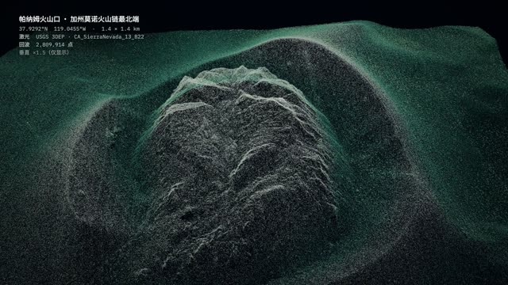

# 火山口

**历史成片·2026-11-07 归档时未重渲** · `style-57-lidar-survey`



[观看/下载压缩预览](https://github.com/cuiyucheng0104-afk/beiming-engine/releases/download/casebook-2026.11/style-57-lidar-survey-preview.mp4) · 历史成片转码，非重新渲染。

## 状态与权利

| 项 | 记录 |
|---|---|
| 技术状态 | 历史成片（归档时未重渲；机器 QA 未跑） |
| 用户认可 | 未审：仓库里没有用户认可的记录；上作品站不等于用户认可 |
| 权利 | 公开归档 |
| 登记类别 | R11（[授权登记册](../../docs/rights/register.md)） |

## 源码与还原

```bash
node tools/env/py.mjs tools/casebook.py restore style-57-lidar-survey --download
```

还原位置：`out/casebook/style-test-66/57-lidar-survey/`。只看代码可加 `--source-only`；先看要下载多少可加 `--dry-run`。命令不运行构建。

| 入口 | 归档原文件 |
|---|---|
| `build.sh` | [查看](../source/style-57-lidar-survey/build.sh) |
| `index.html` | [查看](../source/style-57-lidar-survey/index.html) |
| `CREDITS` | [查看](../source/style-57-lidar-survey/CREDITS) |
| `TREATMENT.md` | [查看](../source/style-57-lidar-survey/TREATMENT.md) |

运行前核对：Legacy Lemo runtime at fixed commit；Python scientific audio packages；FFmpeg；Fonts/samples per CREDITS

历史脚本含本机路径还原标记。还原会替换工作区和Lemo库路径；网络服务、API、外部采样、Windows远端和旧版构建命令仍需按项目准备。`@@ROG_HOST@@` 需用 `--rog-host` 指定才会替换；加 `--strict` 时有未替换的标记就拒绝还原。

## 保留的成片版本

| 文件 | 尺寸 / 秒 | 原文件包 | SHA256 |
|---|---|---|---|
| 57-lidar-survey.mp4 | 1920×1080 / 19.292 | [original-films-02.zip](https://github.com/cuiyucheng0104-afk/beiming-engine/releases/download/casebook-2026.11/original-films-02.zip)，包内 `style-57-lidar-survey/57-lidar-survey.mp4` | `8c0e2a7e51c4d6239d0ae31ce9bc7f3ec72d3e7f8a64c1424e585713834ea0bd` |

完整文件映射见 [catalog.json](../catalog.json)。来源与署名见 [NOTICES](../NOTICES.md)，授权状态见 [授权登记册](../../docs/rights/register.md)。
