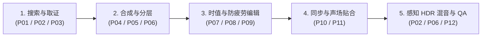

# 音效设计理论与声学工程手册

> 读者：做作品声音设计的 agent 与审片人、维护 `engine/audio/` 的工程师｜状态：操作手册｜依据：2026-11-18 仓库内容与声学工程文献

本手册梳理影视声音叙事、物理建模合成与心理声学三大领域的定量理论，提炼**通用音效设计十二原则（P01–P12）**，并逐一映射到**「搜索 → 合成 → 编辑 → 贴合（同步与声像）→ 混音」**五段工程管线。实操工作流、跨路线配方与审片十问见 [sound.md](../../routes/directing/craft/sound.md)，UCS v8.2.1 分类词表见 [sfx-vocab.md](../../routes/directing/craft/sfx-vocab.md)，声画同步与成片交付门禁见 [QA-GATE.md](../quality/QA-GATE.md)。

---

## 1. 三大理论支柱体系

合格的工程级音效设计同时受三套规律约束：**影视叙事美学**决定声音“该不该响、表达什么”，**物理声学建模**决定声音“因果真不真、动态活不活”，**心理声学与感知混音**决定声音“听不听得清、耐不耐听”。

### 1.1 影视声音叙事与剪辑美学

#### （1）Michel Chion《Audio-Vision》：视听焊接与具身质感
- **增值效应（Added Value）**：声音向画面注入信息、结构、速度感与重力，观众在知觉上会误以为这些属性天然发自画面本身。静止山石叠入次声暗涌即生压迫，矢量细线叠入高频微脉冲即显精密刻度。
- **声画缝合（Synchresis = Synchronism + Synthesis）**：当听觉瞬态与视觉动作变化点落在多感官融合时间窗内时，大脑会自动将二者焊接为同一物理事件。声画缝合是“跨品类借声”的知觉前提（例如借怀表擒纵、相机快门拨盘赋形微型棘轮的高频咬合，或借竹杖破空叠丝帛脆响赋形刀剑挥砍）。但缝合只担保冲击瞬间：一旦尾音暴露违背画面本体的稳态特征（如手按无源圆珠笔混入电动变焦马达谐波），因果聆听会立即识破穿帮。
- **物质化声音指标（Materializing Sound Indices, MSI）**：暴露发声体物理摩擦、气流阻滞、表面粗糙度与接触瑕疵的高频微瞬态细节（集中在 `2.5–14 kHz`）。MSI 充沛时，物体显得沉重、粗糙、可触；MSI 稀缺时，画面趋向轻盈、抽离、纯符号化。工程上对巨物录音大幅降调时，必须把原信号 `> 2.8 kHz` 的接触 MSI 单独提取并锚定叠回冲击帧（`engine/audio/foley.py` 的 `shift_material`），否则材质脆度会随重采样跌入低频而变闷糊。
- **三种聆听模式（Three Listening Modes，源自 Pierre Schaeffer 并由 Chion 拓展）**：
  1. **因果聆听（Causal Listening）**：辨识声音背后的物理动力源与材质（手按弹簧还是伺服电机、空心竹还是实心铁），对应本体门禁；
  2. **语义聆听（Semantic Listening）**：解码约定俗成的语言或界面符号（对白、摩斯码、HUD 确认提示音），要求全片同类符号跨镜头严格一致；
  3. **还原聆听（Reduced Listening）**：剥离声源身份，纯粹考察信号的起音斜率、波峰因数、频谱质心与谐波显著度，对应零训练信号取证（`engine/audio/sfx_judge.py`）。
- **离画声源（Acousmêtre）与听觉视角（Point of Audition, POA）**：画框外发声却支配叙事的声源（Acousmêtre）天然具备遍在感与威慑力，一旦入画显形（De-acousmatization）即回归普通实体。听觉视角 POA 区分**空间视角**（远闷宽湿 vs. 近干窄贴）与**主观角色视角**（如角色头内干声 `subjective_internal`：宽度收窄至 `0.12`、混响全干），可独立于镜头焦距调度情绪。

#### （2）Walter Murch《Dense Clarity, Clear Density》：认知光谱与剪辑语法
- **编码声 ↔ 具身声认知光谱（Encoded vs. Embodied Sound Spectrum）**：
  - **紫罗兰端（纯编码声 Encoded）**：对白、电报式 UI 符号音。大脑语言中枢忙于解码语义，会主动放宽对空间方位的苛求；
  - **红色端（纯具身声 Embodied）**：器乐配乐、超低频体感震动。无需语义解码，直达边缘情绪系统，适合铺展宽声场而不会引发认知过载；
  - **黄色中段（半人马混合态 Centaurs）**：拟音与硬效，兼具物理指涉编码性与声学具身冲击。
- **2.5 声部并发定律（Law of Two-and-a-Half）**：在同一认知光谱区间内，人类注意力最多同时追踪 **`2` 个独立前景事件 + `0.5` 个背景铺垫层**。一旦第 3 个同质瞬态在窄时间窗（约 `80–100 ms`）内等权闯入，个体追踪即刻坍缩为“一团嘈杂背景（Wall of Noise）”。想做出如透明石英晶体般层次丰富却毫不浑浊的“清晰密度（Clear Density）”，必须把并发元素错开在不同认知端（1 路编码 UI/对白 + 1 路中段物理硬效 + 1 路具身配乐）及不同临界频带。
- **空间同化（Worldizing）**：录音棚干声直接贴上画面会像贴在银幕玻璃表面。Murch 通过真实空间外放重录让声音染上空气吸收、建筑早期反射与距离衰减；在数字管线中等价于耦合距离低通、近讲搁架、微双耳线索与直达/混响比（DRR）的统一空间算子（`engine/audio/dsp.py` 的 `space_place`）。
- **切点声学语法（Hard-Cut Micro-Crossfade vs. Split Edit）**：
  - **空间硬切**：场景发生物理硬切且无蒙太奇意图时，环境轨零样本硬切会爆出阶跃咔嗒，长拖尾则会把上一场室外风声带进下一场室内。标准做法是在切点做 **`40–65 ms`（24 fps 下约 `1–1.5 帧`）等功率微交叉淡化**（$\sin^2 + \cos^2 = 1$）；
  - **分离剪辑（Split Edit）**：叙事转场采用 **J-Cut**（下一镜声音提前 `0.25–0.85 s` 先入，建立预期）或 **L-Cut**（上一镜余音延宕 `0.30–1.20 s` 渗入下一镜，承接心理余波），蒙太奇段落用 `0.60–1.20 s` 长等功率溶叠。

#### （3）Randy Thom《Designing a Movie for Sound》：主观过滤与峰值前留白
- **听觉主观性（POV Sound）**：不为画面里每件可见物体机械配音，而是按叙事注意力做减法，放大焦点微声、压暗无关杂讯。
- **留白对比（Negative Space）**：听觉冲击力取决于冲击前后的**局部响度跃迁差 $\Delta L$**，而非绝对峰值。在高潮落点前 **`4–12 帧`（`167–500 ms`）** 抽空环境底床与配乐形成“声学真空”，比把总线硬推 `+6 dB` 撞向限制器更能制造震慑感。

#### （4）David Sonnenschein《Sound Design》：听觉格式塔与情绪频率映射
- **听觉格式塔四原则（Auditory Gestalt）**：
  - **接近律（Proximity）**：时间间隔 `< 120 ms` 或频带相邻的脉冲串被自动归组为单一连续动作（如棘轮连拨、镭射走线）；
  - **相似律（Similarity）**：同频谱包络、同调性根音的微滴音跨越全片仍被识别为同一信息层级；
  - **共同命运律（Common Fate）**：包络起伏与声像轨迹同步的分层（`identity + detail + body`）融合成单一可信实体，起音游离的分层则会剥离穿帮；
  - **闭合与良好延续律（Closure & Good Continuation）**：连续环境底床铺垫下，被前景瞬态短暂遮挡的背景声由大脑自动补全，不显断裂。
- **频率与躯体情绪映射**：
  - `20–80 Hz`（前庭/腹腔共振）：潜意识威压、巨物重力、空间深渊感；
  - `80–250 Hz`（胸腔基频区）：物理撞击质量、厚重底盘；
  - `250–1200 Hz`（中低频温暖区）：木质与器物主体温润感，堆积超标则发闷浑浊（Mud / Boxiness）；
  - `1.5–4.5 kHz`（外耳道敏感区）：人类求救与警报敏感带，决定金属锋利度与语音清晰度，失控则刺耳疲劳；
  - `5–16 kHz`（超高频空气区）：精密微齿咬合、光学晶莹感、近距离丝绸呼吸感。

#### （5）Ric Viers《The Sound Effects Bible》与 Tim Nielsen（UCS 检索学）
- **拟音三支柱与三干线动态配比**：Ric Viers 将生命体拟音归纳为 **Feet（脚步重心）+ Cloth（衣袂连续跟随）+ Props（手持道具交互）** 三支柱，并与 **Ambience（环境干线 `amb`）**、**Hard / Designed FX（硬效与设计音干线 `fx`/`ui`）** 构成全片三干线架构。三干线并非固定开启：写实武侠片三轨全开；纯工程拆解或抽象数据动画无生命体出场时，必须静默关闭生命体 `foley` 干线。
- **UCS 分类与物理机制检索学**：Tim Nielsen 等建立的 **Universal Category System（UCS v8.2.1）** 以 82 大类、753 个正交子类（`CatID`）统一全球音效库命名（`CatID_FXName_CreatorID_SourceID`）。检索时必须摒弃“按画面表面名词硬搜”，转用 **`[物理发声机制/借代物] + [微距/近讲尺度词] + [本体污染排除词]`** 三段式拆词，并按世界观调性做大类白名单加权与禁入类过滤。

---

### 1.2 程序化音频与物理建模合成

当实录素材库缺乏特定几何尺度或需要逐帧响应画面运动曲线时，必须采用物理因果合成而非静态振荡器。

#### （1）Andy Farnell《Designing Sound》：物理因果拆解
一切自然与机械发声均可分解为 **激励器（Exciter，能量注入时间函数）× 共振体（Resonator，几何与材质模态滤波器）× 耦合反馈（Coupling，受力/速度/位移实时调制）**。

1. **非线性赫兹接触碰撞与远场加速度辐射（Hertzian Contact & Acoustic Acceleration Radiation）**：
   弹性锤体以初速度 $v_0$ 撞击刚体时，局部压痕 $\delta$ 产生非线性恢复力 $F = K \delta^{3/2}$，接触持续时间 $\tau_c$ 满足：
   $$\tau_c \approx 2.94 \left(\frac{m_{\text{eff}}}{K}\right)^{2/5} v_0^{-1/5}$$
   半正弦接触脉冲的主瓣截止频率 $f_{\text{cut}} \approx 1.5 / \tau_c \propto K^{2/5} v_0^{1/5}$。硬度 $K$ 越高（金属 > 硬塑 > 木材 > 橡胶）或撞击速度 $v_0$ 越大，$\tau_c$ 越短（硬金属 `0.15–0.8 ms`，硬木 `0.8–2.5 ms`，软胶 `4–15 ms`），激发的高阶模态越明亮。同时，小尺寸固体在远场的辐射声压正比于表面法向加速度 $p_{\text{rad}}(t) \propto \partial^2 w / \partial t^2$（二阶接触力差分，`procedural.modal_impact(..., radiation='accel')`）：在主模态基频以下呈 `-12 dB/oct` 滚降，彻底消除软锤位移响应在 `< 100 Hz` 遗留的非物理低频隆隆尾音（`radiation='disp'` 保留既有位移响应逐样本兼容）。

2. **刚体弯曲模态与频散（Euler-Bernoulli Dispersion）**：
   弦的泛音成整数比 $1:2:3:4$（乐音感），而刚体杆、梁、金属板与螺旋弹簧受四阶弯曲刚度方程 $EI\,\partial^4 w/\partial x^4 + \rho A\,\partial^2 w/\partial t^2 = 0$ 支配，弯曲波相速度随频率升高（频散）：
   - **两端自由梁（刀剑、金属条、木琴键）**：弹性模态频率比为 $1 : 2.758 : 5.404 : 8.933$；
   - **一端固定悬臂梁（卡扣簧片、棘爪）**：模态频率比为 $1 : 6.267 : 17.548$；
   - **受抑螺旋弹簧**：模态频率 $f_k = f_0 k \sqrt{1 + \beta k^2}$，高阶弯曲波群延迟 $\tau_g(k) \propto k^{-1/2}$ 比基频早到达数毫秒，形成真实弹簧释放特有的高频清脆金属微啾，绝非卡通正弦颤音。
   几何尺寸线性放大 $S$ 倍时，模态频率按 $f_k \propto S^{-1}$ 下移，衰减时间按 $\tau_k \propto S^{0.5 \sim 1.0}$ 延长。

3. **气动涡街脱落与偶极子声功率律（Strouhal & Lighthill-Curle）**：
   速度为 $U(t)$ 的气流掠过特征厚度/直径为 $d$ 的刚体（竹鞭、剑脊、羽翼）时，卡门涡街脱落主频遵循 **Strouhal 公式**：
   $$f_s(t) = \frac{\mathrm{St} \cdot U(t)}{d}, \qquad \mathrm{St} \approx 0.18 \sim 0.22$$
   刚体表面脉动升力构成声学偶极子（Dipole），辐射声功率 $P_{\text{ac}} \propto \rho_0 U(t)^6 d^2 / c_0^3$，对应远场声压幅值：
   $$A_{\text{whoosh}}(t) \propto U(t)^{2.5 \sim 3.0}$$
   因此挥动破空声在起手低速段近乎静默，仅在角速度峰值附近陡峭爆发。

4. **液体空化与 Minnaert 气泡共振（Minnaert, 1933）**：
   水花、溪流、沸腾与水墨晕染的“水感”源自水下球形气泡的径向单极子脉动。标准大气压下，半径 $R_0$ 的空气泡自然共振频率为：
   $$f_0 = \frac{1}{2\pi R_0}\sqrt{\frac{3 \gamma P_0}{\rho}} \approx \frac{3.26}{R_0\,[\text{m}]} = \frac{3260}{R_0\,[\text{mm}]}\text{ Hz}$$
   半径 `1 mm` 微泡对应 `3260 Hz` 清脆水珠，半径 `6 mm` 气泡对应 `543 Hz` 深水咕嘟；气泡上浮减压或液膜破裂时伴随 `+8% ~ +25%` 的瞬时上扬扫频（Chirp）。

5. **粘滑弛豫摩擦（Stick-Slip）与步进棘轮状态机**：
   干摩擦界面因静摩擦系数 $\mu_s > \mu_k$，在切向滑移速度 $v(t)$ 下交替经历“弹性黏附储能 → 瞬时微崩塌滑脱”，脱扣脉冲率 $f_{\text{slip}}(v) \in [30, 300]\text{ Hz}$ 随速度非线性上升并激励材质三共振峰。步进棘轮则由转角积分跨越齿距角 $\Delta\theta = 2\pi/Z$ 逐齿触发，经 `30–42 ms` 势能死点悬停后释放“主齿面撞击 + 止逆爪 `+9.5 ms` 副咔嗒”双阶落锁。

6. **三维闪电通道推迟传播、时变管腔注水共振、欧拉盘奇点滚振与非线性激波**：
   - **三维曲折闪电通道 N 波传播（Few, 1969; Ribner & Roy, 1982）**：高度 $z \in [0, 3.2]\text{ km}$ 的梯级先导主干与云间分叉各微元向双耳（$x = \pm 0.12\text{ m}$）辐射零净冲量双极性 N 波冲击子，到达时刻满足推迟势 $t_i = (r_i - r_{\min})/c_0$，幅值按偶极方向图 $\sin^2\theta_i / r_i$ 加权并经分层 ISO 9613-1 大气高频吸收，近场保留 `4–18 kHz` 撕裂电弧，远端演化为 `35–180 Hz` 焦散滚雷与二次箭式回击（`procedural.thunder_strike`）。
   - **杯壶注水时变四分之一波长腔体共振（Minnaert × Levine-Schwinger）**：幂律分布水下微气泡流（$r_0 \in [0.6, 4.5]\text{ mm}$）与飞溅湍流激励上方闭底圆筒空气柱；随液面填充率 $\mathrm{fill}(t)$ 升高，含管口修正的有效气柱长 $L_{\text{eff}}(t) = H(1 - \mathrm{fill}(t)) + 0.61 R$ 连续缩短，奇次轴向共振峰 $f_k(t) = (2k+1)c_0 / [4 L_{\text{eff}}(t)]\ (k=0,1,2)$ 单调上扬（`procedural.pouring_vessel`）。
   - **圆薄板简并分裂闪烁与欧拉盘有限时间奇点滚振（Chladni Doublet & Moffatt, 2000）**：微非对称圆盘正交简并模态 $(f_m, f_m(1+\delta))$ 在左右耳投射正交辐射相位，产生直达 `16–19 kHz` 的金属/玉石拍频闪烁；几何递减弹跳收拢后进入无滑边缘进动滚振，触点颤振率服从 $f_{\text{chatter}}(t) \propto (t_{\text{sing}} - t)^{-1/3}$（`22 → 95 Hz`），并以气膜挤出平拍止音（`procedural.bouncing_disc`）。
   - **超音速弹道 N 波与 Friedlander 冲击波超压（Friedlander, 1946; Whitham, 1956）**：烟花、火炮、瓶塞与鞭梢音爆由前导双极性弹道 N 波脆裂（`0.35–1.2 ms`）叠合零净冲量 Friedlander 冲击波 $p(t) = p_0(1 - t/t_+)e^{-t/t_+}$、`2.5–6.5 ms` 地面反射干涉凹口及 `0–20 kHz` 全带宽尾迹构成（`procedural.shock_blast`）。

#### （2）Perry Cook《Real Sound Synthesis》：模态滤波器组与 PhISEM 粒子群
- **并联二阶模态合成（Modal Synthesis）**：将固体共振体建模为 $M$ 个并联二阶双极点谐振器 $H_k(z) = a_k / (1 - 2 r_k \cos\omega_k z^{-1} + r_k^2 z^{-2})$，极点半径 $r_k = \exp(-1 / (\tau_k f_s))$，且高频阻尼快于低频：$\tau_k = \tau_1 (f_1 / f_k)^\eta$（木材/石板 $\eta \approx 0.7\text{–}0.9$，青铜/水晶玻璃 $\eta \approx 0.25\text{–}0.45$）。
- **PhISEM 随机粒子碰撞能量模型（Physically Informed Stochastic Event Modeling）**：对碎石、铜钱散落、碎玻璃、枯叶、炭火噼啪与积木散落等多体微碰撞，不求 $O(N^2)$ 刚体碰撞解，而以宏观系统总动能指数衰减 $E[n] = \alpha_{\text{sys}} E[n-1] + \Delta E_{\text{ext}}[n]$ 驱动非齐次泊松碰撞概率 $P_{\text{hit}}(t) \propto N_p \cdot E(t)$，每次微碰撞注入毫秒级指数衰减噪声脉冲激发材质特征共振峰。

---

### 1.3 心理声学与动态交互混音

#### （1）Albert Bregman《Auditory Scene Analysis》：频时域掩蔽与听觉流分离
- **同时掩蔽的低频上漫效应（Upward Spread of Masking）**：耳蜗基底膜行波决定了低频强声向高频段的掩蔽斜率极缓（约 `-15 ~ -25 dB/Bark`），而高频向低频掩蔽斜率极陡（`+60 ~ +100 dB/Bark`）。中低频浑浊尾音若不及时收束，会大面积吞噬后续动作的高频清脆瞬态。
- **前后向非对称时域掩蔽（Temporal Masking）**：
  - **前向掩蔽（Forward Masking：`50–200 ms`）**：强掩蔽声停止后，耳蜗与听神经短期适应恢复需 `50–200 ms`（前 `50 ms` 阈值抬升高达 `15–35 dB`，按 $\log_{10}\Delta t$ 衰减）。这从生理上解释了两点：① 峰值前留白（Negative Space）必须提前至少 `4–12 帧`（`167–500 ms`）抽空声床，才能跨过 `200 ms` 前向掩蔽恢复窗；② 快节奏连击动作（`IOI < 250 ms`）必须按相邻间隔收紧前一击尾音，防止前向掩蔽吃掉下一击起音。
  - **后向掩蔽（Backward Masking：`5–20 ms`）**：强瞬态神经潜伏期短，会逆向覆盖其前 `5–20 ms` 内的微弱细节。因此复合拟音中必须让高频 `transient` 先达，厚重低频 `body` 延后 `1.8–3.0 ms` 放置，切不可让肥厚低频抢在脆响之前。
- **听觉流分离与频谱窥视（Auditory Glimpsing）**：人脑无需前景在全频段压倒背景；只要在前景主能量所在的 1–2 个临界频带内打开局部信噪比 `≥ -2.5 ~ +1.5 dB` 的瞬时窥视窗，即可清晰分离出前景流。

#### （2）Zwicker 临界频带（Bark Scale）、ISO 226 等响曲线与时间积分
- **Bark 与 ERB 临界频带**：人耳耳蜗等效于 24 个带宽随频率对数展宽的带通滤波器组。Zwicker Bark 尺度解析式与 Moore-Glasberg 等效矩形带宽（ERB）公式为：
  $$z(f) = 13 \arctan(0.00076 f) + 3.5 \arctan\!\left[\left(\frac{f}{7500}\right)^2\right], \qquad \mathrm{ERB}(f) = 24.7 \left(4.37 \frac{f}{1000} + 1\right)\text{ Hz}$$
  在 `100 Hz` 处临界带宽仅约 `35 Hz`，到 `4 kHz` 展宽至 `456 Hz`，`10 kHz` 达 `1100 Hz`。动态闪避与频谱掩蔽核查必须按临界频带分槽（如 `engine/audio/director.py` 与 `qa.py` 共用的 6 个临界频带）。
- **ISO 226:2023 等响曲线与外耳道共振**：成人外耳道长约 `2.5 cm`，构成一端闭一端开的四分之一波长谐振管（$f \approx c / 4l \approx 3.43\text{ kHz}$），叠合耳甲腔共振后在 **`2.5–4.5 kHz`** 产生 `+10 ~ +15 dB` 的天然声压放大，对应等响曲线最深凹谷。高频电子音与微距金属声必须在此区间做 `-4.5 ~ -6.5 dB` 参量凹槽抑制以防刺耳；而 `< 60 Hz` 超低频在小扬声器上物理失落，巨物压迫感需借 `80–160 Hz` 奇次谐波激发大脑“缺失基频（Missing Fundamental）”效应。
- **Zwislocki 响度时间积分律（`~200 ms`）**：听觉响度感知近似时间常数 $\tau_{\text{int}} \approx 160\text{–}200\text{ ms}$ 的能量积分器。持续时间 $d < 200\text{ ms}$ 的短脉冲面临积分响度惩罚：
  $$\Delta L_{\text{penalty}}(d) \approx 10 \log_{10}\!\left(\frac{d}{200\text{ ms}}\right)\text{ dB}\quad (d < 200\text{ ms})$$
  `2.8 ms` 的针尖脉冲即使样本峰值达 `-21.5 dBFS`，感知响度仍暴跌约 `-18.5 dB` 而完全听不见。

#### （3）Haas 哈斯优先效应、瑞利双工定位与 P-Center 同步
- **哈斯优先效应（Haas Precedence Effect）**：两个相关声波到达双耳的时间差 $\Delta t$ 落入 **`1–30 ms`（瞬态咔嗒 `1–15 ms`，复杂声源至 `30–35 ms`）** 融合定位窗时，听觉系统将其知觉为单一融合事件，空间方位完全锁定在**第一到达波前（First Wavefront）**，同时响度与丰满度显著增强；`< 1 ms` 引发梳状滤波染色，`> 35–50 ms` 则分裂为独立回声。这一效应是分层复合（`body` 延后 `1.8–2.5 ms`、棘轮止逆爪副咔嗒延后 `9.5 ms`、近场早期反射 `4–25 ms`）的物理基石。
- **瑞利双工定位（Rayleigh Duplex Theory）**：`< 900 Hz` 靠双耳时差 ITD（生理极限 `0.65 ms`；单声道兼容立体声混音控制在 `≤ 0.24–0.28 ms` 内防折单反相），`> 1.5 kHz` 靠头影声级差 ILD。
- **P-Center 与非对称同步窗**：Morton（1976）证实人类感知的声音发生点是包络上升斜率重心（P-Center），而非波形首样本。因自然界光快于声，ITU-R BT.1359 视听同步窗呈显著非对称：人脑对“声早于画（抢拍）”极敏感，对“声微晚于画”更宽容；帧级精密动画同步要求 P-Center 锁定在画面结果帧 **`[-10 ms, +1 帧]`** 内。

#### （4）防机关枪效应（Anti-Machine-Gun）与感知 HDR 混音架构
- **听觉习惯化与重复抑制**：物理世界不存在两次全等的碰撞波形。当同一数字切片在 `IOI < 1.5 s` 内原样复读超过 `2` 次，初级听皮层触发刺激特异性适应（SSA），立刻暴露出“塑料电子复读机”假感。由于人类音高辨别阈（JND）低至 `0.05–0.10 st`，工程解相关必须组合：**洗牌不连号多样本池（`N ≥ 4`）+ 动作力度耦合频谱搁架/副层触发 + 保 MSI 微移调（相邻差 `≥ 0.35 st`，范围 `±0.5 ~ ±1.2 st`）+ 中频均衡微扰（`±1.4 dB`）**。
- **EA DICE Frostbite HDR Audio 与 Wwise 动态闪避**：核心法则是“每个声音都重要，但不在同一时刻重要”。用滑动响度窗口保留当前最高优先级事件的局部动态对比（瞬态波峰因数不压扁），将窗口底沿以下的次要背景推暗；在北冥离线管线（`HDRMixer`）中进一步升级为**零延迟前视（Lookahead `12–35 ms`）+ 零相位 6 临界频带精准挖槽**，只让出前景主频带而不抽吸背景低频底盘。

---

## 2. 通用音效设计十二原则（P01–P12）

| 编号 | 原则名称 | 核心理论依据 | 一句话工程判据与红线 | 主映射阶段 |
|---|---|---|---|---|
| **P01** | **因果本体与世界观契约原则** | Chion 因果聆听、UCS 分类学 | 每一声归属物理本体 / 编码界面 / 意象转译三层之一；无源机构严禁电机谐波（`sustained_tone_ms ≤ 120 ms`）与死循环（`loop_periodicity ≤ 0.85`） | 搜索、合成 |
| **P02** | **三干线职能分轨与动态配比原则** | Ric Viers 三干线与拟音三支柱 | 全片拆为 `amb`（环境）、`fx`/`ui`（硬效与设计）、`foley`（生命体脚步/衣料/道具），按 6 类世界观动态设定目标 LUFS 与开关 | 搜索、混音 |
| **P03** | **洁净信噪比与增益守恒原则** | 信号统计与噪声线性传递律 | 归一化把底噪等量放大 $G\text{ dB}$；前景实录硬限 $G \le 20\text{ dB}$（`raw_pk ≥ 0.095`）、放大后底噪 $\le -56\text{ dBFS}$，过 `sfx_judge` 六维取证 | 搜索、编辑 |
| **P04** | **物理因果激励与共振解耦原则** | Farnell 物理拆解、Cook 模态与 PhISEM | 合成须由赫兹接触 / 粘滑脉冲 / 涡街湍流激励物理模态或随机粒子群，振幅与频率随运动速度非线性耦合，禁单正弦充当物理声 | 合成 |
| **P05** | **尺度跨界缝合与具身瞬态保留原则** | Chion 声画缝合与 MSI、Haas 窗 | 特写微距按 `identity + detail + body + space` 四层超真实复合，`body` 延后 `1.8–3.0 ms` 保首波前；降调做巨物必锚定回叠 `> 2.8 kHz` MSI | 合成 |
| **P06** | **等响耳道保护与频谱情绪映射原则** | ISO 226:2023、Sonnenschein 频率映射 | 高频电子/微距音在 `3.5 kHz` 耳道共振区挖 `-4.5 ~ -6.5 dB` 防扎耳凹槽（冷兵器锋利声除外）；`< 60 Hz` 巨物感借 `80–160 Hz` 谐波重构 | 合成、混音 |
| **P07** | **响度时间积分与生命周期服从原则** | Zwislocki `200 ms` 积分律 | 离散微动作包络体 `≥ 12–30 ms` 并用软膝托起 RMS；过程音效按画面起止帧裁切配余弦阻尼淡出，不够长走非周期交叉延展 | 编辑 |
| **P08** | **切点声学语法与空间连续性原则** | Walter Murch 剪辑声学与声桥 | 空间硬切环境轨强制 `40–65 ms` 等功率微交叉淡化防咔嗒与串味；蒙太奇与叙事延宕显式走 `0.6–1.2 s` 长溶叠或 J-cut / L-cut | 编辑、混音 |
| **P09** | **家族词元同构与三级防疲劳原则** | 语义聆听相似律、听皮层重复抑制 | 标准化界面符号锁死同一词元，高潮靠叠高五/八度泛音（`+1.5 ~ +3 dB`）；连续物理动作执行多样本洗牌 + 力度叠层 + `≥ 0.35 st` 微移调，并按 IOI 收紧尾音 | 合成、编辑 |
| **P10** | **感知冲击中心（P-Center）同步原则** | Morton P-Center、ITU-R BT.1359 | 所有瞬态以包络能量斜率重心对齐画面结果帧（容差 `[-10 ms, +1 帧]`），让前导破空与摩擦自然发生在结果帧之前 | 贴合 |
| **P11** | **焦点声像收束与三维空间同化原则** | Chion POA、Murch Worldizing、双工定位 | 声像跟视觉注意力落点并受景别上限 `SHOT_PAN_CAP` 约束（微距 `±0.12`）；运动物体联动连续 `pan(t)`、距离低通、DRR 与多普勒频移 | 贴合 |
| **P12** | **并发声部上限、负空间与感知 HDR 原则** | Murch 2.5 法则、Thom 留白、DICE HDR | `85 ms` 窗限留 `2` 个前景焦点；高潮前 `4–12 帧` 抽空声床；前视零相位 6 临界频带侧链让位；单次母带收口 `-14.0 LUFS / ≤ -1.5 dBTP` | 混音 |

---

## 3. 五段工程管线定量映射

---

### 3.1 阶段一：搜索与取证初筛（Search & Forensic Curation）

**映射原则**：**P01** 因果本体与世界观契约、**P02** 三干线职能分轨、**P03** 洁净信噪比与增益守恒。  
**引擎模块**：`engine/audio/sfx_vocab.py`、`tools/fetch_sfx.py`、`engine/audio/sfx_judge.py`、`engine/audio/library.py`。

#### 定量模型与工程判据
1. **世界观调性与三干线先验配比（`WORLD_PROFILES`）**：
   - `realistic`（写实武侠/实景）：`amb -31.0 / fx -17.5 / foley -21.0 LUFS`，禁入 `TOON, SCI, UI`；
   - `semi_realistic`（半写实/定格积木）：`amb -33.0 / fx -17.0 / foley -22.5 LUFS`，优先 `MECH, PLAS, WOOD, TOY`；
   - `hitech`（工程拆解/抽象数据）：`amb -38.0 / fx -16.5 LUFS`，**`foley` 显式关闭**，优先 `UI, BEEP, LASR, MECH, CLOCK`；
   - `scifi`（科幻机甲）：`amb -30.5 / fx -16.0 / foley -23.5 LUFS`，允许有源 `MOTR, ROBT, ELEC, LASR`；
   - `cartoon`（卡通夸张）：`amb -35.0 / fx -15.5 / foley -22.0 LUFS`，优先 `TOON, TOY, WHST, SWSH`；
   - `poetic`（东方水墨写意）：`amb -32.0 / fx -18.5 / foley -23.0 LUFS`，禁入 `TOON, SCI, MOTR`。
2. **三段式检索拆词公式**：
   $$\text{Query} = \underbrace{\text{物理发声机制/借代物}}_{\text{pocket watch escapement}} + \underbrace{\text{尺度与近场修饰}}_{\text{micro crisp close-mic dry}} + \underbrace{\text{污染排他项}}_{\text{-motor -servo -synth -loop}}$$
3. **取证信号指标与洁净增益方程**：
   - 归一化增益与底噪放大传递：
     $$G = 20 \log_{10}\!\left(\frac{P_{\text{target}}}{\text{raw\_pk}}\right)\text{ dB}, \qquad L_{\text{out\_floor}} = L_{\text{slice\_floor}} + G$$
   - 硬门禁：前景实录切片 $G \le 20.0\text{ dB}$（$P_{\text{target}}=0.95$ 时要求 `raw_pk >= 0.095`），总线前输出底噪 $L_{\text{out\_floor}} \le -56.0\text{ dBFS}$；`sfx_judge` 要求满幅削波样本 `< 24`、直流偏移 `≤ 0.03`、95% 能量有效带宽达标（如 `metal_blade ≥ 5200 Hz`、`mechanical ≥ 3000 Hz`，拦截 8/11 kHz 老旧素材伪升频）、宽带非乐音原型无 `> 6 kHz` 周期颗粒调制电嗡声（`hf_envelope_buzz ≤ 0.50–0.58`）且无 `4–16 kHz` 窄带滤波器金属哨音尖刺（`hf_whistle_db ≤ 17.0–19.5 dB`；`metal_blade / sustained_tonal / tonal_ui / low_drone / mechanical` 豁免）、无源机构 `80–3000 Hz` 窄带固定谱峰驻留 `sustained_tone_ms ≤ 120 ms`。

#### 正反例对照
- **正例**：拆解手按圆珠笔时，认知锚点搜 `ballpoint pen click close-mic -motor`，高频细节层跨界搜 `camera shutter dial` 与 `micrometer ratchet`，入库跑 `sfx_judge` 与 `library.load_slice(..., max_gain_db=20.0)`，只取主瞬态饱满段（`raw_pk > 0.25`）。
- **反例**：直接搜大词 `gear` 或 `lens` 引入自动对焦微型伺服马达录音（含 `> 300 ms` 窄带谐波嗡鸣），或截取录音末尾 `raw_pk = 0.0025` 的静音缝隙裸调 `norm()`，把话筒白噪放大 `+51.6 dB` 炸出单侧嘶声。

---

### 3.2 阶段二：合成与超真实分层（Synthesis & Hyper-Real Layering）

**映射原则**：**P04** 物理因果激励与共振解耦、**P05** 尺度跨界缝合与 MSI 保留、**P06** 等响耳道保护。  
**引擎模块**：`engine/audio/foley.py`、`engine/audio/procedural.py`、`engine/audio/synth.py`、`engine/audio/director.py`。

#### 定量模型与工程区间
| 物理/设计机制 | 核心控制方程 | 工程推荐参数区间 |
|---|---|---|
| **赫兹接触模态撞击** | $\tau_c \propto (m/K)^{2/5} v_0^{-1/5}$；$H(z)=\sum a_k/(1-2r_k\cos\omega_k z^{-1}+r_k^2 z^{-2})$；$p_{\text{rad}} \propto \mathrm{d}^2 w/\mathrm{d}t^2$ | 接触脉冲宽 `0.2–8.0 ms`；模态数 $M = 4\text{–}8$；`radiation='accel'` 施加基频下 `-12 dB/oct` 加速度辐射（`disp` 保兼容） |
| **PhISEM 粒子散落** | $E[n]=\alpha_{\text{sys}} E[n-1]$；$P_{\text{hit}}(t) \propto N_p E(t)$ | 单粒衰减 `0.6–4.5 ms`；系统衰减系数 $\alpha_{\text{sys}} \in [0.996, 0.9997]$ |
| **Strouhal 气动破空** | $f_s(t) = \mathrm{St}\cdot U(t)/d$（$\mathrm{St}\approx 0.20$）；$A(t) \propto U(t)^{2.5\sim 3.0}$ | 细鞭直径 `8–25 mm`（主频 `400–2800 Hz`）；巨翼/重锤叠 `90–220 Hz` 低通棕噪 |
| **Minnaert 气泡与杯腔注水** | $f_0 \approx 3260 / R_0[\text{mm}]\text{ Hz}$；$L_{\text{eff}}(t)=H(1-\mathrm{fill}(t))+0.61R$，$f_k=(2k+1)c_0/(4L_{\text{eff}})$ | 气泡半径 `0.6–12 mm`，上扬扫频 $\chi \in [0.08, 0.25]$；`pouring_vessel` 前三阶奇次腔模随液位上升单调上移 |
| **闪电 N 波 / 欧拉盘 / 激波爆破** | $t_i=(r_i-r_{\min})/c_0$；$f_{\text{chat}}(t)\propto(t_{\text{sing}}-t)^{-1/3}$；$p(t)=p_0(1-t/t_+)e^{-t/t_+}$ | `thunder_strike` 双耳推迟 + 4 层大气吸收壳；`bouncing_disc` 双音闪烁至 `19 kHz` + `22→95 Hz` 滚振；`shock_blast` N 波 + Friedlander 超压 |
| **四层超真实实录复合** | $y(t) = y_{\text{id}}(t) + y_{\text{det}}(t-\delta_1) + y_{\text{body}}(t-\delta_2) + y_{\text{sp}}(t)$ | `identity` 移调 `±1.5 st` 内；`detail` 高通 `1.9–2.6 kHz`（$\delta_1 \approx 0.8\text{ ms}$）；`body` 低通 `4.2–5.4 kHz` 且哈斯延后 $\delta_2 = 1.8\text{–}2.5\text{ ms}$；微距混响 `wet ≤ 0.12` |
| **耳道敏感区防刺耳** | RBJ 参量均衡 $f_0 = 3500\text{ Hz}, Q \approx 1.3$ | 高科技镭射走线（`6.8–12.6 kHz`）在 `3.5 kHz` 挖 `-6.5 dB` 凹槽，`14.8 kHz` 低通滚降 |

#### 正反例对照
- **正例**：微距镜头表现圆珠笔内部棘轮旋转落锁时，前段按转角加速度逐颗摆放 4–5 粒高通 `2.4 kHz` 的独立拨齿微咔（逐齿微升 `+0.35 st`），留出 `35 ms` 悬停静默窗蓄力，到位帧以实录卡扣叠双阶落锁（主齿面撞击 + `+9.5 ms` 止逆爪副咔嗒，跃迁 `+5.5 dB`）。
- **反例**：用 `80 Hz → 30 Hz` EDM 电子正弦扫频充当机械零件重量感，或把巨鲲扑翼录音直接重采样降调 `-10 st` 却不回补 `> 2.8 kHz` 水沫/羽翮接触瞬态，导致听感像隔着棉被敲塑料桶。

---

### 3.3 阶段三：编辑、切点接缝与防疲劳编排（Editorial, Cut Seams & Anti-Fatigue）

**映射原则**：**P07** 响度时间积分与生命周期服从、**P08** 切点声学语法、**P09** 家族词元同构与三级防疲劳。  
**引擎模块**：`engine/audio/editorial.py`、`engine/audio/director.py`（`fit_to_span`、`add_scene_ambience`）、`engine/audio/foley.py`（`ActionVariationDeck`、`RoundRobinDeck`）。

#### 定量模型与工程判据
1. **过程音效时值服从与阻尼淡出**：
   设画面动作持续时长为 $T_{\text{vis}}$，感知冲击锚点为 $t_{\text{anc}}$：
   - 当原始样本尾长 $> T_{\text{vis}}$（`mode='sustained'`）：保留前导并在 $t_{\text{anc}} + T_{\text{vis}}$ 处裁切，施加余弦平方阻尼淡出 $T_{\text{out}} = \mathrm{clip}(0.25 \cdot T_{\text{vis}},\, 15\text{ ms},\, 120\text{ ms})$；
   - 当原始样本短于 $T_{\text{vis}}$：**严禁 `np.tile` 周期硬拼**，采用随机起点偏移（`0 ~ L/3`）配 `12–20 ms` 正交等功率交叉淡化（$w_{\text{out}} = \cos\theta,\, w_{\text{in}} = \sin\theta$）或泊松颗粒重组（`granular_bed`）。
2. **场景切点接缝矩阵**：
   - 空间硬切（`hard_cut`）：切点两侧 `55 ms`（允许区间 `40–65 ms`）等功率微交叉淡化，过 `audio.cuts` 门禁（切点跳变比值 `≈ 1.0 < 3.0`）且零跨场串味；
   - 分离剪辑声桥：`j_cut` 提前 `350 ms`（`250–800 ms`）切入，`l_cut` 延后 `450 ms`（`300–1200 ms`）衰减；蒙太奇 `montage` 用 `850 ms` 长交叉淡化。
3. **连续动作三级防疲劳与前向掩蔽 IOI 收尾**：
   - **三级防机关枪梯度**：① 洗牌池不连号轮询（$N \ge 2$ 时 $i_k \ne i_{k-1}$）；② 动作力度 $F \in [0.1, 1.5]$ 超阈值（`≥ 0.45`）时按比例对齐 P-Center 叠入重击副层，并联动 `2.3 kHz` 高频搁架（`-3.5 ~ +4.0 dB`）；③ 单素材保底微移调，强制相邻两次音高差 $|\Delta s_k| \ge 0.35\text{ st}$（总范围 `±2.4 st` 内）；
   - **IOI 自适应防掩蔽收尾**：设第 $k$ 次与第 $k+1$ 次连击间隔 $\mathrm{IOI}_k = t_{k+1} - t_k$。当 $\mathrm{IOI}_k < 280\text{ ms}$（落入 Bregman `200 ms` 前向掩蔽高危区）时，强制将第 $k$ 击锚点后有效时长收束至：
     $$T_{\text{tail}, k} = \max\!\left(T_{\min},\; 0.82 \cdot \mathrm{IOI}_k\right) \quad (k < K-1),\qquad T_{\text{tail}, K-1} = \text{完整自然释放}$$
     既保证密集快拳颗颗分明，又让收招最后一击气势彻底展开。

#### 正反例对照
- **正例**：全片 4 处同类数据弹窗锁定同一 `hitech_micro_beep(root='D', pattern='double')`，仅在核心结论处开启 `emphasis_layer=True` 叠入 `+12 ms / +36 ms` 高五度与高八度晶莹泛音（抬升约 `+1.5 ~ 2.5 dB`）；武打连击 5 拳走 `schedule_action_series`，前 4 拳随 `140 ms` 间隔紧凑收尾，第 5 拳重击叠入低频胸腔层并完整拖出尾韵。
- **反例**：把 `0.8 s` 的旋盖摩擦原封不动贴在仅持续 `0.28 s` 的画面拆解动作上导致“画停声还在转”；或连续 6 步脚步原样重播同一条 WAV 切片触发强烈机关枪假感。

---

### 3.4 阶段四：贴合：P-Center 同步与三维运动声场（Sync & Spatial Trajectory Coupling）

**映射原则**：**P10** 感知冲击中心（P-Center）非对称同步、**P11** 焦点声像收束与三维空间同化。  
**引擎模块**：`engine/audio/library.py`（`sync_anchor`）、`engine/audio/dsp.py`（`space_place`、`doppler`）、`engine/audio/director.py`（`SHOT_PAN_CAP`、`pan_trajectory`）、`engine/audio/editorial.py`（`couple_motion_trajectory`）、`engine/audio/cuecheck.py`。

#### 定量模型与工程判据
1. **感知冲击中心（P-Center）锚定算子**：
   对信号短时能量包络 $E(t)$ 取正向一阶差分 $D_+(t) = \max(0, \mathrm{d}E/\mathrm{d}t)$，在首个显著主峰上升沿窗口 $[t_a, t_b]$ 内计算加权质心：
   $$t_{\text{anchor}} = \frac{\int_{t_a}^{t_b} t \cdot D_+(t)^\gamma \,\mathrm{d}t}{\int_{t_a}^{t_b} D_+(t)^\gamma \,\mathrm{d}t}, \qquad t_{\text{place}} = t_{\text{visual\_hit}} - t_{\text{anchor}}$$
   放置后波形前导摩擦（`5–160 ms`）自动提前于画面结果帧，冲击重心严丝合缝咬在结果帧上（同步容差：早不超过 `10 ms`，晚不超过 `1` 帧，见 [animation.md](../../routes/directing/craft/animation.md)）。
2. **景别声像收束上限（`SHOT_PAN_CAP`）与等功率摆位**：
   $$\mathrm{pan}_{\text{eff}}(t) = \mathrm{clip}\!\left(2 x_{\text{screen}}(t) - 1,\; -C_{\text{scale}},\; +C_{\text{scale}}\right)$$
   其中 $C_{\text{macro}} = 0.12$、$C_{\text{close}} = 0.25$、$C_{\text{medium}} = 0.35$、$C_{\text{wide}} = 0.60$、$C_{\text{full}} = 0.80$；左右增益满足等功率正弦余弦律 $g_L^2 + g_R^2 = 2$（中置无 `-3 dB` 塌陷）。连续两个以上 `100 ms` 有声窗（`> -26 dBFS`）左右声道能量差须满足 $|L - R| \le 6.0\text{ dB}$。
3. **三维运动空间同化与径向多普勒耦合**：
   - **距离空气吸收低通**：$f_c(d) = \mathrm{clip}(19000 \cdot (d_{\text{ref}} / d)^{0.65},\, 1600,\, 20000)\text{ Hz}$；
   - **直达/混响比（DRR）随距离拉开**：直达增益 $g_{\text{dry}} \propto (d_{\text{ref}} / d)^{0.95}$，混响发送 $g_{\text{wet}} \propto \text{wet}_0 \cdot (d_{\text{ref}} / d)^{0.35}$；近场 $d < 1.2\text{ m}$ 叠加 `210 Hz` 低频近讲搁架（`≤ +4.5 dB`）；
   - **瑞利微双耳定位**：稳态偏置声源在 `< 900 Hz` 施加 `≤ 0.24 ms` 四点三次 Hermite 分数延迟 ITD，在 `> 3.2 kHz` 施加对侧头影搁架衰减（折单声道零梳状滤波，相关系数 `> 0.80`）；
   - **分数延迟多普勒频移**：声源以径向速度 $v_r(t) = -\mathrm{d}d/\mathrm{d}t$（朝向听者为正，$c_0 = 343\text{ m/s}$）掠过时，瞬时频率偏移为：
     $$f'(t) = f_0 \cdot \frac{c_0}{c_0 - v_r(t)}, \qquad \tau_{\text{delay}}(t) = \frac{d(t) - d_{\min}}{c_0}$$

#### 正反例对照
- **正例**：蜜蜂或暗器从画左飞掠画右（全景镜头）时，输入关键帧 `[(-0.60), (+0.60)]` 联动最近点距离包络：接近中点时音量渐强、高频打开、音高微升，掠过中心瞬间翻转为微降调并随距离淡入空间早反射。微距斜拍特写则强制传入 `shot_scale='macro'`，把零件声像锁在 `±0.12` 视觉焦点内。
- **反例**：把带 `140 ms` 前导挥动风声的刀剑录音按第 `0` 样本对齐砍中帧，导致声音严重慢半拍；或在微距镜头直接按三维底座世界坐标算出 `pan = -0.63`，导致耳机左耳单侧轰头（而全片 `audio.mono` 相关性仍高达 `0.97` 漏检，必须靠逐窗 `audio.balance` 拦截）。

---

### 3.5 阶段五：感知 HDR 混音与母带交付（Perceptual HDR Mixing & Mastering）

**映射原则**：**P02** 三干线动态配比、**P06** 频谱平衡与调性同源、**P12** 并发声部上限、负空间与感知 HDR 让位。  
**引擎模块**：`engine/audio/director.py`（`HDRMixer`、`harmonic_freq`、`carve_negative_space`）、`engine/audio/editorial.py`（`ThreeStemWorkstation`）、`engine/audio/qa.py`。

#### 定量模型与工程判据
1. **Walter Murch 并发聚簇裁剪**：
   对任意前景事件 $i$（非背景纹理层），统计落在 $|t_j - t_i| \le 85\text{ ms}$ 聚簇窗内且优先级 $P_j > P_i$ 的独立事件数。一旦 $\ge 2$，事件 $i$ 自动降级：总增益衰减 `-4.5 ~ -5.5 dB` 并施加 `3.6 kHz` `-3.5 dB` 高频搁架退居次景。
2. **Randy Thom 峰值前负空间包络**：
   在全片核心高潮帧 $t_{\text{hit}}$ 前 `lead_frames = 4 ~ 12` 帧（`167–500 ms`）平滑抽低 `amb`（压低 `-14 ~ -60 dB`）与 `music`（保留 `0.35` 底盘或同步抽空），在 `[t_hit - 1.5帧, t_hit + 1帧]` 触底，冲击爆发后经 `0.45–0.65 s` 恢复。
3. **离线前视零相位 6 临界频带侧链闪避（Zero-Phase Spectral Ducking）**：
   在 `[t_hit - 15 ms, t_hit + 220 ms]` 窗内评估前景事件在 6 个临界频带（`80–250`、`250–600`、`600–1.5k`、`1.5k–3.5k`、`3.5k–7.5k`、`7.5k–14k Hz`）的能量占比。对能量占比 `≥ 14%` 的主导频带 $b$，若当前前景对背景（`amb + music`）带内信噪比 $\mathrm{SNR}_b$ 低于目标窥视门限 $\Theta_{\text{role}}$（`hero: +1.5 dB`、`ui: -2.5 dB`、`support: -4.0 dB`），则计算需挖除深度：
   $$D_b = \min\!\left(16.5\text{ dB},\; \max\!\left(D_{\text{role}},\; \Theta_{\text{role}} - \mathrm{SNR}_b + 2.5\right)\right)$$
   用双向零相位二阶带通滤波器（`sosfiltfilt`，全频段相移恒为 $0^\circ$）提取背景的对应频带分量并乘以前视包络（提前 `35 ms` 启动，`t_hit - 12 ms` 达最大深度，`+180 ~ +340 ms` 释放）精确相减。背景 `< 80 Hz` 超低频与其他非冲突频带毫发无损，彻底杜绝传统宽带压缩器的“呼吸抽吸感（Pumping）”。
4. **乐效调性同源与焦点窗口互让**：
   - 带明显音高的剑鸣、钟磬、玻璃提示音通过 `harmonic_freq(hz, root, scale)` 吸附到配乐主调音阶（五声 `pentatonic` / 小调 `minor` / 五度 `fifth`，最大偏移 `≤ 1.5 st`），消除乐效小二度撞音；
   - 叙事抒情段可声明音乐主导窗口（温和压低非关键拟音 `-3 ~ -6 dB`），动作爆发段则由 `hero` 音效主导频带让位。
5. **单次母带收口与机器 QA 硬门禁**：
   混音末尾执行低频失衡护栏（`tame_low`）、ITU-R BS.1770-4 积分响度线性对齐（默认 `-14.0 LUFS`，容差 `±0.5 LU`）、4× 过采样前视真峰值限制（`≤ -1.5 dBTP`）及首尾样本强制归零（`master[0] = master[-1] = 0.0`）。视频封装时直接编码 AAC，**严禁在 FFmpeg 封装阶段二次叠加动态 `loudnorm`**。

#### 正反例对照
- **正例**：古风断水高潮帧前 `8` 帧将风声与配乐抽低 `-16 dB` 跨过前向掩蔽窗，断水瞬间 `hero` 事件在 `1.5k–3.5k` 与 `3.5k–7.5k` 零相位挖开配乐中高频 `-8.5 dB`，剑鸣主频吸附至 `D` 五声音阶，分轨 `audio.masking` 窥视信噪比达 `+3.2 dB`，母带一次收口 `-14.0 LUFS / -1.5 dBTP`。
- **反例**：对白、音乐、环境、拟音全部推到 `-16 LUFS` 靠总线限制器硬压，并在视频合成时再跑一遍 `ffmpeg -af loudnorm`，导致安静段环境底噪被自动拉起 `+10 dB`、高潮撞击反而被压瘪。

---

### 3.6 终局闭环拓展：自动视觉遥测、四干线对白共振峰、情绪导引配乐与长片流式母带

1. **自动视觉遥测与无硬编码角色绑定（Automatic Visual Telemetry）**：
   - **舞台投影传感器（`engine/stage/telemetry.js`）**：`projectThreeActor(object3d, camera, opts)` 对三维角色做纯 4×4 列主序透视/正交矩阵投影，输出归一化声像 `x, y ∈ [-1, 1]`、画高占比 `scale = clamp(projectedHeight / 2, 0, 1.5)`、欧氏物距 `depth ≥ 0.1 m` 与视锥可见性 `visible ∈ {0, 1}`；`trackCanvasActor(rect, viewport)` 归一化二维画布元素；`createAudioTelemetry(actors).install(win)` 挂载 `window.AUDIO_TELEMETRY(t, f)`，由 `events.mjs --telemetry`（`film.json` 设 `audio.telemetry: true`）采为 `kinematics.json`（注入 `BEIMING_KINEMATICS`）。
   - **打点与角色耦合（`engine/audio/spotting.py` & `editorial.py`）**：`spot_from_kinematics(kin)` 剔除切点 `±1` 帧伪峰后提取 `cuts / holds / motion_peaks` 与各角色可见区间及轨迹；无页面源码的成品视频由 `spot_from_video(video_path)` 经 FFmpeg 管道 O(1) 帧内存流式提取四分区 `Kinematics`；`FourStemWorkstation.bind_actor(kin, actor_id, wave, ...)` 直接驱动连续声像、`screen_scale_to_distance` 远近衰减、大气高频吸收与多普勒频移。
2. **四干线对白共振峰零相位让位（Four-Stem Dialogue Formant Pocket）**：
   - **理论判据**：人类语音辨识度核心由第一、二、三共振峰及辅音擦音区（`800–4200 Hz`）决定，而管弦大提琴与低音贝斯的温暖底盘集中在 `< 350 Hz`。宽带乘法闪避（`music * duck`）同时砍掉低频基音会产生严重抽吸感。
   - **工程算子（`director.carve_dialogue_pocket`、`sculpt_stem_eq`、`FourStemWorkstation.set_dialogue`）**：对白轨经 `85 Hz` 二阶高通、`-1.8 dB @ 240 Hz` 去胸腔浑浊、`+1.2 dB @ 3.0 kHz` 提清晰度、`-1.0 dB @ 7.2 kHz` 柔化齿音，有声窗（`> -42 dBFS`）定标 `-16.0 LUFS` 并挂 `rt=0.32 s, room_wet=0.04` 微早反；零相位临界频带挖槽（15 ms 前视、20 ms 起音、180 ms 释放）仅衰减配乐 `800–4200 Hz`（默认 `4.2 dB`，`< 350 Hz` 实测衰减 `< 0.01 dB`）、`amb` `600–4500 Hz`（`2.5 dB`）与 `fx/foley` `1.2–4.2 kHz`（`1.8 dB`）。
   - **清晰度门禁（`qa.py` `audio.dialogue`）**：有声句段 `1–4 kHz` 对同期背景信噪比 `≥ +2.0 dB` 判 `pass`，`[-2.0, +2.0) dB` 判 `warn`（`dialogue_masked`），`< -2.0 dB` 或满幅削波判 `fail`（退出码 4）；`film build` 自动合成 `dialogue.json`（`BEIMING_DIALOGUE_DIR`）并在 `mix` 阶段执行前置 `audio/qa.json` 快败拦截。
3. **通用算法电影作曲与零跑调 Cover 管线（`engine/audio/composer.py` · `engine/audio/music_gen.py` · `npm run audio:music`）**：
   - **六类风格化算法作曲与功能/调式和声连接（`composer.py`）**：内置 `COMPOSER_STYLES = ('cinematic_orchestral', 'chinese_chamber', 'anime_nostalgic', 'hitech_minimal', 'ink_poetic', 'playful_folk')` 与 `infer_composer_style`。`plan_harmonic_arc` 执行严格终止式语法（`establishing -> development` 主/下中/下属展开、`suspension` 半终止属持续音 `V7sus4 / V9sus4`、高潮首拍正格回归主和弦 `I`、以及 `dur >= 6s` 时片尾提前 `1.5–2.2 s` 完成正格/变格终章解决）；`solve_voice_leading` 以 Viterbi 动态规划在 `Bass ∈ [E1..C3]`、`Tenor/Alto/Soprano ∈ [C3..E5]` 求解最小声部运动路径（共同音保持 `0` 半音跳进、上声部平均运动 `≤ 2.5 st`、零声部交叉、严惩平行纯五/八度、奖励外声部反行）。
   - **单主题动机变形与挂留泛音呼吸（`MotifEngine` · `Fermata Breath`）**：全曲收敛于单一 `4–6` 音歌唱性核心动机（严禁全八度机械音阶跑动与走音线性滑音），跨段落执行呈示（`establishing`）、节奏紧缩变奏与事件锁拍点缀（`development`）、严格调内模进（`rising`）及八度扩充加对位副歌（`climax`）。高潮前留白段（`suspension` / `间`）严禁 `-240 dBFS` 死断电，改为保持 `-26 ~ -32 dBFS` 高把位属泛音呼吸（Fermata Breath，比高潮低 `≥ 12 dB`，顺畅通过 `cuecheck.silence`），并在末段 `0.28–0.42 s` 注入竖琴/古筝弱起上行刮奏与定音鼓/堂鼓滚奏引子（Anacrusis Pickup）；`render_score_wav` 保持 `100.0%` `A4 = 440.0 Hz`（`0.0 cents` 失谐），支持 `pad_tail_s` 延续片尾主和弦防 Cover 提前淡出，并由 `export_midi` 导出零依赖标准 SMF Type-1 `.mid`。
   - **零跑调 Cover 对齐护栏（`music_gen.align_cover_pitch_locked`）**：对接本地 Magpie Suno MCP（`--provider suno --model v6`）与远端 ACE-Step 1.5（`--provider acestep`）返回音频后，**严禁调用 PCHIP 等非保调时域变速重采样扭曲音高**；一律走双频带起音通量恒定偏移校正（`±140 ms`）与 Laroche-Dolson 立体声身份锁相 STFT 相位声码器均匀微伸缩（`≤ ±2.5%`，基频漂移 `~0.0 cents < 3 cents`），精裁至 `N(dur)` @ 48 kHz `PCM_24` 并附带 D11 `aigc` 标识。
4. **长片流式总线粘合母带（Long-Form Streaming Bus Glue，`engine/audio/stream.py`）**：
   - 针对分钟级（10 分钟）长片，`stream.Bus` 采用 `float32` 局部稀疏写入，`stream.bus_glue_compress` 与 `stream.master_chain(..., chunk_s=10.0)` 在分块原地处理中跨块延续 IIR `lfilter(..., zi=...)` 状态与 Numba `@njit` 慢起音压缩包络：与全内存 `mixing.master_chain` 积分响度差 `< 0.05 LU`、分块边界零阶跃咔嗒，`600 s` 立体声实测峰值内存 `854 MB < 1.0 GB`。

---

## 4. 全管线核心工程参数速查总表

| 管线阶段 | 物理/感知量 | 工程安全区间 / 硬门禁 | 失控后果 | 对应检查或护栏 |
|---|---|---|---|---|
| **1. 搜索** | 切片归一化增益 $G$ | 前景实录 `≤ 20.0 dB`（`raw_pk ≥ 0.095`），输出底噪 `≤ -56 dBFS` | 话筒白噪被等量放大 `+30 ~ +52 dB` | `library.load_slice` |
| **1. 搜索** | 无源机构窄带谐波驻留 | `sustained_tone_ms ≤ 120 ms`；包络自相关 `≤ 0.85` | 手按/冷兵器听出伺服电机声或死循环味 | `sfx_judge.judge_ontology` |
| **1. 搜索** | 素材 95% 能量有效带宽 | 金属刃 `≥ 5.2 kHz`、水 `≥ 3.8 kHz`、机械 `≥ 3.0 kHz` | 8/11 kHz 劣质老素材伪升频导致闷糊 | `sfx_judge.judge_wave` |
| **1. 搜索** | 高频颗粒电嗡与窄带哨音尖刺 | 宽带原型 `hf_envelope_buzz ≤ 0.50–0.58`、`hf_whistle_db ≤ 17.0–19.5 dB`（乐音/金属豁免） | `> 6 kHz` 周期颗粒调制蜂鸣或 `4–16 kHz` 高 Q 金属哨音 | `sfx_judge.extract_metrics`、`judge_wave` |
| **2. 合成** | 哈斯层间微延迟 $\Delta t$ | `body` 延后 `1.8–3.0 ms`；棘轮副咔嗒 `+8–12 ms` | `< 1 ms` 相位抵消糊瞬态；`> 35 ms` 分裂成双响 | `foley.composite_mechanism` |
| **2. 合成** | 耳道共振区保护凹槽 | `3.5 kHz`（`2.8–4.5 kHz`）衰减 `-4.5 ~ -6.5 dB, Q=1.35` | 高频电子音/金属声刺耳扎耳朵 | `director.hitech_laser_trace` |
| **3. 编辑** | 微动作最小有效时长 | 起笔脉冲 `≥ 12 ms`；独立叙事微声包络体 `≥ 30 ms` | `< 5 ms` 针尖脉冲因 `200 ms` 积分惩罚约 `-18 dB` 而听不见 | `director.subtle_precision_cue` |
| **3. 编辑** | 空间硬切环境微交叉淡化 | `40–65 ms`（默认 `55 ms`，等功率正余弦窗） | `0 ms` 爆出切点咔嗒；`> 200 ms` 跨空间串味穿帮 | `HDRMixer.add_scene_ambience`、`audio.cuts` |
| **3. 编辑** | 连击防疲劳与 IOI 收尾 | 移调差 `≥ 0.35 st`（摆幅 `±0.5 ~ ±1.2 st`）；`IOI < 280 ms` 时尾长 `≤ 0.82·IOI` | 同波形复读触发机关枪效应；前尾前向掩蔽糊死后一击 | `ActionVariationDeck`、`editorial` |
| **4. 贴合** | P-Center 声画同步偏差 | 相对画面结果帧 `[-10 ms, +1 帧]` | 按文件第 `0` 样本硬贴导致前导摩擦拖慢主冲击 | `library.sync_anchor`、`audio:cuecheck` |
| **4. 贴合** | 按景别声像上限 `SHOT_PAN_CAP` | 微距 `±0.12`、特写 `±0.25`、中景 `±0.35`、全景 `±0.60` | 特写镜头按几何底座大偏置造成单耳轰头偏斜 | `HDRMixer.add_cue`、`audio.balance` |
| **4. 贴合** | 舞台视觉遥测与角色绑定 | `x, y ∈ [-1, 1]`、`scale = h/H ∈ [0, 1.5]`；剔除切点 `±1` 帧伪峰 | 手写固定声像/电平导致运动声源脱体、远近失真 | `telemetry.js`、`spotting.py`、`bind_actor` |
| **5. 混音** | 并发焦点与峰值前负空间 | `85 ms` 窗最多 `2` 个焦点；高潮前抽空 `4–12 帧`（`167–500 ms`） | 多声部拥堵成噪音墙；高潮缺乏呼吸对比 | `HDRMixer`、`carve_negative_space` |
| **5. 混音** | 四干线对白共振峰挖槽与清晰度 | 配乐仅挖 `800–4200 Hz`（`< 350 Hz` 零衰减）；`1–4 kHz` 对白 `SNR ≥ +2.0 dB`（硬门 `-2.0 dB`） | 宽带乘法抽吸低频底盘，或台词被配乐中频糊住 | `carve_dialogue_pocket`、`audio.dialogue` |
| **5. 混音** | 分轨窥视信噪比、双向乐效与流式母带 | 窥视 `SNR ≥ -5 dB`（`hero ≥ -1 dB`）；`-14±1 LUFS`（含 `-13.3` 粘合母带）、TP `≤ -1.5 dBTP`；10 分钟峰值内存 `< 1.0 GB` | 乐效互淹或被死压；长片母带撑爆内存 | `audio.masking`、`mixing/stream.master_chain` |

---

## 5. 参考文献、来源与许可

本章仅引用声学物理公式、心理声学实验规律与电影工程方法论概念，未复制受版权保护的专著原文：

- **影视声音叙事与剪辑理论**：
  - Michel Chion, *Audio-Vision: Sound on Screen* (1990 / Columbia University Press, 1994, 2nd ed. 2019) & *The Voice in Cinema* (1999)：增值效应、声画缝合、物质化声音指标（MSI）、三种聆听模式、离画声源（Acousmêtre）与听觉视角（POA）。
  - Walter Murch, *Dense Clarity, Clear Density* (*The Transom Review*, 2005) & *In the Blink of an Eye* (2nd ed., 2001)：编码声与具身声光谱、2.5 声部并发定律、Worldizing 空间同化、硬切与 J/L-cut 分离剪辑。
  - Randy Thom, *Designing a Movie for Sound* (*Iris*, 1999)：角色主观听觉视角（POV Sound）与高潮前静默留白对比。
  - David Sonnenschein, *Sound Design: The Expressive Power of Music, Voice, and Sound Effects in Cinema* (Michael Wiese Productions, 2001)：听觉格式塔分组与频率情绪映射。
  - Ric Viers, *The Sound Effects Bible* (Michael Wiese Productions, 2008) & Vanessa Theme Ament, *The Foley Grail* (2nd ed., 2014)：拟音三支柱（Feet / Cloth / Props）与环境/硬效/拟音三干线分轨体系。
- **分类学与标准词表**：
  - Tim Nielsen, Justin Drury, Kai Paquin et al., *Universal Category System (UCS) v8.2.1*（公有领域 `CC0-1.0`，仓库词表快照见 `engine/audio/ucs_vocab.json` 与 [sfx-vocab.md](../../routes/directing/craft/sfx-vocab.md)）。
- **程序化音频与物理声学建模**：
  - Andy Farnell, *Designing Sound* (MIT Press, 2010)：激励器 × 共振体 × 耦合因果拆解、Euler-Bernoulli 弯曲色散模态、Strouhal 气动涡街、粘滑弛豫摩擦与机械步进状态机。
  - Perry R. Cook, *Real Sound Synthesis for Interactive Applications* (A K Peters / CRC Press, 2002) & *Physically Informed Sonic Modeling (PhISM)* (*Computer Music Journal*, 1997)：并联二阶模态合成与 PhISEM 随机粒子碰撞能量模型。
  - Marcel Minnaert, *On musical air-bubbles and the sounds of running water* (*Philosophical Magazine*, 1933)；H. Levine & J. Schwinger, *On the radiation of sound from an unflanged circular pipe* (*Physical Review*, 1948)；N. Curle, *The influence of solid boundaries upon aerodynamic sound* (*Proc. R. Soc. Lond. A*, 1955)：水下气泡单极子共振、无障板圆管末端修正与刚体气动偶极子六次方声功率律。
  - A. A. Few, *Power spectrum of thunder* (*J. Geophys. Res.*, 1969) & H. S. Ribner & D. Roy (*JASA*, 1982)；H. K. Moffatt, *Euler's disk and its finite-time singularity* (*Nature*, 2000)；F. G. Friedlander (*Proc. R. Soc. Lond. A*, 1946) & G. B. Whitham (*J. Fluid Mech.*, 1956)：三维闪电通道 N 波推迟传播、欧拉盘有限时间奇点滚振与非线性激波超压波形。
- **心理声学、视听同步与动态混音标准**：
  - Albert S. Bregman, *Auditory Scene Analysis: The Perceptual Organization of Sound* (MIT Press, 1990) & Martin Cooke (2006)：同时掩蔽、前后向时域掩蔽、听觉流分离与局部频谱窥视（Glimpsing）。
  - Hugo Fastl & Eberhard Zwicker, *Psychoacoustics: Facts and Models* (3rd ed., Springer, 2007)；Brian C. J. Moore & Brian R. Glasberg (1983)；Jozef Zwislocki (1960)：Bark / ERB 临界频带、外耳道共振与 `200 ms` 响度时间积分。
  - Helmut Haas (1951 / *JAES* 1972)；John Morton, Shane Marcus & Clive Frankish (1976)；Geoffroy Peeters et al., *The Timbre Toolbox* (*JASA*, 2011)：哈斯优先效应融合窗、感知冲击中心（P-Center）与正交音色描述符。
  - Stefan Strandberg & David Möllerstedt (EA DICE, GDC 2008–2009) & Audiokinetic Wwise HDR Documentation：滑动响度窗口与优先级驱动感知 HDR 动态混音。
  - 国际标准：ISO 226:2023（纯音等响曲线）、ISO 9613-1（大气声吸收）、ITU-R BS.1770-4（K 加权节目响度与过采样真峰值）、ITU-R BT.1359-1（广播视听相对定时容差）。
