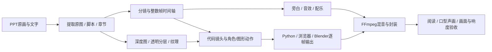

# PPT怎样变成代码动画：已有项目的工作方法

这批内容已经做过，不是新提案。七部故事介绍片和六个发布会动画工程的源代码、关键素材与成片现已归档；入口见 [PPT案例目录](../../cases/INDEX.md)。本页从当时的工程和Obsidian记录整理，时长重新用现存成片ffprobe核对。

## 七部故事介绍片

| 作品与入口 | 现存主版本 | 时长 | 画面方法 | 继续制作时优先读 |
|---|---|---:|---|---|
| [见龙](../../cases/entries/ppt-jianlong.md) | v2新旁白 | 194.500s | 印刷长镜头、水墨/木刻质感、PPT原画深度分层 | `jianlong/TREATMENT.md`、时间表、timeline、深度分层工具 |
| [目之所及](../../cases/entries/ppt-in-sight.md) | 故事介绍片 | 184.100s | 原画2.5D、镜框转场、地图/HUD、追车声画节奏 | `方案.md`、`film/build.py`、配音lines、depth |
| [她的舞蹈导师](../../cases/entries/ppt-dance-mentor.md) | v1 | 162.667s | 战术板箭头、冻结时刻、动作标记，90BPM | `方案.md`、`film/build.py`、`tools/beats.py` |
| [懂你的人](../../cases/entries/ppt-understands-you.md) | 后续书桌版 | 185.583s | Blender Cycles一镜到底、照片浮雕、投影HUD | `tools/desk_film.py`、desk_scene/desk_anim/desk_tex；勿误用旧版film入口 |
| [日落之前](../../cases/entries/ppt-before-sunset.md) | v1 | 170.792s | 西部海报原画分层、夕阳与倒计时、双语旁白 | `方案.md`、`film/build.py`、`film/mix.py`、suns |
| [画境追宝](../../cases/entries/ppt-painting-treasure.md) | v1 | 237.041s | 11幅漫画、三次入画、翻译气泡、画廊展签 | `方案.md`、`film/timeline.json`、build/mix/assemble |
| [这条街照常过年](../../cases/entries/ppt-new-year-street.md) | v3 | 124.800s | 灯笼节拍、100BPM、原画移动、三语声音 | `film/build.py`、`fix3.py`、`rerender.py`，对照旧版build_v1/v2 |

这些影片均保留高清和手机版本；手机AAC封装可能让容器时长相差几十毫秒，不按此误判成不同剪辑。原片及精确SHA256见各案例卡。

## 发布会PPT的另一组工程

- [方案B《片库之夜》](../../cases/entries/keynote-B-kaitou.md)：20秒开头。
- [方案C《打开》开头](../../cases/entries/keynote-C-kaitou.md)：20秒；与 [180秒全片](../../cases/entries/keynote-C-quanpian.md) 分开保存，避免以开头覆盖完整工程。
- [开卷](../../cases/entries/keynote-seg1-kaijuan.md)：33.333秒；[材质](../../cases/entries/keynote-seg2-caizhi.md)：40秒；[燃比娃](../../cases/entries/keynote-seg3-ranbiwa.md)：35秒。
- [共用资源](../../cases/entries/keynote-shared.md)：整理后的IP图、材质和其他共享输入。还原到原有相邻目录，保留 `../共用` 关系。

这些是独立版本/段落，不把“开头+全片+手机版”算成三个新作品。

## 实际流程

**1. 提取，不把整张幻灯片当成最终镜头。** 分开正文、备注、原始插画、Logo和表格。保留图片与章节对应，避免仅截图后放大导致二次模糊。历史工程里保存的 `素材/`、原画与提取文本是这一层。

**2. 先定叙事时间轴。** 一页PPT不等于一个镜头。按故事动作和阅读时间拆开镜头，再固定旁白、声音cue和字幕；`timeline.json`、`lines.json`、TREATMENT或方案说明是项目的编排依据。

**3. 根据素材选择空间方法。** 人物/背景可分为前中后层，用深度图驱动局部位移；纸张、桌面、建筑可建成真实几何。单张图片估计出的深度只支持受限机位，不能声称已经补全背面。书桌版用Blender，其他项目多用Pillow/NumPy或网页绘图；它们不是一个统一着色器。

**4. 动作必须承担信息。** 镜框张开、冻结标注、照片浮雕、入画、倒计时都能改变观众看到的信息；只推拉图片、叠字幕容易成为“动态PPT”。《懂你的人》的旧版被退回后改为书桌空间，是这一点的实际教训。

**5. 声音独立整理。** 生成旁白、音乐和拟音分轨保存，通过时间轴对齐并混音。已有配音/音乐作为素材归档；重配需要单独配置服务和采样，不把它描述为纯离线一键可复现。

**6. 各走原本可用的渲染器。** 浏览器页面满足DUR/render/READY可接北冥逐帧渲染。Python片用现存build脚本，Blender片用场景与相机脚本。先验证单帧和1–2秒片段，再决定是否迁移到RAEA；不在归档时强改全部工程。

## 新片应该复用什么

| 新需求 | 先取哪个案例 | 主要复用点 |
|---|---|---|
| 从故事PPT讲清人物关系 | 目之所及、画境追宝 | 章节拆镜、旁白时间轴、画内信息层 |
| 原画要更有空间而非简单推拉 | 见龙、懂你的人书桌版 | 深度分层、纸面材质、相机路径与空间转场 |
| 科技发布会/IP片库介绍 | C-quanpian | 开头与全片的边界、章节与共用资源、封面落版 |
| 要清晰解释动作 | 她的舞蹈导师 | 冻结、箭头、节拍和信息阅读顺序 |
| 东方节庆/版画叙事 | 这条街照常过年、见龙 | 原画语言、分层、灯光/纸纹、声音节奏 |

## 保留的限制

这些工程来自不同制作路径，存在历史绝对路径、环境依赖和旧版入口。还原工具替换已知工作区路径，**不自动修复全部历史构建逻辑**。先看案例卡再运行命令。

原笔记指出部分故事片还需人工听音、复查音频峰值和完整审片；本轮核对成片信息与归档完整性，没有重新给七部片做响度母带，也没有替用户完成商业终审。北冥与RAEA后续可吸收这些时间轴和资产方法，但不应把它们全称为同一套三渲二风格。
