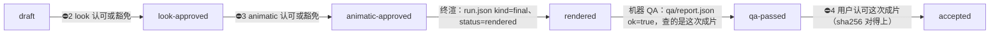

# 创作闸门与审片

> **解决什么**：一部作品什么时候可以终渲、什么时候可以说「已交付」。答案不靠 agent 自己判断，由三样东西现算：作品描述 `films/<名>/film.json`、审片记录 `films/<名>/review/`、最近一次运行 `films/<名>/out/latest` 指向的 `run.json` 与 `qa/report.json`。
> **依据**：决策 D08（`docs/decisions/2026-11-10-industrial-baseline.md`）；导演方法的四个关口见 `routes/directing/DIRECTING.md` §1。
> **实现**：`engine/production/review.js`（记录）、`engine/production/state.js`（状态机与闸门），命令入口 `node engine/production/film.js`。出片编排 `tools/film`（P06）调用同一套库。

同目录还有：[SOP.md](SOP.md)（从需求到交付的生产链总表）、[RUBRIC.md](RUBRIC.md)（六维评分、一票否决、问题分级、代理审片规程）、[review.template.md](review.template.md)（送审单）、[issue.schema.json](issue.schema.json)（问题条目格式）。

## 1. 四个关口

| 导演方法的关口 | 记录里的 `gate` | 是否阻断 | 给用户看什么 | 认可冻结什么，什么时候失效 |
|---|---|---|---|---|
| ⛔1 结构 | `structure` | 不阻断，只记录 | 一句话、三个候选结构、对标表 | — |
| ⛔2 画风 | `look` | 阻断终渲 | 风格帧、比例对照、色彩脚本条、style-lock | 冻结 `style` 的 id 与 version；风格升版即失效 |
| ⛔3 动态预演 | `animatic` | 阻断终渲 | 由正片时间轴驱动的整片预演（半分辨率、占位主体、临时声）与联系表 | 冻结镜头表（帧率、总帧数、每镜 in/out）；任何切点变了即失效，只改事件时提示 |
| ⛔4 成片 | `final` | 阻断「已交付」 | 这次运行的成片（全速、带声、从头到尾）、代理审片证据、自检表 | 冻结所看成片的 sha256；成片换了即失效 |

关口的顺序不能跳：没有 look 的认可或豁免，animatic 的认可不推进状态（status 里提示 `gate-order`）。

## 2. 状态



| 状态 | 对外文字（`deliveryLabel`） | 进入条件 |
|---|---|---|
| `invalid` | 作品描述不合格（先修 film.json） | `film.js check` 有错误 |
| `draft` | 制作中：风格帧还没有用户认可 | 默认 |
| `look-approved` | 风格已认可，待动态预演认可 | look 有效的 approve 或 waive |
| `animatic-approved` | 动态预演已认可，可以终渲 | 再加 animatic 有效的 approve 或 waive |
| `rendered` | 已终渲，待机器 QA | 再加最近一次运行是终渲（`kind: final`，`status` 为 rendered / passed / accepted，记录合格、有成片 sha256） |
| `qa-passed` | 技术检查通过，待用户审看成片 | 再加 QA 报告合格、`ok: true`、`input.sha256` 是这次的成片 |
| `accepted` | **已交付 · 用户已认可** | 再加 final 的 approve，且用户看过的文件里有这次成片的 sha256 |

规则：
- 状态只现算，不存档；只有连续满足的阶段才算数。出片时 look / animatic 还没认可的终渲（`render-bypassed-gate`）、QA 查的不是这次成片的（`qa-input-stale`）、用户认可的不是这一版成片的（final `stale`），都不往上走。
- 「已交付」「用户已认可」「已验收」这类说法只能由 `accepted` 生成。写说明、汇报、README 之前用 `findUnbackedClaims(text, state)`（`engine/production/state.js`）查一遍；没到 accepted 时写「技术检查通过，未经用户审看」。
- 运行记录 `run.json` 里的 `creativeAcceptance` 不决定状态：状态只认 `review/` 的记录。run.json 写了 accepted，也必须带人工认可（见 §5）。

## 3. 怎么记录

一条结论一个文件：`review/<闸>-<YYYY-MM-DD>.json`，同一天同一道闸再记就是 `-2`、`-3`……；**只增不改**，新的结论覆盖旧的结论（同一秒内按序号）。用命令写，不要手写：

```sh
# 用户认可风格帧（--file 可重复；记录里自动写每个文件的 sha256）
node engine/production/film.js review films/<名> --gate look --decision approve \
  --file films/<名>/stills/look_01.png --file films/<名>/stills/look_02.png \
  --quote "可以，就按这个方向做，天空再亮一点" --source-ref "Claude Code 会话 2026-11-10 用户第 14 条消息"

# 用户否定：写清维度与下次必须改什么
node engine/production/film.js review films/<名> --gate animatic --decision reject \
  --quote "节奏太碎了，镜头 C 太短" --source-ref "飞书 2026-11-11 10:32" \
  --rejected-on rhythm,camera --must-change "镜头 C 至少 4 秒，合并 S3 与 S4" --shot C=fail:太短

# 用户明确说跳过某一关（只能 look / animatic）
node engine/production/film.js review films/<名> --gate animatic --decision waive \
  --quote "不用看预演了，直接出成片" --source-ref "会话 2026-11-10 第 20 条"

# agent 的代理审片：只能 comment，写结论、分数与问题帧（不推进状态）
node engine/production/film.js review films/<名> --gate final --decision comment \
  --summary "代理检查通过：切点 ±3 帧无跳帧，读字时长全部达标" --shot B=note:第 101 帧发丝穿过镜框

# 看状态、过闸门
node engine/production/film.js status films/<名> [--json]
node engine/production/film.js gate films/<名> final     # 能否终渲：exit 0 放行，exit 4 拒绝并说明缺什么
node engine/production/film.js gate films/<名> deliver   # 能否写「已交付」：只有 accepted 放行
```

`--quote` 原样照录用户说的话：含标点，不改写、不概括、不翻译；多行用 `--quote-file <UTF-8 文本>`。`--source-ref` 写能找回这句话的地方（会话与消息序号、聊天记录时间、邮件主题、会议纪要路径），不写本机绝对路径。`--source-at` 写用户说话的时间（默认现在）。`--dry-run` 只打印记录。

## 4. agent 能做什么、不能做什么

- **不能自己批准**：approve / reject / waive 只能由用户或指定审片人做。记录里 `reviewer.kind` 必须是 `human`，并带原话与出处；没有原话、原话是占位符（`用户原话`、`{{…}}`、`TODO`、`代理检查通过`……）或自评口吻的记录无效，状态计算当它不存在。`recordedBy` 写实际录入的人或 agent（默认 agent）。
- **不能替人看片**：全速带声的完整观看只能由人做；agent 不能写「已带声看过」。
- **能做代理审片**：按 [RUBRIC.md](RUBRIC.md) §4 的规程看联系表、切点帧条、事件帧条、声画数据、读字与安全区，打分并写问题条目（[issue.schema.json](issue.schema.json)），用 `--decision comment` 记录。代理审片的结论只能写「代理检查通过 / 未通过」。
- **不能编原话**：二手转述不是原话。例如九分钟版文档转述过「用户要求完全沿用原版十秒」，那是转述，不能补成样片的审片记录。
- **豁免**：用户明确说跳过 look 或 animatic 时，照录原话写 waive；final 不能豁免（用户不看片就要交付时，状态停在 qa-passed，对外写「技术检查通过，未经用户审看」）。

## 5. 运行记录里的创作验收

`run.json`（附录 C8）的 `creativeAcceptance` 是 `{ status, reviews[] }`，每条评审 `{ reviewerKind, reviewer, decision, quote, source, scores?, vetoes?, evidenceFrames?, record? }`。`engine/production/project.js` 的 `validateRenderResult(run, { strict: true })`（`film.js validate-result` 与状态机都用它）要求：

- `accepted` 至少有一条 `reviewerKind: human`、`decision: approve`、带原话与出处的评审；只有 AI 评审时最多写 `ai-reviewed`。
- AI 评审只能是 `comment`。
- 技术验收 `passed` 必须指向一份可解析、`ok: true` 的 QA 报告（`qa/report.json`）；命令与日志只能作补充证据。渲染器只写 `status: rendered` 与 `technicalAcceptance.status: not-run`，由 QA 判定。

## 6. 历史作品

完成于闸门建立之前的作品没有 look / animatic / final 记录，状态只能是 `draft`，不能写「已交付」。例：`films/beiming-10s`（《北冥》10 秒样片的镜像）——认可版本另见决策 D05。要补记录，只能拿用户对该作品本身的原话。
