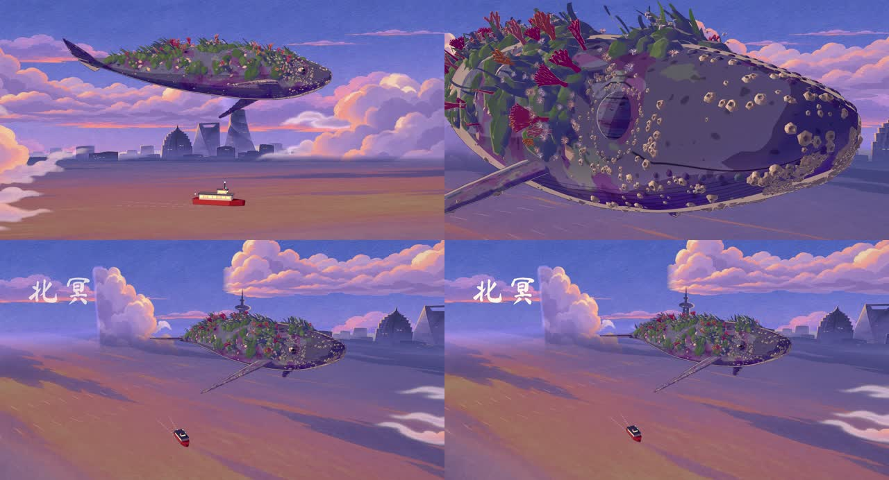

# 10 秒原生实验：结果与边界

> 读者：要复现或引用原生实验结果的人｜状态：实测记录｜依据：2026-11-06，RTX 5090 · Vulkan，运行包 `v0.1.0-canary.2`；另有入库后的 macOS 复现

实际影片代码已整理到 [examples/raea/film.tsx](../../examples/raea/film.tsx)。下面是原实验的测量；目录迁移后的验证另行记录，不混作同一次跑分。

## 实际做了什么

三个镜头在 3.5 秒、6 秒切换：渡船与巨鲲建立尺度 → 鲲眼近景眨眼 → 拉开距离，8.1 秒出现片名。沿用自有鲲、渡船和水彩底板；三维物体有真实摄影视差，水面与尾迹由自写 WESL 驱动。没有使用旧视频充当画面输入。

鲲的程序形变被转换成 GLB 骨骼和 morph；`Swim` clip 一拍三采样，摄影、船位和水面按 24fps 更新。自写 Python 生成声音，FFmpeg 最后复制原生视频轨并封装 AAC。

## 原实验记录

| 项目 | 结果 |
|---|---|
| 画幅 / 帧率 / 时长 | 1920×1040 / 24fps / 10.000 秒 |
| 完整解码帧数 | 240 |
| 图形后端 / 视频编码 | Vulkan / OpenH264 软件编码 |
| 视频文件大小 | 19,521,074 bytes |
| FFmpeg 综合响度 / 真峰值 | −14.02 LUFS / −3.06 dBTP |
| 黑场 / ≥0.75 秒静帧 | 均未检出 |
| 原生统计含编码速度 | 47.74fps；有其他 GPU 负载，不是受控跑分 |
| 人工检查 | 全时段 4fps 抽帧、切点、眨眼与字体复核 |
| 浏览器播放复核 | 正常结束于 10 秒；显示侧丢 8 帧，文件完整解码 240 帧 |

原始指标和 SHA256 见 [experiment-qa.json](experiment-qa.json)。RAEA check 的响度读数为 −13.6 LUFS，与 FFmpeg 算法读数不同，分别保留。技术检查通过不等于人物表演或画风等价通过。

## 复现中发现的兼容点

| 现象 | 本例处理 | 后续正式集成要做什么 |
|---|---|---|
| 雾暴露透明底板矩形边缘 | 关闭该场景通用距离雾，以绘画底板表达空气透视 | 独立测试 premultiplied alpha、雾与遮罩顺序 |
| 天空面片露边 | 使用二维背景并叠加 `Canvas3D layered` | 固定相机运动范围，核对分层合成 |
| ShaderMesh 纹理路径不解析 | WESL 纹理用项目相对 `media/river.png` | 不假设所有接口都接受 `staticFile` 的同一种路径 |
| Windows 中文路径下字体未加载 | 片名使用内嵌 TTF 数据；保留 OFL 声明 | 验证目标机字体与路径，不能只看默认替代字体 |
| 原 GLSL 弯曲不进入 GLB | 导出骨骼 TRS、蒙皮、morph 和 clip | 新模型也必须验证阴影、深度与动作 |

## 尚未验证

- 真人物表演、视线追踪、手脚接触、长片状态与调度。
- 原版北冥 ID 墨线、Kuwahara 与此实现的视觉等价。
- 完整三维城市；本片城市和云仍为绘画面片。
- 与北冥同内容同画质的受控性能比较。
- 其他 RAEA 版本及全部 SDK 功能。

## 入库后的复现检查

2026-11-06 在 macOS 从本仓库新目录执行 `raea:prepare → raea:check → raea:render`，完整通过。新导出的鲲、渡船与原实验 GLB 的 SHA256 完全一致；新视频完整解码 240 帧，1920×1040 / 24fps / 10 秒，AAC 音轨，−14.02 LUFS / −3.06 dBTP，无黑场或 ≥0.75 秒静帧。

运行日志没有渲染错误；有上游 WebAssetPlugin 的通用启动警告。四个关键时刻已查看，片名与眨眼正常；部分远景机位仍可见绘画云片的截断竖边，需后续场景美术修整。本次复现验证可运行性，不代表画面已达到最终艺术验收。

当前数据见 [publication-validation.json](publication-validation.json)。本次没有重跑 5090 性能测试；Windows 新版 Node 包装脚本尚未在工作站重新执行，历史 Windows 原生实验仍单独记录。

## 重构后复现记录（2026-11-10，工业级加固 P14）

基线：分支 `hard/P14` 提交 `d105b81`（底座 `routes-template@abfdc83`，含 main 的 `62ad28e`），macOS 26.5 · Apple M5 Pro · Metal（从运行时日志识别）· 原生编码 VideoToolbox；运行时 `0.1.0-canary.2`，可执行文件 sha256 与 `engine/native/runtime.lock.json` 一致；Node 24.13、FFmpeg 8.0.1、Playwright 1.63.0 / Chromium 153。操作入口已统一到 [B 路线手册](../../routes/b-native/README.md)。

| 步骤 | 命令 | 结果 |
|---|---|---|
| 准备 | `node engine/native/prepare.mjs examples/raea` | exit 0，约 6 秒。鲲 `8f77f664…66f9`（R01 眼睑 UV 修复后的新基准），渡船 `c34e6996…c8c7`（底座 R24 把红绿航行灯换到正确舷侧后的新基准）；回读断言：四片眼睑睑缘一圈 texel 到墨线色的距离比 0.145–0.150（上限 0.35；用未修复的半球 UV 重导同一配方为 1.037，导出失败、正式路径不留文件） |
| 出片 | `node engine/render/native.mjs examples/raea` | exit 0，全程约 28–38 秒（原生渲染 4.7–14.5 秒，含首次着色器编译）。母版：原生 VideoToolbox 视频轨逐位复制 + AAC；网页版：H.264 High@4.1、yuv420p、BT.709 有限范围四标签、AAC 48 kHz 立体声，15.5 MB；240 帧 / 10.000 秒；−14.0 LUFS、真峰值 −3.2 dBTP；mp4 comment 写「含 AI 生成画面」 |
| 运行时自带成片检查 | 出片入口自动运行 `raea check` | 无问题：响度、无突停、无 3 秒冻帧、文字不裁切、安全区、读字时长（毛笔片名是图片层，不计入文字项） |
| 可复现性 | 同一提交连渲两次（`--run-id final-a / final-b`） | 母版解码后 240/240 帧 framemd5 逐帧相同（PSNR ∞）；原生 VideoToolbox 码流本身两次不同，网页版视频码流与音频码流两次逐字节相同 |
| 回归测试 | `node --test 'tests/native/*.test.mjs'` | 全过（含资产桥重导出与基准逐字节比对、逐帧版式核对） |

与上一节复现相比的画面改动（都是有意的，例片不是像素基准）：近景云按镜头摆、截断竖边每帧都在画外，上下截断边烘有机软边（不再出现竖直刀口）；天际线按原图 2:1 等比（不再压扁），水岸线压在江面上；页面层天空随摇 / 仰移动；渡船朝运动方向、尾迹在船尾后（审查 R04）；鲲的位置、昂头与 Swim 片段同一个一拍三时钟（R07）；纸纹改为页面层整幅、一拍二换纸；片名改为 A 路毛笔按笔顺写出、收笔飞白；眨眼那一帧一声细小铃音、片名两字起笔各一声，与分镜表一致（R11）。未改：没有 A 路的屏幕 ID 墨线与 Kuwahara；仍未在 Windows / 5090 上用新入口重跑。
