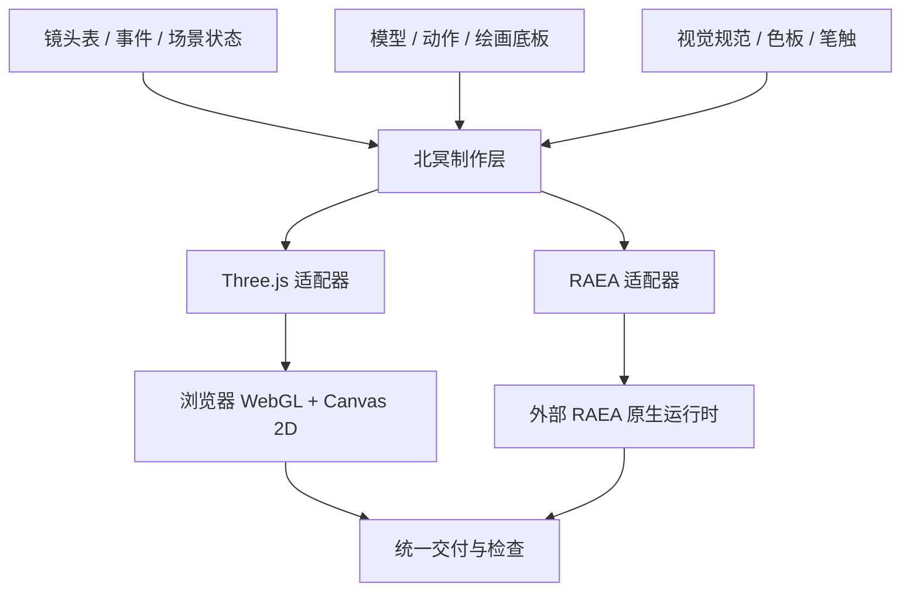

# 技术集成指引

先按 [ROUTES.md](../../ROUTES.md) 选择创作路线。本文重点指导 **北冥风格路线如何吸收 RAEA 的能力**；独立 RAEA 原生路线可以直接从 [TSX 示例](../../examples/raea/README.md) 开始，无需等待下面的统一制作层实现，也无需沿用北冥的固定画风。

目标是扩展北冥的表演、资产与运行能力，同时保留现有画风。按 **镜头状态 → 资产桥 → 风格校准 → 原生后端 → 表演与规模验证** 的依赖推进。创作优先级始终是动作是否被拍出来。

本文中的接口草案和“建议新增”目录尚未实现。可执行部分只有 [examples/raea](../../examples/raea/README.md) 中的实验、资产导出和构建工具。

## 1. 先确定接入位置



两个后端各自管理场景、材质、GPU 和输出。这里没有跨 Chromium 与原生进程直接共享纹理的已实现通道，也没有通用 `renderer = raea` 的替换接口。

### 联合使用时的职责编排

**北冥是制作与美术编排层，RAEA 是原生执行层。** 北冥决定发生什么、何时发生、怎样拍、采用什么画风；RAEA 将目标状态落实为原生场景、材质、动画与渲染。原有 Three.js 路径继续承担原版画风基准和已成熟镜头。

| 层级 | 负责内容 | 输入 → 输出 | 数据应放在哪里 |
|---|---|---|---|
| 影片编排 | 镜头顺序、事件、角色/道具状态、声音时间 | 剧本事件 → ShotSpec | 北冥 production |
| 表演与摄影 | 动作采样、目标约束、相机轨道、分层时钟 | ShotSpec + 整数帧 → FrameState | 北冥 performance / production |
| 视觉规范 | 色板、阶调、边缘光、笔触、层级 | 风格意图 → 两侧参数映射 | 北冥 style |
| 执行适配 | 场景节点、材质、资源绑定、状态应用 | FrameState → Three 对象或 RAEA 场景 | 各 backend |
| 原生运行 | Bevy 场景更新、GPU 绘制、合成、读回与编码 | RAEA 场景 → 帧/视频/日志 | RAEA runtime |
| 交付验收 | 拼接、声音、技术检查、人工视觉验收 | 镜头产物 → 成片与报告 | 北冥 render / QA |

单帧流程建议：`frame → 定位镜头 → 求世界状态 → 采样动作和相机 → 求风格参数 → 后端应用 → 渲染 → 记录`。动作和相机求值只写一份，材质实现允许分别维护。

第一步可以用共享纯函数生成少量状态；复杂运动可预烘焙为按帧数据或 GLB clip。RAEA TSX 使用 `useCurrentFrame()` 读取相同帧号后取值。不要用浏览器真实时间驱动原生播放，也不必逐帧通过进程通信传送完整场景树。

建议 `FrameState` 包含 `frame / shotId / camera / actors / lights / world / look / overlay`。所有值有显式单位：世界以米、旋转用 xyzw 四元数、时间用整数帧；二维布局采用设计画幅单位并独立缩放。旧北冥镜头与导出 GLB 的比例在适配器里处理，不能把原长约 600 的鲲与导出长约 30 的鲲混用相机尺度。

### 按镜头选后端，按影片统一交付

短期在镜头清单指定 `backend: "three" | "raea"`。原版镜头可以继续走 Three，新增骨骼表演或重场景走 RAEA。一个镜头先由一个后端完成；若要把两个后端的图层混合，必须另建透明图像序列/遮罩/深度等合成协议，当前示例并未实现。

跨后端镜头拼接前统一尺寸、帧率、色彩转换与标签、曝光基准、采样音频格式及编码参数。`concat -c copy` 只在码流参数兼容时使用；无法保证时从统一中间格式生成最终视频。镜头 ID、全局起止帧、资产和风格版本写入 manifest，避免每次切镜头重置动作相位或错误套用局部时间。

工程目录建议如下；除了 `examples/raea` 外，以下新增目录均为实施方案：

```text
engine/production/     镜头清单、世界状态、统一帧状态
engine/performance/    相机/动作采样、角色目标与二维姿态
engine/style/          视觉规范及参数版本
engine/backends/three/ 现有场景与后期的适配
engine/backends/raea/  TSX 场景、材质映射与外部运行调度
engine/render/        镜头产物、音画封装、交付报告
examples/raea/        当前已运行的原生实验与资产桥
```

| 北冥当前文件 | 已有能力 | 集成动作 | 对照 RAEA 源码 |
|---|---|---|---|
| [`engine/stage/film.js`](../../engine/stage/film.js) | 镜头选择、`update`、`look`、后期、显示层、READY | 在外层引入数据协议；先让旧镜头通过适配继续运行 | [提交入口][react]、[场景转换][scene] |
| [`engine/core/clock.js`](../../engine/core/clock.js) | 整数帧与一拍几 | 明确全局帧、镜头局部帧和角色连续时钟 | [Program][program]、[Timeline][timeline] |
| [`engine/form/bend.js`](../../engine/form/bend.js) | GPU/JS 脊柱波形 | 烘焙成骨骼/morph，或在新后端重写形变与阴影路径 | [Model 入口][model] |
| [`engine/shade/toon.js`](../../engine/shade/toon.js) | 三色、阴影、羽化、rim 与艺术补光 | 按视觉语义重建，逐项校准 | [Toon Rust][toon]、[Toon WESL][toonshader] |
| [`engine/look/index.js`](../../engine/look/index.js) | 指定后期顺序 | 分离风格意图和后端参数 | [FramePass][framepass]、[Outline][outline] |
| [`engine/paint`](../../engine/paint) / [`src/girl.js`](../../src/girl.js) | 二维人物路径、笔触与局部动作 | 建立二维关键姿态；三维角色另走骨骼与目标约束 | [Character][character]、[求解器][solve] |
| [`engine/render/video.mjs`](../../engine/render/video.mjs) | 分段浏览器截图和 FFmpeg | 增加外部运行时调度与统一 manifest | [原生导出][export]、[编码][encode] |

## 2. 镜头与动作协议：先解决状态，再追求抽象

现有镜头是 `{scene, camera, update(t, f), look(t)}`；`createFilm` 传入的是**全片时间**。新接口必须保留这一兼容层，否则已有 `shotA/B/C` 的时间曲线会错位。

建议新增 `engine/production/`，第一版只存数据和纯函数，不导入 Three、React 或 RAEA。接口草案：

```ts
// 设计草案，不是当前可 import 的 API。
type Vec3 = [number, number, number];
type FrameContext = {
  frame: number;             // 全片整数帧，范围 [0, frameCount)
  localFrame: number;        // frame - shot.inFrame
  fps: number;
  time: number;              // frame / fps
  localTime: number;
  seed: number;
};
type ShotSpec = {
  id: string;
  inFrame: number;
  outFrame: number;          // 半开区间 [inFrame, outFrame)
  cameraTrack: string;
  worldState: string;        // 场景、时间、天气、道具等明确状态
  actorTracks: string[];
  lookPreset: string;
  acceptance: { atFrame: number; visibleEvent: string }[];
};
type ActorSample = {
  asset: string;
  position: Vec3;
  rotationQuaternion: [number, number, number, number]; // xyzw
  clip?: { name: string; time: number; loop: boolean };
  goals?: { gaze?: Vec3; leftHand?: Vec3; rightHand?: Vec3 };
};
```

实施要求：

- 全片时间和镜头时间分别使用。鲲的连续游动通常不在每次切镜头时从零开始；人物的“抬手”动作可以用镜头局部时间。
- 角色一拍三采用 `floor(frame / 3) * 3 / fps`；镜头、水面、雾按全帧更新。不要把所有节点统一降成 8fps。
- 轨道按绝对帧采样，不在 `update` 中累计 `position += speed * dt`。随机装饰在建场时用种子生成；每帧抖动按帧号取值。
- 非纯函数模拟明确标注需要顺序回放或预烘焙。RAEA Compute 的跨帧状态不能无条件套用北冥多 worker 随机起帧。
- 场景状态必须真正改变资产、灯光和材质。镜头表写“夜海”，却只改字幕，不算状态实现。

**验收：** 切点前后各一帧无丢帧；同一帧顺序采样、直接跳转、倒退再前进一致；切镜头时角色动作相位连续。先比较状态数据，再在同一设备/版本比较像素，编码文件哈希不作为跨设备画面一致的替代指标。

## 3. 资产桥：当前已实现的部分

入口是 [`export-kun.mjs`](../../examples/raea/tools/export-kun.mjs)，核心转换在 [`export-kun-browser.mjs`](../../examples/raea/tools/export-kun-browser.mjs)，结构检查在 [`export-kun-validate.mjs`](../../examples/raea/tools/export-kun-validate.mjs)。

它调用现有 `createKun` / `createFerry`，而不是另换一套角色。主要工作：

1. 把几何、反照率纹理与顶点色导出为标准 glTF 材质数据。
2. 将原本在 GPU 上执行的脊柱弯曲采样为骨骼 TRS；给身体和尾鳍写入蒙皮权重。
3. 将胸鳍、眼睑的真实枢轴动作写入 clip；海草摆动写入四个 morph targets。
4. 合并实例装饰，保留位置与颜色，并限制导出规模。
5. GLTFLoader 回读、AnimationMixer 采样、检查循环首尾和运动幅度。

原实验结果为 42 骨骼、73 动画通道、489,858 三角面；几何约 18.06MB。名义鲲长 30m，前向 +X、上方 +Y。细节、误差和循环改动见 [资产桥接说明](../../examples/raea/ASSET-BRIDGE.md)。

### 对新的角色或场景资产

- 约定单位、原点、前向、包围盒、骨骼名字和 clip 名称。不要仅看“能打开 GLB”。
- 灯光和屏幕后期不烘进 baseColor，除非明确作为美术设计选择；反照率与显示色空间分开。
- 顶点变形影响主渲染、阴影、深度和法线。只搬主画面会导致影子和墨线脱离模型。
- 实例合并会改变三角面和 draw call；按实际场景测量，不认定合并必然更快。
- GLB 存几何与动作，不会存下北冥的 ID 墨线、Kuwahara 或完整灯光逻辑。

**验收：** 有限坐标、索引、权重和、动画时间、骨骼引用、材质纹理、循环首尾、独立加载以及关键姿态都通过。当前独立 validator 不等价于完整 Khronos 合规认证。

## 4. 风格迁移：按照可见结果逐层搭建

建议新增 `engine/style/` 存版本化风格规范，初期只描述视觉语义；将 Three 与 RAEA 数值放在各自适配器。先保留原版 `src/toon.js`、`src/look.js` 与样片作为参考。

| 视觉层 | 北冥当前实现 | RAEA 对应入口 | 需要重新实现或校准 |
|---|---|---|---|
| 色阶 | 半兰伯特三色、双羽化 | `ToonMaterial` | 光照分档依据、阴影参与方式、色阶比例和明度 |
| 补光/rim | 底部暖光、暗部冷光、背光边缘 | Toon rim / `ShaderExt` | 方向约束、宽度、颜色、受光面保护 |
| 表面 | 物体空间噪声和反照率钩子 | 纹理、顶点色、表面扩展 | 坐标、噪声尺度、色彩空间 |
| 外轮廓 | 深度 + 物体 ID，抖动和笔压 | Toon 外壳 / 屏幕 Outline | ID 语义、实例区别、细线保护和最终叠加阶段 |
| 颜料笔触 | 八扇区 Kuwahara | 自定义 `FramePass` | 算法、采样半径、边缘保护；内置 Paint 并不等价 |
| 底板 | 透明平面、遮罩与分层视差 | `ImagePlane` / 分层页面 | alpha、预乘、雾参与、深度遮挡和排序 |
| 显示层 | 后期后独立 Canvas2D | 页面覆盖层 | 字体、字号、布局与效果排除 |

### 推荐调试顺序

1. 关后期、关轮廓，仅检查反照率、纹理和顶点色。统一纯色覆材质会丢掉鲲眼、斑纹和苔藓。
2. 固定相机、单主光和曝光，校准三档明暗；增加阴影测试物，不只看正面球体。
3. 加 rim 与艺术补光，确认不会把平涂变成塑料高光。
4. 加透明底板和空气透视，检查卡片边缘、背景色以及人物前后遮挡。
5. 分开生成墨线信息与颜料滤波，再决定最终叠加顺序；不得默认 RAEA Outline 的位置与北冥相同。
6. 最后加纸纹、颗粒和标题；在最终分辨率检查线宽和颗粒大小。

在 1920×1040、3840×2080 各保留固定关键帧。评价至少包括色板、明暗面积、轮廓、局部纹理和远景可读性。相机、资产与灯光未对齐时，不使用一个 SSIM 数字宣告风格相同。

## 5. 角色表演：二维与三维各有实现

RAEA [`Character`][character] 将世界空间目标转换到角色坐标，再调用姿态求解。[`solve`][solve] 中有手、脚、视线和座位目标；[`clipPose`][clip] 支持动作采样，[`matching`][matching] 提供动作匹配相关实现。这些是源码已有能力，本仓库的 10 秒实验**尚未使用真人物演示**。

建议北冥制作层统一表达“看向何处、手放何处、动作发生何时”，后端分别实现：

- **二维人物：** 分层轮廓、头部角度、眼睛方向、手臂关键姿态、遮挡与动作过渡。继续使用 `engine/paint`；不能把一张侧脸贴图当成已完成的任意角度人物。
- **三维人物：** 自有角色、骨骼绑定、可用动作片段和重定向，再加入 IK / 接触目标。RAEA 的动作库及角色生产依赖需要单独准备，不能推定公开仓库自带所有资产。

首个表演验收镜头建议 4–6 秒：阴影经过 → 人物停止手上动作 → 抬头 → 视线落到鲲眼 → 手松开扶栏。每个事件必须有可识别关键姿态，脚与手接触稳定；自动质量检查不能替代人工观看。

## 6. 原生执行：独立进程与明确的交付约定

当前可运行的适配示例是 [`render.mjs`](../../examples/raea/tools/render.mjs)：固定版本检查 → 资产预检 → 调用外部 RAEA → 保留 manifest 和日志 → FFmpeg 复制视频并封装 AAC → ffprobe 检查。

建议后续新增 `engine/backends/three/` 与 `engine/backends/raea/`，逐步封装 `prepare / render / inspect`，而不是先重写已有核心。第一版可以保持两份场景实现，只共享资产、采样数据和规范。

统一输出记录至少包括：源码提交、运行时版本、尺寸/fps/帧数、种子、资产哈希、后端与显卡、编码器、各阶段耗时、文件哈希、技术检查、人工视觉验收及已知限制。

Windows 原生路径使用 `WGPU_BACKEND=vulkan`；浏览器路径使用 `BEIMING_ANGLE=vulkan`。它们作用于不同运行时。当前 RAEA canary 的 Windows 默认 H.264 是 OpenH264 软件编码，不等于 NVENC；GPU 渲染、读回和编码分别计时。

性能对比需使用相同画幅、帧数、镜头与画质要求，记录预热/冷启动和并发负载。原实验 47.74fps 包含编码且显卡被共享，只能证明该次运行，不能当作比北冥更快的基准。

## 7. 具体实施清单与退出条件

| 阶段 | 文件落点 | 状态 | 完成条件 |
|---|---|---|---|
| 0：研究与可运行桥 | `docs/raea`、`examples/raea` | 已入库；历史 5090 实跑记录在实验文档 | 从仓库生成 GLB、运行例片、核对版本和输出 |
| 1：镜头协议 | 建议 `engine/production/{shot,clock,state}.js` | 待实现 | 原三镜头兼容、切点与顺序/跳帧一致，状态能实际驱动画面 |
| 2：风格规范 | 建议 `engine/style/` + 两侧映射 | 待实现 | 反照率、三档、阴影、轮廓、底板逐项对照；记录剩余差异 |
| 3：执行适配器 | 建议 `engine/backends/` | 当前只有独立实验 CLI | 两条构建路径不互相依赖；清晰失败、日志与 manifest |
| 4：人物表演 | 建议 `engine/performance/` + 自有角色资产 | 待实现 | 一个完整因果事件；手脚接触、视线和姿态均通过观看 |
| 5：规模生产 | 镜头清单、缓存、分段输出与复核工具 | 待实现 | 先 30–60 秒多事件段落，再扩展；技术与创作验收分别通过 |

原版 `npm run build` 持续作为回归基线。实验目录可单独移除，原项目仍可构建。不要在未通过视觉验收前把 RAEA 设为默认后端。

## 8. 版本与许可边界

保留源码固定提交、示例使用的 API 和测试运行时版本。canary 更新后重新检查材质默认值、字体、资源路径、透明合成和编码器选择。

RAEA 当前 FSL 与北冥 MIT 的范围分别遵循各自许可。本文提供原创解释和调用代码，没有复制 RAEA 内核或 SDK。项目按具备相应整合权限的内部开发场景设计；目录和进程隔离服务于工程维护，来源与许可声明独立保留。

[react]: https://github.com/shinyobjectz/raea/blob/fb3f70844e03cc40185e3a06c394060d26c5cd38/runtime/react/src/commits.rs#L81
[scene]: https://github.com/shinyobjectz/raea/blob/fb3f70844e03cc40185e3a06c394060d26c5cd38/runtime/scene/src/lib.rs#L331
[program]: https://github.com/shinyobjectz/raea/blob/fb3f70844e03cc40185e3a06c394060d26c5cd38/core/program/src/ir.rs#L28
[timeline]: https://github.com/shinyobjectz/raea/blob/fb3f70844e03cc40185e3a06c394060d26c5cd38/core/program/src/timeline.rs#L22
[model]: https://github.com/shinyobjectz/raea/blob/fb3f70844e03cc40185e3a06c394060d26c5cd38/sdk/render/src/3d/model.tsx#L278
[toon]: https://github.com/shinyobjectz/raea/blob/fb3f70844e03cc40185e3a06c394060d26c5cd38/systems/material/src/toon.rs#L25
[toonshader]: https://github.com/shinyobjectz/raea/blob/fb3f70844e03cc40185e3a06c394060d26c5cd38/systems/material/src/toon.wesl#L113
[framepass]: https://github.com/shinyobjectz/raea/blob/fb3f70844e03cc40185e3a06c394060d26c5cd38/systems/framepass/src/lib.rs#L100
[outline]: https://github.com/shinyobjectz/raea/blob/fb3f70844e03cc40185e3a06c394060d26c5cd38/systems/post/src/outline.rs#L28
[character]: https://github.com/shinyobjectz/raea/blob/fb3f70844e03cc40185e3a06c394060d26c5cd38/sdk/character/src/character/drawing.tsx#L100
[solve]: https://github.com/shinyobjectz/raea/blob/fb3f70844e03cc40185e3a06c394060d26c5cd38/sdk/character/src/character/solve.ts#L227
[clip]: https://github.com/shinyobjectz/raea/blob/fb3f70844e03cc40185e3a06c394060d26c5cd38/sdk/character/src/clip.ts#L233
[matching]: https://github.com/shinyobjectz/raea/blob/fb3f70844e03cc40185e3a06c394060d26c5cd38/sdk/character/src/matching.ts
[export]: https://github.com/shinyobjectz/raea/blob/fb3f70844e03cc40185e3a06c394060d26c5cd38/runtime/export/src/render.rs#L111
[encode]: https://github.com/shinyobjectz/raea/blob/fb3f70844e03cc40185e3a06c394060d26c5cd38/runtime/encode/src/render.rs#L43
