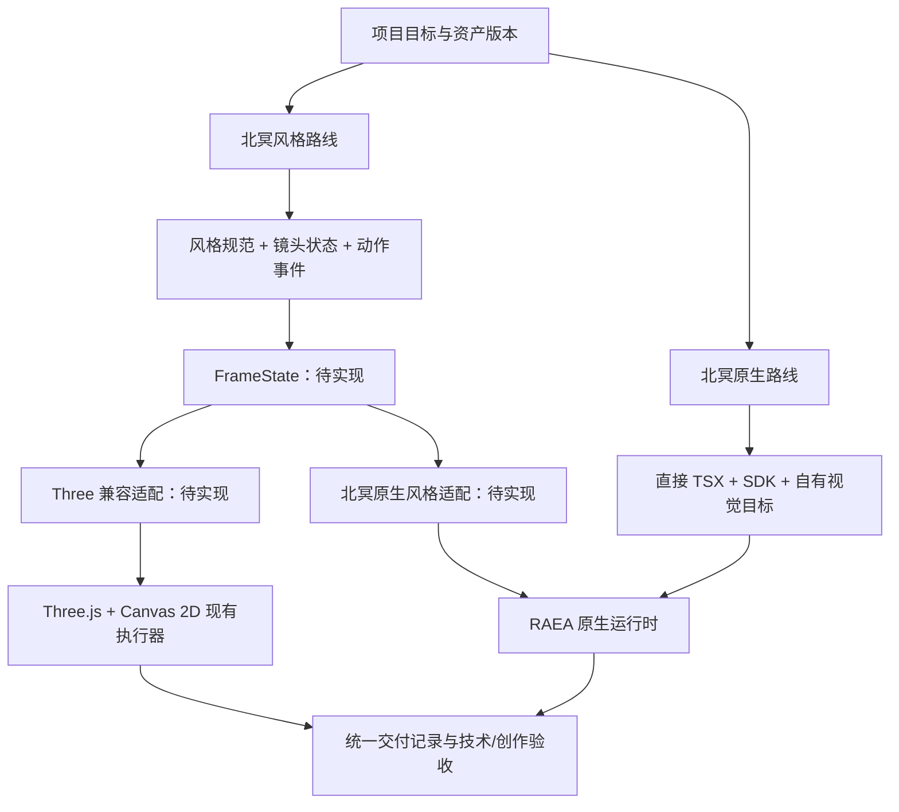

# 数据与模块契约：三条路线如何合作

> 读者：设计三条路线共用数据与接口的工程师｜状态：实施规格；作品描述 film.json v2、交付档位、创作闸门、`ProjectSpec` 与 `RenderResult` 的校验已实现，ShotSpec / FrameState / BackendAdapter 仍是设计｜依据：2026-11-06，2026-11-10 按决策 D01–D11 修订

本页是实施规格。已经实现、可以直接调用的部分：

| 契约 | 实现 | 说明 |
|---|---|---|
| 作品描述 `films/<名>/film.json` v2 | [`engine/production/film.js`](../../engine/production/film.js)，schema 见 [`film.schema.json`](../../engine/production/film.schema.json) | 每部作品唯一的时间源：镜头表、事件表、节拍、停顿都用整数帧；字段与规则见 [engine/production/README.md](../../engine/production/README.md)；本页 §0 摘要 |
| 交付档位 | [`engine/production/profiles.json`](../../engine/production/profiles.json) | 决策 D07；QA 期望值由 `film.js expect` 给出 |
| 页面约定 v1 | 本页 §0.2 | A、C 路线的页面与渲染器之间的约定（计划附录 C5） |
| 创作闸门与状态 | [`engine/production/state.js`](../../engine/production/state.js)、[`review.js`](../../engine/production/review.js) | 决策 D08；操作说明见 [docs/creative-review/](../creative-review/README.md) |
| `ProjectSpec` 与 `RenderResult` | [`engine/production/project.js`](../../engine/production/project.js) | T01 的字段与路径校验；路线改用注册表 id；RenderResult 加了人工评审与 QA 证据规则（§7） |
| 共享资产 | [`engine/assets/manifest.js`](../../engine/assets/manifest.js) | 资产 id、sha256 与锁文件（§6） |

`ShotSpec / FrameState / BackendAdapter` **尚未作为引擎 API 实现**；渲染器目前也不读 ProjectSpec。JSON 模板（[templates/](templates/)）供作品记录和实现时参照，没有被渲染器消费的字段不得描述为已生效的渲染参数。

## 0. 作品描述与页面约定

### 0.1 film.json v2（摘要）

- **时间**：`output.frameCount` 是时长的唯一来源；镜头 `shots[]` 是半开区间 `[in, out)`，首尾相接覆盖 `[0, frameCount)`；事件 `events[]` 写结果帧 `frame` 与所属镜头 `shot`；秒只由 帧 / fps 推出。改切点用 `node engine/production/film.js retime`，事件跟着镜头走。
- **路线**：`route` 取路线注册表 id（`a` / `b` / `c`），`backend` 按路线取值；交付规格只引用档位 `output.profile`。
- **不许有没有消费者的时间字段**：时间只写在 `shots`、`events`、`holds`、`timeline`、`posterFrame`。
- **校验**：`node engine/production/film.js check films/<名> [--json]`（退出码 0 / 2 / 4）；模版用 `--template`。

### 0.2 页面约定 v1（A、C 路线）

渲染器（`engine/render/`）打开作品的 `index.html`，按整数帧逐帧调用 `render(t)`。页面必须遵守：

| 字段 | 要求 |
|---|---|
| `window.DUR` | 必选。有限正数（秒），且 `round(DUR × fps)` 必须等于 film.json 的 `output.frameCount` |
| `window.render(t)` | 必选。`t` 是秒（= 帧号 / fps）；结果只由 `t` 决定（任意帧单独渲与顺序渲一致）；可以同步执行或返回 Promise，受单帧超时约束 |
| `window.READY` | 必选。资源加载完、着色器编译完后置为 `true`，须在就绪超时之内 |
| `window.TEXTS(t)` | 推荐。返回该时刻画面上的文字 `[{ text, box: [x, y, w, h], alpha, font }]`（像素框、0–1 不透明度），给 QA 查安全区、停留时长、对比度与缺字 |
| `window.EV`、`window.TIMELINE` | 可选。声画事件表与节拍表，`engine/render/events.mjs` 导出成 `events.json` / `timeline.json`；作品有 film.json 时它们必须与 film.json 的事件一致（或直接从 film.json 生成） |
| `window.__RENDER` | 由渲染器注入：`{ fps, width, height, profile }`；页面据此按档位排版，不自己写死帧率 |
| `window.BEIMING_CONTRACT` | 可选，页面约定的版本号，缺省按 1 处理 |

禁止：渲染路径里用 `Math.random`、`Date.now`、`performance.now`（只用于计时的除外）、无种子的噪声（`engine/core/noise.js` 不再接受无种子调用）；渲染时读回 GPU 画布；访问外网。页面里的时间常量（例如 `timeline.js` 的 `DUR`、`FPS`）要从 film.json 读，或与它一致——`film.js check` 会核对作品目录里 `timeline.js` 的 `DUR` 与 `FPS`。

B 路线的原生入口（`film.tsx`）不走页面约定：帧数、尺寸由 film.json 的 `output` 与 `native` 段给出，时间只由 `useCurrentFrame()` 决定。

## 1. 共用到什么程度

| 内容 | 北冥风格路线 | 北冥原生路线 | 共享方式 |
|---|---|---|---|
| 项目与交付信息 | 必需 | 必需 | 相同字段语义，可各自保存 |
| 资产身份与版本 | 必需 | 必需 | 相对路径、哈希、单位、坐标轴、clip 名 |
| 镜头/帧状态 | 统一求值用于跨后端适配 | 可直接 TSX；无需先做统一 IR | 只有跨后端或多人协作时再采用 FrameState |
| 材质和后期 | 风格规范映射到不同实现 | 自由采用 RAEA 材质和 WESL | 分享视觉目标，分别保存后端数值 |
| 动作 | 二维姿态或三维 clip/目标约束 | RAEA 原生角色与动画能力 | 可共享 clip、世界目标与动作事件 |
| GPU 与编码 | 浏览器/未来原生适配 | 原生运行时 | 统一记录实际执行证据 |

北冥原生路线（B）必须保留直接使用原生运行时 SDK 的空间。C 路线（北冥代码动画风格 · 86 式）与 A 共用页面渲染器，只共享作品描述、页面约定与交付记录（决策 D01）。统一层第一版只表达已有北冥镜头需要的内容，不尝试把所有 RAEA 功能重新封装一遍。



这是目标编排图。当前 Three 影片仍直接由 `src/main.js` 调用镜头；现有 RAEA 例片直接运行 TSX。图中的统一状态与两类适配器要按任务卡逐步建立。共享的是资产身份和交付语义，不要求两条路线使用同一种场景描述。

## 2. ProjectSpec

模板：[北冥风格路线项目](templates/project-beiming.json)、[北冥原生路线项目](templates/project-raea.json)。作品描述 film.json 与 ProjectSpec 互转：`toProjectSpec(film, { runtime, execution, filmDir })` / `fromProjectSpec(spec)`（`engine/production/film.js`）。

| 字段 | 类型/约束 | 含义与校验 |
|---|---|---|
| `schemaVersion` | 整数，起始 1 | 配置结构版本；未知版本拒绝自动解释 |
| `projectId` | 稳定字符串 | 与临时输出名分离；用于镜头和资产记录 |
| `route` | 路线注册表 id：`a` / `b` / `c`（旧值 `beiming` = a、`raea` = b，目录名 `a-webgl` / `b-native` / `c-style` 也认） | 创作路线，不从后端倒推；注册表 `routes/routes.json`，缺省内置三条 |
| `backend` | a：`three`；b：`native`（旧写法 `raea`）；c：`canvas` / `svg` / `dom` / `three` / `webgl` | 当前执行路径；a 的风格搬到原生执行（a + native）需标明风格迁移状态 |
| `entry` | 仓库相对文件路径 | A / C 为作品目录的 `index.html`，B 为原生入口 TSX |
| `runtime` | 版本对象 | Three/浏览器或 RAEA 包版本；另记源码提交 |
| `output` | 宽高、fps、frameCount | 时间总长由整数帧推导；H.264 yuv420p 的宽高为偶数 |
| `style` | id/version/baseline | 北冥风格路线需基准；北冥原生路线可独立定义目标 |
| `assets` | 资产清单位置 | 初期清单也可内嵌；不能只记录文件名不记内容版本 |
| `audio` | 采样率/声道/目标响度 | 目标与实测分开；响度不等同峰值 |
| `execution` | 目标平台/GPU/图形后端 | 计划值，不能直接当成已执行证据 |

所有 `entry / baseline / manifest / outputDir` 以仓库或项目根为明确基准，不能混用进程当前目录。路径不允许穿出项目授权范围。日志中的真实机器路径留在本地，不写进公开模板。

## 3. ShotSpec：边界必须可计算

模板：[shot.json](templates/shot.json)。

- `inFrame` 含起始，`outFrame` 不含结束；240 帧的整片范围是 `[0, 240)`。
- 同一轨道镜头必须无意外空隙/重叠。转场单独声明重叠区，不能用时间舍入掩盖。
- `globalFrame` 是影片时间，`localFrame = globalFrame - inFrame`。
- `actorClockOrigin` 是“角色轨道 ID → 非负整数全局帧号”的映射。连续动作保留原起点（如 0），本镜新动作填 `inFrame`；不接受 `"shot" / "film"` 字符串别名。当前镜头使用的动作起点不得晚于 `inFrame`，需要延迟启动时由轨道内事件表达。
- 角色时间为 `(globalFrame - actorClockOrigin[trackId]) / fps`；如需一拍三，先将角色帧向下量化到 3 的倍数。切镜头不能默认从零启动同一只鲲。
- `stateBefore / stateAfter` 是世界或角色状态引用，描述可计算变化；`visibleEvents` 存需要人工验收的画面事实。
- `visibleEvents[].atFrame` 使用全局整数帧号，落在 `[inFrame, outFrame)`；移动镜头起点时同步更新事件帧，不能把局部帧直接填入。
- `cameraTrack / actorTracks / worldTrack / lookPreset` 引用稳定 ID，缺失应失败，不能静默换成默认镜头。

角色起点为 0 时，24fps 的一拍三时间为 `floor(globalFrame / 3) * 3 / 24`；非零起点先按上式减去该角色的起点帧。镜头通常保留 `globalFrame / 24`。动作是否量化由轨道决定，不能把所有参数统一降帧。

## 4. FrameState：使用单位和快照，不传运行时对象

```ts
// 设计接口；当前 engine/ 尚未导出这些类型。
type V3 = [number, number, number];
type Q4 = [number, number, number, number]; // xyzw，单位四元数
type FrameContext = {
  globalFrame: number; localFrame: number;
  fps: number; seed: number; shotId: string;
};
type ActorState = {
  id: string; assetId: string;
  positionM: V3; rotation: Q4; scale: V3;
  clip?: { name: string; timeSeconds: number; loop: boolean };
  pose2d?: { id: string; progress: number };
  goals?: { gazeM?: V3; leftHandM?: V3; rightHandM?: V3 };
};
type FrameState = {
  context: FrameContext;
  camera: { positionM: V3; targetM: V3; verticalFovRad: number;
            nearM: number; farM: number };
  actors: ActorState[];
  world: { stateId: string; lightRigId: string; atmosphereId: string };
  look: { presetId: string; version: string; overrides: object };
  overlay: { designWidth: number; designHeight: number; items: object[] };
};
```

第一版不允许 `THREE.Object3D`、React element、纹理句柄或 GPU buffer 出现在 FrameState 中。通过资产 ID 查找已加载资源。它可以序列化为 JSON，逐帧落盘或按纯函数采样。

世界用米、Y 向上；各模型的原始前向通过资产清单转换。相机采用明确的垂直 FOV 弧度。Three 的 FOV 度数和 RAEA 相机弧度由适配器转换。旧鲲长约 600、导出鲲名义长 30m，比例不能隐含在镜头曲线中。

二维布局用设计画幅坐标，输出分辨率单独记录。归一化 UV、屏幕像素、世界米三种坐标不得混用。颜色记录十六进制 sRGB 或注明线性 RGB 的三元组，进入 shader 时只转换一次。

## 5. 采样、求解与后端生命周期

建议的单帧顺序：

```text
整数帧
  → 选择 ShotSpec
  → 求世界与灯光状态
  → 采样角色 clip/二维关键姿态与相机轨道
  → 应用接触和视线目标（明确世界/角色坐标转换）
  → 生成 FrameState
  → 后端应用已准备好的资源
  → 渲染和记录
```

建议的后端协议：

| 方法 | 输入/输出 | 责任 |
|---|---|---|
| `inspectCapabilities()` | 能力列表与版本 | 明确不支持的特性；不暗中换效果 |
| `prepare(project, assets)` | ready/资源报告 | 解码、上传、字体和 shader 预热；一次性处理 |
| `apply(frameState)` | 无渲染副作用的状态应用结果 | 更新对象，不在每帧重新加载 GLB |
| `render(frame)` | 图像/统计或已编码帧 | 渲染阶段；状态模拟推进责任不能重复 |
| `finish()` | 镜头产物和 manifest | 排空编码器，关闭文件，确认帧数 |
| `dispose()` | 资源释放结果 | 释放场景、纹理、进程，避免长片累积 |

Three 适配器先包装现有镜头，不直接改写其全局 `update(t,f)` 语义。北冥原生路线的作品可直接使用运行时生命周期；只有北冥跨后端需求才实现上述包装。

**有状态模拟：** 资产或镜头记录 `evaluation: absolute | baked | sequential`。前两者经过验证后可按帧并行；顺序模拟需缓存、warm-up/checkpoint 或从起点回放。单帧 render 接口的存在不意味着模拟已经可随机访问。

## 6. AssetManifest

已实现的部分：共享资产注册表 [`engine/assets/manifest.js`](../../engine/assets/manifest.js)。资产 id 写成 `<种类>:<名字>@v<版本>`（种类 model、character、material、plate、font、ref；作品自带的文件写 `local:<相对路径>`），film.json 的 `assets` 只写 id；每个资产的 sha256 记在 `engine/assets/assets.lock.json`，JS 模块的哈希覆盖它在 `src/` 里的 import 闭包。命令：`node engine/assets/manifest.js list | check [--film <作品>] | lock [--write]`。资产改了而锁文件没更新时，`film.js check` 提示 `asset-changed`（用到它的镜头缓存失效，用户认可过的风格帧要复核）。

下面是完整资产记录的设计（模板：[asset.json](templates/asset.json)，尚未实现）。每个资产至少包含 ID、来源/版本、文件相对路径、SHA256、单位、前向/上向、包围盒、材质类别、动画片段和形变方式。

对于 GLB，额外记录：skin/bone 数量、clip 名称和时长、是否循环、morph 数、纹理颜色空间、双面/alpha 模式、是否包含 baked light。对于底板，记录 alpha 是否预乘、边缘处理、宽高比、层级、雾参与、阴影参与与视差规范。

需要保留的变更历史：模型生成或程序建模版本 → 减面 → 反照率烘焙 → 绑定/动作 → 导出 → 独立回读。只有最后文件存在，不等于动作或材质已经正确。

## 7. RenderResult 与失败语义

模板：[render-result.json](templates/render-result.json) 是**未执行的记录模板**，`status` 和各证据字段不能预填成功。

| 失败类别 | 处理 | 保留证据 |
|---|---|---|
| 缺素材、未知 clip、schema/version 不匹配 | 开始渲染前失败 | 字段路径、资产 ID、期望/实际版本 |
| shader/字体/纹理错误 | 此镜头判失败，不只检查 MP4 存在 | stderr、错误关键帧、实际材质 |
| 软件 GPU 回退 | 当任务要求 5090 时不能作为完成 | adapter、驱动、后端与进程信息 |
| 输出帧数/尺寸/音轨不匹配 | 阻止交付 | ffprobe 与完整解码结果 |
| 技术通过但动作/画风不符 | 创作验收不通过 | 对照帧和失败事件，不延长成片凑时长 |

一个结果同时保存 `technicalAcceptance` 与 `creativeAcceptance`。最终 `accepted` 只有两者都满足本项目要求时才成立。

### 7.1 运行记录 run.json（RenderResult v1 扩展，计划附录 C8）

每次运行写进 `films/<名>/out/<run-id>/run.json`（run-id 为 `YYYYMMDD-HHMMSS-<短提交>[-dirty]`），`films/<名>/out/latest` 是写着 run-id 的指针文件。模板：[run.json](templates/run.json)。

| 字段 | 含义 |
|---|---|
| `kind` | `final`（终渲）/ `animatic`（动态预演）/ `preview` / `still`；状态机只把 `final` 算作终渲 |
| `status` | `not-run` → `running` → `rendered`（出片完成、待技术验收，渲染器写）→ `passed`（技术验收通过，QA 判定后写）→ `accepted`（创作验收也通过）；`failed` / `blocked` |
| `projectId`、`shotId`（整片写 `film`）、`route`、`backend` | 身份；`route` 取注册表 id |
| `sourceCommit`、`dirty`、`argv`、`tools{node, playwright, browser, ffmpeg, python?, raea?}` | 来源与工具版本 |
| `actualDevice`、`actualGraphicsBackend`、`actualEncoder`、`softwareFallback` | 实际执行证据（rendered / passed / accepted 必填前三项） |
| `output{path, sha256, width, height, fps, frames, pixFmt, color}`、`frameHashes`、`timing{阶段: 秒}` | 产物与耗时 |
| `technicalAcceptance{status, evidence[]}` | 渲染器只写 `not-run`；`passed` 必须指向一份可解析、`ok: true` 的 QA 报告（`qa/report.json`） |
| `creativeAcceptance{status, reviews[]}` | `status`：`not-reviewed` / `ai-reviewed` / `rejected` / `accepted`；`reviews[]` 每条 `{ reviewerKind: human \| ai, reviewer, decision, quote, source{kind, ref, at}, scores?, vetoes?, evidenceFrames?, record? }`。AI 只能 `comment`；`accepted` 至少要一条人工 `approve`，带审阅人原话与出处 |

校验：`node engine/production/film.js validate-result <run.json> [--film <作品>]`，库 `validateRenderResult(run, { strict: true, runDir })`。T01 的旧形状（`creativeAcceptance` 只写 `events` / `styleComparison`）只在默认口径下兼容，运行记录一律用严格口径。

QA 报告 `qa/report.json` 的最小字段：`{ schemaVersion: 1, film, input: { path, sha256 }, profile, checks: [{ id, status: pass | fail | warn | waived, value, expected, evidence, waiver? }], ok }`；`input.sha256` 必须是这次运行的成片。

### 7.2 创作闸门

终渲之前 look 与 animatic 必须有用户认可或原话豁免；「已交付」「用户已认可」只能由 accepted 状态生成。状态不写在任何文件里，由 film.json、`review/` 的审片记录与最近一次运行现算（`node engine/production/film.js status <作品>`）。规则与命令见 [docs/creative-review/README.md](../creative-review/README.md)。

## 8. 按什么顺序实现这些契约

1. 先统一项目、资产和结果记录，不阻塞北冥原生路线开工。
2. 在北冥路线用原三镜头实现最小 FrameState 适配，保持旧版关键帧基准。
3. 做一个跨后端镜头，验证尺度、颜色、时间、alpha 和输出一致性。
4. 再扩展人物约束和有状态模拟，按能力显式选择适配方式。

实现任务与依赖见 [工作分解](work-breakdown.md)。没有被当前示例实际消费的模板字段，不得描述为已经生效的渲染参数。
