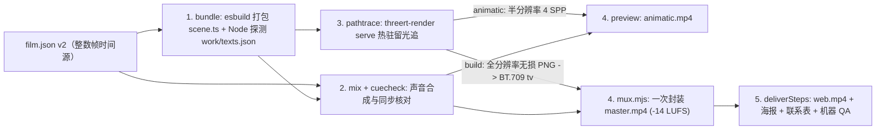

# 北冥光追路线工程手册（D · `d-pathtrace`）

> 读者：维护 `engine/pathtrace/`、`tools/film/lib/pathtrace-steps.mjs` 与 D 路线护栏的工程开发者｜状态：工程实施手册｜依据：[决定书](../decisions/2026-11-10-industrial-baseline.md) D04、D08、D09、D10、D13

做作品请直接读 **[D 路线手册](../../routes/d-pathtrace/README.md)**（新建、三道闸、目录、工艺与常见坑都在那里）。本页记录 D 路线（**北冥光追 · 物理路径追踪**）的引擎分层、外部运行时版本锁、打包与探测协议、去字对照对比度测量、帧级缓存以及远程工作站协同设计。

## 1. 路线定位与合规边界（D13）

- **对外品牌名**：固定为 **北冥光追 · 物理路径追踪**（`id: "d"`，`slug: "d-pathtrace"`，`backend: "pathtrace"`），产品与路线名不带 `RTX`，也不用上游项目名 `ThreeRT` 命名目录、文件、脚本或环境变量（遵守 D04，`UPSTREAM_NAME_RE = /raea|vork|threert/i` 由机器检查阻断）。
- **底层开源许可**：调用第三方原生路径追踪运行时 `ThreeRT`（`meshy-dev/ThreeRT`，**MIT 许可**，2026 Meshy LLC；可选启用 Intel Open Image Denoise `Apache-2.0` 降噪库，授权登记见 [register.md](../rights/register.md) R15）。与 B 路线不同，D 路线底座无 FSL 竞争性限制，成片与管线可全商业使用；但按 D10 存储分层与源码边界，主仓不提交运行时二进制与 `OIDN` 动态库，D 路线的两个目录（`engine/pathtrace/`、`routes/d-pathtrace/`）内不放 `.rs` / `.wesl` / `.wgsl` / `Cargo.toml` 文件，由 `tools/repo-check/rules/route-d/runtime-and-template.mjs` 与 `comp.fsl-boundary` 把关；核心帧源的源码边界见[核心帧源的源码边界](../decisions/2026-11-23-core-source-boundary.md)（草案，待用户确认）。
- **与 B 路线及 A/C 离屏出片的关系**：B 路线（北冥原生 · BNE）及实验后端 `b:rt` 保持现状不变；A、C 的 `webgpu` 离屏出片（D12）用于北冥三渲二与 86 式风格化；需要硬件全局光照、面光源软阴影、拉丝金属镜面反射或体积烟火奇观的新作品直接走 D 路线。

## 2. 直通出片架构（砍掉二次翻拍）

D 路线由 `tools/film/lib/pathtrace-steps.mjs` 接入统一的 `npm run film -- stills | animatic | build | render`，原生无损 8-bit BT.709 PNG 序列直通 `engine/render/lib/mux.mjs`（支持默认 `libx264` CRF 14 与 `--encoder nvenc` 硬编），省去无头浏览器二次翻拍与二次有损编码：



## 3. 核心模块契约

### 3.1 运行时锁与解析（`engine/pathtrace/runtime.mjs`）

- **锁文件 `engine/pathtrace/runtime.lock.json`**：记录 `schemaVersion: 1`、`upstream: "ThreeRT (meshy-dev/ThreeRT)"`、40 位 `commit`、语义化版本 `version`（如 `0.1.1-beiming.1`）、`license: "MIT"`，以及 `linux-x64`、`macos-arm64`、`windows-x64` 三平台的 `binary` 相对路径、`binarySha256`（64 位十六进制）与如实标注的布尔值 `oidn`。
- **查找顺序**：优先读环境变量 `BEIMING_PT_BIN`；未设置时自动解析 `~/.cache/beiming/pathtrace/<version>/bin/threert-render`（Windows 下 `.exe`），同时定位同级 `presets/`（`cinematic.json`、`preview.json`）与 `sdk/`（供 `esbuild` 解析 `@threert/scene` 与 `@threert/gameplay`，无需额外检出外部源码仓）。
- **命令约定**：`node engine/pathtrace/runtime.mjs status | check [--json]` 遵守 [docs/CLI.md](../CLI.md) 信封与退出码（缺二进制或哈希不符退 `3`，`--help` 零副作用）。

### 3.2 `film.json` v2 `pathtrace` 段与时间源防坑

在 `engine/production/film.js` 与 `film.schema.json` 中登记顶层可选段 `pathtrace`：

| 字段 | 类型与取值 | 说明 |
|---|---|---|
| `preset` | `"cinematic"` \| `"preview"` | 渲染预设，正式出片默认 `"cinematic"`，`animatic` 自动降为 `"preview"` |
| `spp` | 正整数 | 全局默认每像素采样数（模版默认 `24`） |
| `animaticSpp` | 正整数 | 动态预演每像素采样数（默认 `4`） |
| `denoise` | `"auto"` \| `"oidn"` \| `"wavelet"` \| `"none"` | `"auto"` 在运行时 `oidn: true` 时启用 OIDN，否则走内置引导降噪 |
| `seed` | 整数 | 场景确定性随机种子 |
| `shotSpp` | `Record<ShotId, 正整数>` | 按镜头 ID 覆盖采样数（如 `{ "S02": 48 }`），键必须存在于 `shots[]` |
| `overlay` | `"none"` \| `"page"` | 是否在封装前叠合透明页面字幕层 |
| `note` | 字符串（可选） | 采样预算说明 |

> **为什么 `shotSpp` 只按镜头 ID 索引**：`engine/production/film.js` 的 `isTimeLikeField` 会将白名单之外带 `frame / sec / in / out / dur` 词根的键判为「无消费者的时间字段」（exit 4）。按镜头 ID 映射后，切点只在 `shots[]` 维护一份，`film.js retime` 重排切点时高采样区间自动跟随镜头移动。

### 3.3 纯 ESM 场景 SDK 与三维微晶 HUD（`engine/pathtrace/`）

为兼容 Node 22.0+（不依赖 `--experimental-strip-types`），`engine/pathtrace/` 场景底座采用纯 JavaScript 模块加配套 `.d.ts` 类型声明，`bundle.mjs` 同时兼容作品导入 `index.js` 或 `index.ts`：

- **`definePathtraceFilm(factory)`**（`index.js` + `index.d.ts`）：
  - 在 `threert-render serve` 的 QuickJS 运行时内桥接 `defineGame`，从作业载荷读取 `state.frame` 与 `state.hideTexts`，计算当前所属镜头 `shot`、`localFrame`、`localT`、`shotProgress`，调用 `renderFrame(frame, ctx)`。
  - 在 Node 探测阶段暴露 `.probeFilm({ film, width, height, fps })`，逐帧调用 `textsAt(frame, ctx)` 收集屏幕像素框并写出 `work/texts.json`。
- **`placeInCameraFrustum` 与 `projectBoxToPixels`**（`camera.js` + `camera.d.ts`）：
  - 根据相机位置、朝向、垂直 `fov` 与画幅宽高比，把近裁面三维铭牌精确摆放到目标像素矩形 `[x, y, w, h]`，并强制将局部 Z 厚度钳制在 `z ≤ 0.0015` 米（`1.5 mm`），消除广角透视侧壁拉伸。
  - `projectBoxToPixels` 将世界空间网格或包围盒反投回像素坐标，保证 `work/texts.json` 里的安全区检测框与真实光追成片逐像素对齐。
- **`createWaferHudMaterial`**（`hud.js` + `hud.d.ts`）：
  - 注入 `o.base = vec3<f32>(0.0); o.specular = 0.0;`，彻底屏蔽电介质默认的 `4%` 菲涅尔反射，防止近距高强聚光灯扫过前景时把暗底 HUD 洗成灰白色块。
- **去字对照帧对比度门禁**：对 `work/texts.json` 中每条文字的峰值帧，编排器额外向 `threert-render serve` 发送一条 `state: { frame, hideTexts: true }` 对照帧作业，供 `tools/qa` 计算世界内三维文字与真实光追背景的 WCAG 相对亮度对比度（`≥ 3:1` 硬门）。

### 3.4 帧级缓存与远程工作站协同

- **热进程 JSONL 渲染**：`pathtrace` 步骤启动单个常驻 `threert-render serve --presets <presetsDir>` 进程，经标准输入逐行喂入帧作业 JSON，避免逐帧冷启动 Vulkan / Metal 设备与重编着色器。
- **单帧内容寻址缓存**：帧缓存键由 `scene.bundle.js` 哈希、分辨率、帧号、帧 `spp`、`preset`、`denoise`、`seed` 共同决定，存放在 `out/cache/pt-frames/<sceneKey>/f_NNNNNN.png`。修改单个镜头的 `shotSpp` 或局部重渲（`npm run film -- render films/<名> --shot S02`）时，其余镜头直接硬链接命中缓存。
- **本机与远程 5090 分工**：日常在开发机独显上跑 `stills` 与 `animatic` 过前两道闸；高采样全片或 4K 交付通过 [`tools/remote/cli.mjs`](../../tools/remote/README.md) 按提交哈希派发到远程工作站隔离工作树执行，校验哈希后拉回本地 `films/<名>/out/`。

## 4. 工程改动的自检清单

改动 `engine/pathtrace/`、`tools/film/lib/pathtrace-steps.mjs` 或 `routes/d-pathtrace/` 后，按顺序跑通以下命令再合入：

```sh
node tools/run-tests.mjs --only production,cli,film,env,pathtrace,governance,qa
npm run check:repo
npm run comp:scan && npm run comp:rights
npm run env:doctor -- --route d
node tests/ci/smoke-render.mjs --only d-render --golden off
```

在有硬件 GPU 的机器上补跑端到端冒烟：`npm run new -- d pt-smoke --title 光追冒烟` → `stills` → `animatic` → `build`，核对两次 `--no-cache` 的帧哈希逐帧一致，验证完毕后清理临时 `films/pt-smoke/` 目录。
