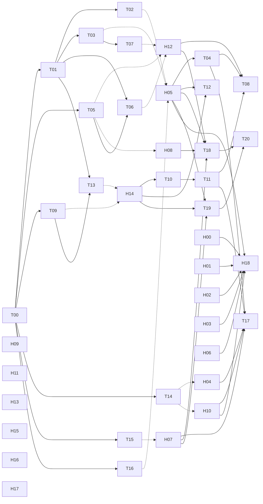

# 引擎工程待办与多代理分工

> 读者：分派与领取引擎、工具工程任务的人｜状态：任务卡由 work-plan.json 生成，状态以 JSON 为准｜依据：[决定书](../decisions/2026-11-10-industrial-baseline.md) D06

做作品不看这一页：新片按[三路线总指引](../../routes/README.md)选路线，用 `npm run new` 建作品，作品的进度由 `film.json` 与 `films/<名>/review/` 记录（D06）。这一页只管引擎与工具的工程任务：T 编号是早先拆出的工程任务，H 编号是工业级加固的 19 个工作包（H00–H17 对应 P00–P17，H18 对应 PZ）。机器可读的状态在 [work-plan.json](work-plan.json)，下面的依赖图与任务卡都由它生成。

## 怎样领取工作

```sh
npm run plan:check                           # 结构、依赖、认领与过期、证据与指引路径、写入范围冲突
npm run plan:next -- --route a               # 依赖已满足、可以领取的任务（a / b / c / shared）
node tools/work-plan.mjs --verify-diff H02   # 改动是否都落在该任务的写入范围里（基线默认取认领记录）
node tools/work-plan.mjs --check --strict --json
```

旧名 `npm run routes:check`、`npm run routes:next` 保留一个版本，调用时提示改名。命令约定（退出码、`--json` 信封）见 [docs/CLI.md](../CLI.md)。

- **可以领取**：`plan:next` 列出的任务前置依赖都已 done；领取前还要确认素材与验收输入齐备。
- **领取**：集成负责人把任务改成 `in-progress` 并写 `claim`（谁、在哪个分支或会话、从哪个提交开始、`startedAt`）。认领默认 14 天到期（计划的 `claimTtlDays`），还在做就改 `expiresAt` 续期。工具只读，不替人改状态。
- **完成**：写 `evidence` 再改成 `done`。`file` 与 `result` 要在仓库里，`commit` 要能在 git 里找到，`command` 写实际跑过的命令与结果；只写了文档不算完成。
- **取代**：不再单独做的任务标 `superseded`，写明被谁取代、为什么；依赖它的任务改依赖取代者。

## 检查规则

| 情形 | 结果 |
|---|---|
| 结构错误：字段、状态、路线、认领格式、依赖不存在或成环、done 缺证据或前置未完成、依赖了被取代的任务 | 退出 4 |
| 两个在办任务（in-progress / blocked）写入范围重叠 | 退出 4 |
| 认领过期 | 退出 4 |
| 证据文件、证据提交或详细指引不存在，证据文件的 sha256 变了 | 退出 4 |
| 可领取任务之间、可领取与在办任务之间写入范围重叠 | 提示；`--strict` 时退出 4 |
| 未完成任务的输入里写了不存在或不完整的路径 | 提示；`--strict` 时退出 4 |
| 未完成任务的写入范围首段在仓库里不存在，也没登记在 `newRoots`（计划新增的根目录与根文件） | 提示；`--strict` 时退出 4 |
| `--verify-diff` 有越出写入范围的改动（含未提交、未跟踪的文件） | 退出 4 |
| 未知路线、未知任务、参数冲突 | 退出 2，并列出合法取值 |

路径比较按 Mac / Windows 共用工作区保守处理大小写与 Unicode 等价名；它是词法提醒，不是文件锁，也不解析符号链接。工具只核对证据在不在，不判断截图或日志的内容是否合格，那一步仍由集成负责人复核。

## 多代理编排规则

1. 集成负责人独占根文档、注册文件（`package.json`、`package-lock.json`、`.gitignore`）与 `work-plan.json` 的状态更新；代理在汇报里写修改建议。
2. 先按任务卡分配唯一的写入范围。两个任务命中同一文件或目录时，先拆分或串行，不用后写覆盖前写；CI 里的 `--strict` 守住这一条。
3. 每个代理交付实际变更文件、验证命令及结果、未完成项和关键证据。只读了源码就写「源码核对」；没在 Windows 上重跑，就不写成 5090 验证。
4. 改共享契约（film.json 字段、页面约定、`engine/` 已有接口、命令约定）先通知集成负责人统一字段与版本，再改消费者。
5. 技术通过与创作通过分别判断；「已交付」「用户已认可」只能由用户确认的记录生成（D08）。
6. `blocked` 保留写入范围；移交由集成负责人先调整任务范围，不以等待素材为由允许覆盖。
7. 改了 `work-plan.json` 就重新生成下面这一段：`node tools/work-plan.mjs --cards`，用输出替换两行注释之间的内容；`node --test tools/work-plan.test.mjs` 会逐字核对。

<!-- plan:cards:begin 由 node tools/work-plan.mjs --cards 生成；改 work-plan.json 后重新生成这一段，tools/work-plan.test.mjs 逐字核对 -->

## 依赖总览

实线箭头：前置依赖（箭头指向后做的任务）；虚线箭头：被取代（指向取代它的任务）。



## 任务卡

### T00 · 固定现有源码与实验基线

- 路线：`shared`；角色：集成负责人；状态：`done`。
- 依赖：无。
- 输入：现有 Three 样片与 RAEA 10 秒实验。
- 写入范围：`docs/raea/`。
- 交付：固定提交源码对照和历史运行证据。
- 验收：明确源码阅读、实跑验证和未完成能力。
- 证据：`docs/raea/architecture.md`；`docs/raea/experiment-qa.json`；`docs/raea/publication-validation.json`；提交 `b529852`（源码对照）。
- 详细指引：[README.md](../raea/README.md)。

### T01 · 项目记录与结果契约的最小实现

- 路线：`shared`；角色：契约工程师；状态：`done`。
- 依赖：T00。
- 输入：docs/routes/contracts.md；docs/routes/templates/project-*.json 与 docs/routes/templates/render-result.json。
- 写入范围：`engine/production/project.js`、`tests/production/project.test.mjs`。
- 交付：字段校验与路径解析函数；版本不匹配/无效路径诊断。
- 验收：两条路线均可记录；不强制 RAEA 使用 FrameState；拒绝越界路径和不完整输出定义；不把计划 GPU 字段写成已执行 GPU。
- 证据：`engine/production/project.js`；`tests/production/project.test.mjs`；`node --test tests/production/project.test.mjs`（c16f0b7 时 13 项通过，62ad28e 后为 20 项）；提交 `c16f0b7`（实现；校验器当时只在测试中被调用，渲染器不读项目记录）。
- 详细指引：[contracts.md](contracts.md)。

### T02 · 统一资产身份与可回读验证

- 路线：`shared`；角色：资产工程师；状态：`superseded`。
- 取代：由 H05 取代；作品描述包的 engine/assets 就是 T02（资产 ID 与 sha256 清单）。
- 依赖：T01。
- 输入：现有 GLB 导出/回读脚本；自有二维底板和三维模型。
- 写入范围：`engine/assets/manifest.js`、`tools/assets/inspect.mjs`、`tests/assets/`。
- 交付：AssetManifest 和导出版本关系；坐标/单位/clip/材质检查报告。
- 验收：单位、前向、骨骼与片段可核对；不把屏幕后期当成 GLB 自带能力；修改文件内容后哈希与缓存失效可检出。
- 详细指引：[contracts.md](contracts.md)。

### T03 · 北冥镜头和帧状态纯函数采样

- 路线：`a`；角色：时间与状态工程师；状态：`superseded`。
- 取代：由 H05 取代；镜头选择与帧状态并入作品描述包的 engine/production（shot.js、state.js、timeline.js）。
- 依赖：T01。
- 输入：engine/stage/film.js；engine/core/clock.js；src/main.js 与三镜头。
- 写入范围：`engine/production/shot.js`、`engine/production/state.js`、`tests/production/state.test.mjs`。
- 交付：半开区间镜头选择；FrameContext/FrameState 最小采样器。
- 验收：同一帧顺序/跳帧/倒退采样状态一致；全局和镜头局部时间不混淆；切镜头不重启持续游动相位；加入原版 setPose 在 look 调用前后切换 Euler 顺序的 CPU 回归；修复策略须验证旧片基准，不把存在 render(t) 等同随机访问已通过。
- 详细指引：[contracts.md](contracts.md)。

### T04 · 为现有 Three 镜头建立兼容适配

- 路线：`a`；角色：Three 集成工程师；状态：`planned`。
- 依赖：H05。
- 输入：原版主片固定帧；现有 update(t,f)/look(t)。
- 写入范围：`engine/backends/three/`、`tests/backends/three/`。
- 交付：最小 Three BackendAdapter；旧镜头兼容夹具与对照帧（tests/backends/three/）。
- 验收：原片 source 不被实验覆盖；既有全局时间语义保持；像素或可解释视觉差异记录齐全。
- 详细指引：[beiming-style.md](beiming-style.md)。

### T05 · 建立北冥风格校准场景与变量实验

- 路线：`a`；角色：风格工程师；状态：`superseded`。
- 取代：由 H12、H08 取代；A 路线包的 lab/ 含 T05 的校准场景；风格基线目录 docs/style-baselines/ 归金标准包。
- 依赖：T00。
- 输入：src/toon.js 与 src/look.js；原版固定关键帧。
- 写入范围：`lab/style-calibration/`、`lab/style-calibration.js`、`docs/style-baselines/`。
- 交付：固定模型/相机/光照的校准页；色阶、阴影、rim、描边、笔触逐项变体。
- 验收：控制单个变量并记录实际参数；1080/4K 设计像素含义明确；每个保留风格有近中远景与运动证据。
- 详细指引：[beiming-style.md](beiming-style.md)。

### T06 · 从影片预设提炼视觉规范及参数版本

- 路线：`a`；角色：风格规范工程师；状态：`superseded`。
- 取代：由 H12 取代；A 路线包的 engine/style 就是 T06（风格注册表 beiming-original@v1）。
- 依赖：T05、T01。
- 输入：校准场景和选定画风；contracts 的颜色和单位规范。
- 写入范围：`engine/style/`、`tests/style/`。
- 交付：版本化 StyleSpec；Three 参数映射及未知参数诊断。
- 验收：默认值与原片参数来源可追溯；线性/sRGB 转换点明确；新风格不覆盖旧风格基线。
- 详细指引：[beiming-style.md](beiming-style.md)。

### T07 · 二维人物关键姿态和完整动作事件

- 路线：`a`；角色：二维表演工程师；状态：`superseded`。
- 取代：由 H12 取代；A 路线包的 engine/performance 就是 T07（pose2d 与二维人物）。
- 依赖：T03。
- 输入：engine/paint；src/girl.js；4–6秒注意到鲲的事件表。
- 写入范围：`engine/performance/pose2d.js`、`examples/performance-2d/`。
- 交付：抬头、视线转移、手部松开的关键姿态；状态可采样的动作片段。
- 验收：三个动作节点可从静帧辨认；手/物体接触和遮挡正确；完整观看确认事件推进，非只有呼吸摆动。
- 详细指引：[beiming-style.md](beiming-style.md)。

### T08 · 北冥画风在原生运行时上的执行适配试点

- 路线：`a`；角色：跨后端材质工程师；状态：`planned`。
- 依赖：T04、H12、T11。
- 输入：固定 FrameState 与相同 GLB；Three 风格校准场景。
- 写入范围：`engine/native/style/`、`films/beiming-native-calibration/`。
- 交付：同镜头两侧渲染；色阶/阴影/轮廓/alpha/后期差异矩阵。
- 验收：不把 GLSL 字符串直接当 WESL；每项等价与不等价有关键帧证据；ID 墨线/Kuwahara 未实现时明确标缺。
- 详细指引：[beiming-style.md](beiming-style.md)。

### T09 · RAEA 独立新作品目录与基础场景

- 路线：`b`；角色：原生场景工程师；状态：`superseded`。
- 取代：由 H14 取代；engine/native 通用原生层（b6bbd44）已实现独立作品目录与基础场景，由 B 路线包维护（D06）。
- 依赖：T00。
- 输入：examples/raea 已跑通例片；固定 RAEA runtime 与 SDK。
- 写入范围：`examples/raea-starter/`。
- 交付：不依赖原片鲲和底板的最小原生项目；独立 TSX/资源/声音/输出目录。
- 验收：能创建自己的视觉目标与素材；不必等待北冥 FrameState；明确 Composition 和脚本中时长/尺寸所有来源。
- 详细指引：[raea-native.md](raea-native.md)。

### T10 · 原生二维三维合成能力夹具

- 路线：`b`；角色：原生合成工程师；状态：`planned`。
- 依赖：H14。
- 输入：Canvas3D/ImagePlane/Model SDK；自有透明底板和测试几何。
- 写入范围：`tests/native/fixtures/layers/`。
- 交付：相机/透明/雾/字体/阴影的最小夹具；每项截图和运行状态。
- 验收：能区分层级排序、深度与 alpha 错误；字体在目标平台实际显示；缺失资源或 shader 错误不能靠输出文件存在判成功。
- 详细指引：[raea-native.md](raea-native.md)。

### T11 · 原生材质与后期扩展夹具

- 路线：`b`；角色：WESL 材质工程师；状态：`planned`。
- 依赖：T10。
- 输入：ToonMaterial/ShaderMesh/FramePass；RAEA 源码已核对的绑定限制。
- 写入范围：`tests/native/fixtures/materials/`。
- 交付：反照率/光照/轮廓/全屏 pass 逐层演示；原生自由画风示例。
- 验收：明确纹理和 uniform 的输入语义；材质、后期、compute 三个扩展点不混用；不要求采用北冥原版后期。
- 详细指引：[raea-native.md](raea-native.md)。

### T12 · 原生运行时上的骨骼角色与目标约束事件

- 路线：`b`；角色：三维表演工程师；状态：`planned`。
- 依赖：H14、H05。
- 输入：自有绑定角色和动作；Character/clip/goals 实际 API。
- 写入范围：`tests/native/fixtures/character/`。
- 交付：手脚接触、视线、动作混合的4–6秒片段；绑定与动作重定向记录。
- 验收：角色与动作资产真实存在；手脚接触和目标空间转换稳定；不拿鲲眨眼替代真人物表演验证。
- 详细指引：[raea-native.md](raea-native.md)。

### T13 · RAEA 项目级运行包装与参数解耦

- 路线：`b`；角色：原生运行工程师；状态：`superseded`。
- 取代：由 H14 取代；engine/native 与 engine/render/native.mjs（b6bbd44）已是项目级运行包装，由 B 路线包维护（D06）。
- 依赖：T09、T01。
- 输入：现有入口 examples/raea/tools/render.mjs 与 examples/raea/tools/prepare.mjs；项目记录契约 docs/routes/contracts.md。
- 写入范围：`engine/backends/raea/run.mjs`、`tests/backends/raea/`。
- 交付：独立项目入口/尺寸/帧数/音频配置；一致的结果记录与失败退出。
- 验收：摆脱固定10秒/固定media清单；不影响现有10秒示例；实际 runtime、图形和编码路径分别记录。
- 详细指引：[raea-native.md](raea-native.md)。

### T14 · 共享5090工作台互斥与运行证据

- 路线：`shared`；角色：工作站工程师；状态：`superseded`。
- 取代：由 H04、H10 取代；渲染槽位、输出锁与 GPU 守卫归渲染器包；控制机与工作站协作协议 tools/remote 归环境包。
- 依赖：T00。
- 输入：现有 ComfyUI/利用率预检；目标机可用工具与进程查询。
- 写入范围：`tools/workstation/`。
- 交付：不终止任务的等待/拒绝与作业互斥协议；版本/适配器/占用/日志采集。
- 验收：队列未知与队列空区分；抢占竞争有明确策略且不kill；Windows脚本在目标机实际验证后才标完成。
- 详细指引：[validation-and-rtx.md](validation-and-rtx.md)。

### T15 · 统一技术验收与结果报告

- 路线：`shared`；角色：QA 工程师；状态：`superseded`。
- 取代：由 H07 取代；统一技术验收就是机器 QA 门 tools/qa。
- 依赖：T00。
- 输入：两路线历史产物；ffprobe/FFmpeg 检查方法。
- 写入范围：`tools/qa/`、`tests/qa/`。
- 交付：完整解码/黑场/静帧/响度/音画检查；结构化技术报告。
- 验收：预期帧数来自当前项目而非固定240；指标失败有退出码和证据；技术通过不自动把创作验收标通过。
- 详细指引：[validation-and-rtx.md](validation-and-rtx.md)。

### T16 · 风格与动作的人工验收记录

- 路线：`shared`；角色：视觉验收负责人；状态：`superseded`。
- 取代：由 H05 取代；人工验收记录并入作品描述包的创作闸门与 docs/creative-review/。
- 依赖：T00。
- 输入：选定视觉基准与visibleEvents；原片及迁移实验观察结果。
- 写入范围：`docs/creative-review/`。
- 交付：可见事件、空间、风格、剪辑检查表；逐项通过/失败与关键帧证据。
- 验收：每个镜头有信息变化；风格对齐与原生自由风格使用不同基准；失败镜头可定位到动作/模型/灯光/后期层。
- 详细指引：[validation-and-rtx.md](validation-and-rtx.md)。

### T17 · 同内容目标下的受控性能实验

- 路线：`shared`；角色：性能工程师；状态：`planned`。
- 依赖：T04、T11、H04、H10、H07。
- 输入：可比较的镜头资产与画质目标；闲置工作台与已知编码路径。
- 写入范围：`tools/bench/`、`docs/benchmarks/`。
- 交付：冷启动/预热/渲染/读回/编码分段统计；性能与画质并列报告。
- 验收：共享负载与设备信息可复核；不同内容不能直接宣称倍数提升；Vulkan不标为NVENC或光追。
- 详细指引：[validation-and-rtx.md](validation-and-rtx.md)。

### T18 · A 路线 30 秒多事件验收段落

- 路线：`a`；角色：北冥路线集成负责人；状态：`planned`。
- 依赖：H12、H08、H07、H05。
- 输入：锁定画风；至少两个连续叙事事件。
- 写入范围：`films/beiming-sequence-30s/`。
- 交付：30秒连贯镜头与工程；技术和创作双验收。
- 验收：不是延长游动循环凑时长；角色/道具/光照状态跨镜头连续；对照预告片画风并列出偏差。
- 详细指引：[beiming-style.md](beiming-style.md)。

### T19 · B 路线 30 秒独立作品验收

- 路线：`b`；角色：原生路线集成负责人；状态：`planned`。
- 依赖：H14、H07、H05。
- 输入：自有视觉目标；原生场景夹具（T10、T11）；人物表演按作品需要选做（T12）。
- 写入范围：`films/native-sequence-30s/`。
- 交付：30秒独立风格原生作品；可重建项目记录。
- 验收：不被北冥模板或固定10秒限制；动作和场景能力真实出现在画面；工程可在记录的目标机复现。
- 详细指引：[raea-native.md](raea-native.md)。

### T20 · 三路线发布与 agent 入口更新

- 路线：`shared`；角色：发布集成负责人；状态：`planned`。
- 依赖：T18、T19。
- 输入：A、B 两条路线的 30 秒验收结果；源码、版本、参数与交付记录。
- 写入范围：`README.md`、`ROUTES.md`、`AGENTS.md`、`docs/releases/`。
- 交付：版本化入口和复现命令；完成状态与剩余问题清单。
- 验收：计划与已实现状态同步；三条路线都能从入口走通；不包含机器私有路径或未经确认的运行结果。
- 详细指引：[work-breakdown.md](work-breakdown.md)。

### H00 · P00 决策与冻结点

- 路线：`shared`；角色：集成负责人；状态：`in-progress`。
- 认领：集成负责人；会话 `routes-template`；基线 `abfdc83`；2026-11-10 起，2026-12-15 到期（集成负责人 2026-11-10 续期：加固工作流各包仍在并行开发，原定 11-24 到期赶不上集成；续到 12-15，与合规待修豁免的到期日一致）。
- 依赖：无。
- 输入：决定书 docs/decisions/2026-11-10-industrial-baseline.md 的 D01–D11（全部）；差距 GAP-14（加固差距清单）。
- 写入范围：`docs/decisions`、`package.json`、`package-lock.json`、`.gitignore`。
- 交付：D01–D11 决定书；F0、F1、F2 冻结点与合入顺序；package.json、package-lock.json、.gitignore 的登记。
- 验收：docs/decisions/D01…D11 各一份，含「决定 / 理由 / 影响的包 / 决定人 / 日期」；F0、F1 时 git merge-base --is-ancestor 验证在建提交均已进入 main；P02·M2 之后：node tools/work-plan.mjs --check --strict --json → ok:true（H 任务同波次写入范围不重叠）。
- 详细指引：[2026-11-10-industrial-baseline.md](../decisions/2026-11-10-industrial-baseline.md)。

### H01 · P01 合规：止损、历史清理与许可治理

- 路线：`shared`；角色：合规包属主；状态：`done`。
- 认领：P01 属主代理（加固工作流）；会话 `hard/P01`；基线 `abfdc83`；2026-11-10 起，2026-11-24 到期。
- 依赖：无。
- 输入：决定书 docs/decisions/2026-11-10-industrial-baseline.md 的 D02、D03、D04；差距 COMP-01、GAP-11、COMP-13、COMP-02、COMP-09、GAP-13、COMP-04、COMP-08、COMP-07（加固差距清单）；前置里程碑 P02.M0（按里程碑对接，不等整包完成）。
- 写入范围：`LICENSE`、`REUSE.toml`、`LICENSES`、`SECURITY.md`、`.mailmap`、`docs/rights`、`tools/compliance`、`tools/repo-check/rules/comp`、`tests/comp`。
- 交付：受限资产止损（需用户授权）；docs/rights/ 授权台账；REUSE 许可标注与 SECURITY.md；check:repo 的 comp 规则；FSL 与 LemoLab 署名边界说明。
- 验收：1a（需用户授权）：gh release view casebook-2026.11 --json assets 不再含 node tools/compliance/restricted-packs.mjs 列出的受限包；1b：node tools/repo-check.mjs --only comp --json → 0 error（密钥、本机路径、内网地址、签名 URL、FSL 文本误入 MIT 目录、派生文件缺来源头）；1b：gh repo view --json licenseInfo -q .licenseInfo.key → mit；REUSE 规则检查通过；1c：git log --all --format=%ae | sort -u 只剩 noreply；git log --all -- <清单路径> 为空。
- 证据：提交 `9f58ebe`（合并 hard/P01 进集成分支）；提交 `14f6c0d`（集成修复：comp 阻断级发现清零）；`node tools/repo-check.mjs --only comp --json`（2026-11-10 集成后 0 error；包状态 ready。仍待：1a 撤下受限 Release 资产要用户授权，licenseInfo 要推送后核对，1c 按 D02 不改写历史，39 个授权字段待用户补，派生文件来源头等 P13、P04、P06 修（待修豁免 12-15 到期））。
- 详细指引：[2026-11-10-industrial-baseline.md](../decisions/2026-11-10-industrial-baseline.md)。

### H02 · P02 治理骨架：路线注册表、命令约定、规范检查框架、新建作品、工程计划

- 路线：`shared`；角色：治理骨架属主；状态：`done`。
- 认领：P02 属主代理（加固工作流）；会话 `hard/P02`；基线 `abfdc83`；2026-11-10 起，2026-11-24 到期。
- 依赖：无。
- 输入：决定书 docs/decisions/2026-11-10-industrial-baseline.md 的 D01、D04、D06；差距 ENTRY-01、ENTRY-10、ENTRY-03、TOOLS-15、ORCH-11、ORCH-12、ENTRY-13、TOOLS-02、ENTRY-07（加固差距清单）；前置里程碑 F0、P05.M0（按里程碑对接，不等整包完成）。
- 写入范围：`routes/README.md`、`routes/routes.json`、`tools/new-film.mjs`、`tools/repo-check.mjs`、`tools/repo-check/core`、`tools/repo-check/rules/core`、`tools/lib`、`tools/work-plan.mjs`、`tools/work-plan.test.mjs`、`docs/routes/README.md`、`docs/routes/work-plan.json`、`docs/routes/work-breakdown.md`、`docs/CLI.md`、`tests/cli`、`tests/governance`。
- 交付：路线注册表 routes/routes.json；命令约定库 tools/lib/；可插拔规范检查 tools/repo-check/；new-film 生成并校验 film.json v2；引擎工程待办 v2（plan:check、plan:next、verify-diff）；docs/CLI.md 与 tests/cli、tests/governance。
- 验收：node tools/work-plan.mjs --ready --route c --json → exit 0；--route nope → exit 2 并列出注册表里的合法取值；node tools/new-film.mjs a t8 --title 试映 --json --dry-run → exit 0 且 git status 无变化；正式生成后 node engine/production/film.js check films/t8 → exit 0；重复生成 → exit 2；node --test tests/cli tests/governance tools/work-plan.test.mjs 全过；contract.test 覆盖 package.json 全部脚本（--help 无副作用、未知参数 exit 2）；node tools/repo-check.mjs --json 在 main 上 exit 0；tests/governance/fixtures 的每种违规都给出对应规则 id 并 exit 4（附录 C1：契约不通过）。
- 证据：提交 `d2f4810`（合并 hard/P02 进集成分支）；提交 `cdcf92b`（集成修复：规则加载器认域模块写法）；提交 `ab01fea`（集成修复：契约测试覆盖 38 个 npm 脚本）；`node --test tests/cli tests/governance tools/work-plan.test.mjs`（2026-11-10 集成后全过；包状态 ready。new-film 与 film.js 的两条联调用例等 P05 合入后自动启用）。
- 详细指引：[CLI.md](../CLI.md)。

### H03 · P03 agent 执行层与指令优先级

- 路线：`shared`；角色：agent 执行层属主；状态：`in-progress`。
- 认领：P03 属主代理（加固工作流）；会话 `hard/P03`；基线 `abfdc83`；2026-11-10 起，2026-12-15 到期（集成负责人 2026-11-10 续期：加固工作流各包仍在并行开发，原定 11-24 到期赶不上集成；续到 12-15，与合规待修豁免的到期日一致）。
- 依赖：无。
- 输入：决定书 docs/decisions/2026-11-10-industrial-baseline.md 的 D01–D11（全部）；差距 ENTRY-02、COMP-10、GAP-07、GAP-08（加固差距清单）；前置里程碑 P02.M0（按里程碑对接，不等整包完成）。
- 写入范围：`CLAUDE.md`、`.claude/settings.json`、`.claude/skills`、`.claude/hooks`、`.githooks`、`.ignore`、`cases/vendor/README.md`、`tools/repo-check/rules/agent`、`tests/agent-layer`。
- 交付：根目录 CLAUDE.md 桥接到 AGENTS.md；.claude 钩子与技能；vendor 里的上游指令只当资料；check:repo 的 agent 规则。
- 验收：test -f CLAUDE.md && grep -qx '@AGENTS.md' CLAUDE.md；node --test tests/agent-layer：hook 对写 cases/vendor/**、src/**、git add -A 返回阻断；对写 films/<名>/** 放行；rg -l 'window.render' 在 cases/ 下 0 命中；rg --no-ignore -l 'window.render' cases 仍 ≥200；node tools/repo-check.mjs --only agent → 嵌套 AGENTS/CLAUDE/SKILL 文件与白名单一致。
- 详细指引：[2026-11-10-industrial-baseline.md](../decisions/2026-11-10-industrial-baseline.md)。

### H04 · P04 渲染器 v2

- 路线：`shared`；角色：渲染器属主；状态：`in-progress`。
- 认领：P04 属主代理（加固工作流）；会话 `hard/P04`；基线 `abfdc83`；2026-11-10 起，2026-12-15 到期（集成负责人 2026-11-10 续期：加固工作流各包仍在并行开发，原定 11-24 到期赶不上集成；续到 12-15，与合规待修豁免的到期日一致）。
- 依赖：无。
- 输入：决定书 docs/decisions/2026-11-10-industrial-baseline.md 的 D07、D09；差距 TOOLS-01、CODE-02、CODE-03、GAP-01、ENV-07、ORCH-09、QUAL-14、TOOLS-07、CODE-05、CODE-08、CODE-13、COMP-14、ENV-15、ENV-05、TOOLS-14、ORCH-06、TOOLS-06、QUAL-03、CODE-06、QUAL-04、QUAL-05、QUAL-06、TOOLS-05、CODE-07、ENV-06、ORCH-05、TOOLS-20、GAP-15、TOOLS-17、CODE-11、GAP-02（加固差距清单）；前置里程碑 P02.M0、P05.M0、P08.G0（按里程碑对接，不等整包完成）。
- 写入范围：`engine/render/page.mjs`、`engine/render/still.mjs`、`engine/render/video.mjs`、`engine/render/mux.sh`、`engine/render/serve.mjs`、`engine/render/shots.mjs`、`engine/render/README.md`、`engine/render/lib`、`tools/rtx`、`tests/render`、`docs/渲染与4K.md`、`tools/repo-check/rules/render`。
- 交付：渲染失败即停、不留进程与 .segs-*；run.json 运行记录；BT.709 tv 封装链与响度收口；镜头级渲染与续跑；GPU 守卫、渲染槽位与输出锁。
- 验收：R1：node --test tests/render/failure.test.mjs → 12 个失败夹具各在 30 s 内按退出码表退出，out/**/.segs-* 为空，无残留子进程；R2：每次渲染写 <out>.run.json，node engine/production/film.js validate-result <run.json> → exit 0；同一 --out 并发第二个 exit 5；R3：ffprobe → yuv420p/tv/bt709×3；node tools/baseline/golden.mjs compare --set beiming-core → 0 差异；25 fps 输入按 24 封装 → exit 4；终版 AAC −14±0.5 LUFS、TP ≤ −1.0；R4：--frames 72:120 → 48 帧；镜头缓存命中时 0 帧重渲；中途 kill 后 --resume 的 framemd5 与一次跑完相同；--plan 预测误差 ≤20%。
- 详细指引：[2026-11-10-industrial-baseline.md](../decisions/2026-11-10-industrial-baseline.md)。

### H05 · P05 作品描述、时间轴、状态与创作闸门

- 路线：`shared`；角色：作品描述包属主；状态：`in-progress`。
- 认领：P05 属主代理（加固工作流）；会话 `hard/P05`；基线 `abfdc83`；2026-11-10 起，2026-12-15 到期（集成负责人 2026-11-10 续期：加固工作流各包仍在并行开发，原定 11-24 到期赶不上集成；续到 12-15，与合规待修豁免的到期日一致）。
- 依赖：无。
- 输入：决定书 docs/decisions/2026-11-10-industrial-baseline.md 的 D01、D07、D08；差距 ORCH-01、ORCH-03、ORCH-14、ORCH-15、ORCH-02、ORCH-13、QUAL-11、CRAFT-02（加固差距清单）；前置里程碑 P02.M0（按里程碑对接，不等整包完成）。
- 写入范围：`engine/production`、`engine/assets`、`engine/core/tempo.js`、`docs/routes/contracts.md`、`docs/routes/templates`、`docs/creative-review`、`films/beiming-10s`、`tests/production`、`tests/assets`、`tools/repo-check/rules/spec`。
- 交付：film.json v2 校验器 engine/production/film.js；交付档位 profiles.json；时间轴与三道创作闸门（look → animatic → final）；docs/creative-review/ 的生产 SOP 与审片标尺；films/beiming-10s 镜像；资产清单 engine/assets。
- 验收：node --test tests/production tests/assets 全过（film.json v2 校验、三种历史时间轴写法、闸门规则、accepted 必须有人工评审）；node engine/production/film.js check routes/<a-webgl|b-native|c-style>/template --template --json → 三份均 exit 0；films/beiming-10s/film.json 镜像 + 一致性测试：改 src/main.js 镜头起点（临时副本）即失败；临时作品无 animatic 审批时 film render --final → exit 4；approve/waive 后放行并写 review/*.json（含审阅原话与文件 sha256）。
- 详细指引：[2026-11-10-industrial-baseline.md](../decisions/2026-11-10-industrial-baseline.md)。

### H06 · P06 出片编排 CLI（tools/film）

- 路线：`shared`；角色：出片编排属主；状态：`in-progress`。
- 认领：P06 属主代理（加固工作流）；会话 `hard/P06`；基线 `abfdc83`；2026-11-10 起，2026-12-15 到期（集成负责人 2026-11-10 续期：加固工作流各包仍在并行开发，原定 11-24 到期赶不上集成；续到 12-15，与合规待修豁免的到期日一致）。
- 依赖：无。
- 输入：决定书 docs/decisions/2026-11-10-industrial-baseline.md 的 D07、D08；差距 TOOLS-03、ORCH-10、ENTRY-05、TOOLS-08、TOOLS-19（加固差距清单）；前置里程碑 F0、P02.M0、P04.R1、P05.M0、P07.M0、P10.E1（按里程碑对接，不等整包完成）。
- 写入范围：`tools/film`、`engine/render/build.mjs`、`engine/render/events.mjs`、`build.sh`、`tools/contact_sheet.py`、`tools/make_html.py`、`tests/film`、`tools/repo-check/rules/film`。
- 交付：三条路线统一的出片命令 npm run film -- build films/<名>（build、render、mix、qa、approve 等子命令）；build.sh 改为《北冥》兼容壳；运行目录 films/<名>/out/<run-id>/。
- 验收：for r in a c：node tools/new-film.mjs $r ci-$r && node tools/film/cli.mjs build films/ci-$r --profile web-1080p24 --json → exit 0，产出 master/web/player/run.json/qa 报告，帧数 = film.json frameCount；sh build.sh（《北冥》兼容壳）在 P04·R3 前 video 中间件 framemd5 与改造前一致；R3 后 PNG 金标准零差异；--from mux 只重跑封装；运行后 $TMPDIR 无新增文件；接触印只含本次运行的帧；Windows CI（pwsh、无 Git Bash）：npm run film -- build films/ci-c → exit 0。
- 详细指引：[2026-11-10-industrial-baseline.md](../decisions/2026-11-10-industrial-baseline.md)。

### H07 · P07 机器 QA 门（tools/qa）

- 路线：`shared`；角色：机器 QA 属主；状态：`done`。
- 认领：P07 属主代理（加固工作流）；会话 `hard/P07`；基线 `abfdc83`；2026-11-10 起，2026-11-24 到期。
- 依赖：无。
- 输入：决定书 docs/decisions/2026-11-10-industrial-baseline.md 的 D07；差距 QUAL-02、ORCH-07、QUAL-08、CRAFT-09、GAP-03、QUAL-07（加固差距清单）；前置里程碑 P02.M0、P05.M0（按里程碑对接，不等整包完成）。
- 写入范围：`tools/qa`、`tests/qa`、`docs/quality`、`docs/routes/validation-and-rtx.md`、`tools/repo-check/rules/qa`。
- 交付：QA 报告 schema；delivery、visual、texts、plates 四组检查；已知问题台账 docs/quality/。
- 验收：node tools/qa/cli.mjs delivery out/beiming.mp4 --profile web-1080p24 --json：P04·R3 前因色彩标签 FAIL，R3 后 PASS；tests/qa 合成样本（25 fps、缺音轨、截短、黑帧、静帧 12 帧、单帧 +20 亮度、多余切点、缺字、文字越界）各自以指定检查项 FAIL；qa plates 对《北冥》与 B 例片报出 clouds_back / clouds_front_a / clouds_front_b 的直线淡出；docs/quality/known-issues.json 有 QA-A-001/002、QA-B-001/002；qa 报告可作为 RenderResult.technicalAcceptance.evidence 被 P05 的校验器解析。
- 证据：提交 `96a0df2`（合并 hard/P07 进集成分支）；`node --test "tests/qa/*.test.mjs"`（2026-11-10 集成后 52 项全过；包状态 ready。《北冥》跑 qa report 仍按实情 exit 4：AIGC 元数据等 P04、P06，texts 两项要用户批准豁免）。
- 详细指引：[2026-11-10-industrial-baseline.md](../decisions/2026-11-10-industrial-baseline.md)。

### H08 · P08 金标准基线、确定性与认可参照

- 路线：`shared`；角色：金标准属主；状态：`in-progress`。
- 认领：P08 属主代理（加固工作流）；会话 `hard/P08`；基线 `abfdc83`；2026-11-10 起，2026-12-15 到期（集成负责人 2026-11-10 续期：加固工作流各包仍在并行开发，原定 11-24 到期赶不上集成；续到 12-15，与合规待修豁免的到期日一致）。
- 依赖：无。
- 输入：决定书 docs/decisions/2026-11-10-industrial-baseline.md 的 D05；差距 QUAL-01、ENV-02、CRAFT-10、GAP-12、QUAL-10、ORCH-08（加固差距清单）。
- 写入范围：`tools/baseline`、`tests/golden`、`docs/style-baselines`、`media`、`tools/repo-check/rules/baseline`。
- 交付：金标准与确定性检查 tools/baseline（golden、determinism）；tests/golden 基线；media/PROVENANCE.json；认可参照与回归金标准分开存放。
- 验收：G0：node tools/baseline/golden.mjs capture --set beiming-core --set lab → tests/golden/<platformKey>/manifest.json；compare 在 HEAD 上 exit 0；lab 页查询参数扰动（如 test=look&lw=2）→ compare exit 1 并输出差异图；node tools/baseline/determinism.mjs . --seams --workers 4 → 0 差异；有状态反例夹具 → exit 4；media/PROVENANCE.json 覆盖 media/* 全部文件；D5 决定已执行；docs/style-baselines/POLICY.md 写明同后端 / 跨后端阈值与 --gpu 策略。
- 详细指引：[2026-11-10-industrial-baseline.md](../decisions/2026-11-10-industrial-baseline.md)。

### H09 · P09 测试入口、CI 与发布

- 路线：`shared`；角色：测试与 CI 属主；状态：`done`。
- 认领：P09 属主代理（加固工作流）；会话 `hard/P09`；基线 `abfdc83`；2026-11-10 起，2026-11-24 到期。
- 依赖：无。
- 输入：决定书 docs/decisions/2026-11-10-industrial-baseline.md 的 D09；差距 CODE-01、TOOLS-09、QUAL-13、ENTRY-14、CODE-14、CODE-09（加固差距清单）；前置里程碑 P02.M0、P04.R1、P08.G0、P10.E1（按里程碑对接，不等整包完成）。
- 写入范围：`.github/workflows/ci.yml`、`.github/workflows/release.yml`、`.github/dependabot.yml`、`tools/run-tests.mjs`、`tools/check-all.mjs`、`eslint.config.js`、`ruff.toml`、`.editorconfig`、`CHANGELOG.md`、`tests/ci`。
- 交付：统一测试入口 tools/run-tests.mjs 与 check-all.mjs；CI 工作流 ci.yml、release.yml；CHANGELOG.md。
- 验收：node tools/run-tests.mjs → 发现并运行 tests/**/*.test.mjs、tools/*.test.mjs 与 Python unittest，exit 0，unit job < 3 min；PR 上 unit、smoke-render（SwiftShader 金标准 linux-swiftshader、失败夹具、模版片 320×180 出片）、windows-paths 三个 job 为必需检查且全绿；在测试 PR 中故意改坏 engine/shade 锚点或 render(t) → CI 变红；推 v* 标签 → release.yml 跑完整 CI 并附接触印与静帧；CHANGELOG.md 有对应条目。
- 证据：提交 `1a7aa0a`（合并 hard/P09 进集成分支）；`node tools/run-tests.mjs`（2026-11-10 集成后已合入各域全过；包状态 needs-config：CI 还没在 GitHub 上首跑，分支保护、仓库变量与发布标签要用户授权，金标准清单等 P08）。
- 详细指引：[2026-11-10-industrial-baseline.md](../decisions/2026-11-10-industrial-baseline.md)。

### H10 · P10 环境、安装与跨平台

- 路线：`shared`；角色：环境包属主；状态：`done`。
- 认领：P10 属主代理（加固工作流）；会话 `hard/P10`；基线 `abfdc83`；2026-11-10 起，2026-11-24 到期。
- 依赖：无。
- 输入：决定书 docs/decisions/2026-11-10-industrial-baseline.md 的 D09、D10；差距 ENV-01、TOOLS-04、ENV-11、ENV-12、TOOLS-21、ENV-03、TOOLS-16、CODE-12、ENV-08、TOOLS-10、ENTRY-08、ENV-04、ENTRY-17、ENTRY-09、GAP-06、GAP-09（加固差距清单）；前置里程碑 P02.M0（按里程碑对接，不等整包完成）。
- 写入范围：`tools/env`、`tools/remote`、`requirements.txt`、`requirements.in`、`requirements.lock`、`.python-version`、`.nvmrc`、`.gitattributes`、`LARGE-FILES.allow`、`docs/ENVIRONMENT.md`、`docs/RTX工作站.md`、`tests/env`、`tools/repo-check/rules/env`。
- 交付：env:doctor 与 setup；Python 锁文件、.python-version 与 .nvmrc；.gitattributes；docs/ENVIRONMENT.md；tools/remote 工作站协作协议。
- 验收：E1：node tools/env/doctor.mjs --route a --json 在只装 Node 的干净 macOS 上列出全部缺项与可复制修复命令并 exit 3；照做后 exit 0；E1：node tools/env/setup.mjs 按 requirements.lock 建 .venv，第二次运行不再下载；node tools/env/py.mjs -c 'import numpy, scipy, numba, soundfile, soxr' 在无 python 别名的 macOS 与无 python3 的 Windows 上 exit 0；E2：Windows autocrlf=true 全新克隆后 cases/ 以外无 w/crlf；PYTHONIOENCODING=gbk 下 node tools/env/py.mjs tools/casebook.py list > x.txt → exit 0；E3：films/x/ 放 20 MB 文件 git add -A 不纳入，强行 add 时 check:repo 失败；tools/remote 在工作站按指定 sha 出片并回传哈希一致的成片与 run.json。
- 证据：提交 `376bd37`（合并 hard/P10 进集成分支）；提交 `bac6a82`（集成修复：登记合入后新读到的环境变量）；`node --test "tests/env/*.test.mjs"`（2026-11-10 集成后全过，env 规则 0 error；包状态 needs-config：Windows 真机与工作站远程出片未实测，要用户授权或由 CI 的 windows-latest 覆盖）。
- 详细指引：[2026-11-10-industrial-baseline.md](../decisions/2026-11-10-industrial-baseline.md)。

### H11 · P11 声音链路

- 路线：`shared`；角色：声音链路属主；状态：`in-progress`。
- 认领：P11 属主代理（加固工作流）；会话 `hard/P11`；基线 `abfdc83`；2026-11-10 起，2026-12-15 到期（集成负责人 2026-11-10 续期：加固工作流各包仍在并行开发，原定 11-24 到期赶不上集成；续到 12-15，与合规待修豁免的到期日一致）。
- 依赖：无。
- 输入：决定书 docs/decisions/2026-11-10-industrial-baseline.md 的 D07、D11；差距 QUAL-09、QUAL-15、CODE-10、GAP-04（加固差距清单）；前置里程碑 F0、P05.M0、P02.M0（按里程碑对接，不等整包完成）。
- 写入范围：`engine/audio`、`audio`、`tools/audio`、`tests/audio`。
- 交付：声音 QA engine/audio/qa.py；与路线无关的 cuecheck；配音、字幕与长片混音；《北冥》混音样本保持不变。
- 验收：sh audio/build.sh → out/mix.wav 的 sha256 与 tests/audio/golden/<platformKey>.json 一致（《北冥》混音不变）；python -m engine.audio.qa --film films/ci-a/film.json --json；单声道、截短、过载三类样本 exit 1；audio/check.py --strict 在整体 +6 dB 时 exit 1；engine.audio.cuecheck 接受与路线无关的事件表；把一个 cue 挪 2 帧 → exit 1；M2：node tools/audio/voice.mjs build <dialogue.json> --offline → 配音、SRT/ASS、TEXTS 三者时间差 ≤1 帧；10 分钟合成混音峰值内存 < 1.5 GB。
- 详细指引：[2026-11-10-industrial-baseline.md](../decisions/2026-11-10-industrial-baseline.md)。

### H12 · P12 A 路线：模版、手册、字体与工艺工具

- 路线：`a`；角色：A 路线属主；状态：`in-progress`。
- 认领：P12 属主代理（加固工作流）；会话 `hard/P12`；基线 `abfdc83`；2026-11-10 起，2026-12-15 到期（集成负责人 2026-11-10 续期：加固工作流各包仍在并行开发，原定 11-24 到期赶不上集成；续到 12-15，与合规待修豁免的到期日一致）。
- 依赖：无。
- 输入：决定书 docs/decisions/2026-11-10-industrial-baseline.md 的 D01、D05、D07、D08；差距 TOOLS-13、ENV-14、CRAFT-01、CRAFT-05、CRAFT-06、CRAFT-03、CRAFT-08、CRAFT-15、CRAFT-07、CRAFT-04、CRAFT-16（加固差距清单）；前置里程碑 F0、P05.M0、P06、P07.M0、P08.G0（按里程碑对接，不等整包完成）。
- 写入范围：`routes/a-webgl`、`engine/style`、`engine/performance`、`lab`、`assets`、`fonts`、`tools/fonts`、`tools/plates`、`tools/lookdev`、`tools/form`、`tools/title`、`docs/craft`、`docs/routes/beiming-style.md`、`docs/北冥样片.md`、`tests/style`、`tests/performance`、`tools/repo-check/rules/route-a`。
- 交付：A 模版接 film CLI 与 film.json v2；按作品生成字体子集；风格注册表 engine/style；定调流程 LOOKDEV；底板、造型、片名工具；二维人物 pose2d。
- 验收：A1：node tools/new-film.mjs a ci-a --title 晨渡 && node tools/fonts/subset.mjs films/ci-a && node tools/film/cli.mjs build films/ci-a → QA 全过（含缺字 0）；A2：engine/style 注册表能解析 beiming-original@v1；未注册的 lookPreset 让 check:repo 失败；films/ 下由 JSON 驱动的《北冥》副本与金标准逐像素一致；A2：13 张底板都有 edgePolicy；tools/plates、tools/form、tools/title 各有夹具测试；lab 变体页默认走正片后期并附基线更新审批记录；A2：pose2d 重做镜头 B 触镜动作，3.50 / 3.58 / 4.00 秒三帧与原版差异在阈值内。
- 详细指引：[2026-11-10-industrial-baseline.md](../decisions/2026-11-10-industrial-baseline.md)。

### H13 · P13 引擎九层维护

- 路线：`shared`；角色：引擎九层属主；状态：`in-progress`。
- 认领：P13 属主代理（加固工作流）；会话 `hard/P13`；基线 `abfdc83`；2026-11-10 起，2026-12-15 到期（集成负责人 2026-11-10 续期：加固工作流各包仍在并行开发，原定 11-24 到期赶不上集成；续到 12-15，与合规待修豁免的到期日一致）。
- 依赖：无。
- 输入：决定书 docs/decisions/2026-11-10-industrial-baseline.md 的 D01–D11（全部）；差距 ORCH-04、CODE-04、CRAFT-12（加固差距清单）；前置里程碑 P08.G0、P04.R2（按里程碑对接，不等整包完成）。
- 写入范围：`engine/core/clock.js`、`engine/core/math.js`、`engine/core/noise.js`、`engine/core/stroke.js`、`engine/form`、`engine/shade`、`engine/stage`、`engine/look`、`engine/paint`、`engine/overlay`、`tests/engine`。
- 交付：tests/engine（API 快照、着色器锚点、性质测试）；noise 必须给种子；film.js 读 window.__RENDER 与 update 的 ctx；LemoLab 派生代码来源头。
- 验收：node --test tests/engine（API 快照、three r170 着色器锚点、clock/noise/form 性质测试；noise 无种子调用抛错）< 15 s；film.js 改动（读 window.__RENDER 的 fps、update 第三参数 ctx）后 node tools/baseline/golden.mjs compare --set beiming-core --set lab → 0 差异；25 / 30 fps 夹具逐帧页面帧号无未声明的重复；传了 paperUrl 但加载失败 → 页面报错含 URL，渲染器非零退出；engine/core/math.js 带 LemoLab 来源头，check:repo 的 comp 规则通过。
- 详细指引：[2026-11-10-industrial-baseline.md](../decisions/2026-11-10-industrial-baseline.md)。

### H14 · P14 B 路线（北冥原生 · BNE，render anything）

- 路线：`b`；角色：B 路线属主；状态：`in-progress`。
- 认领：P14 属主代理（加固工作流）；会话 `hard/P14`；基线 `abfdc83`；2026-11-10 起，2026-12-15 到期（集成负责人 2026-11-10 续期：加固工作流各包仍在并行开发，原定 11-24 到期赶不上集成；续到 12-15，与合规待修豁免的到期日一致）。
- 依赖：无。
- 输入：决定书 docs/decisions/2026-11-10-industrial-baseline.md 的 D03、D04；差距 CRAFT-14、TOOLS-11、QUAL-12、ENV-09、CODE-16（加固差距清单）；前置里程碑 F0、P04.R2、P05.M0、P07.M0（按里程碑对接，不等整包完成）。
- 写入范围：`engine/native`、`engine/render/native.mjs`、`examples/raea`、`routes/b-native`、`docs/routes/raea-native.md`、`docs/raea`、`tests/native`、`tools/repo-check/rules/route-b`。
- 交付：native.mjs 退出码与报错对齐附录 C1；草图帧过 GPU 守卫；raea check 结果并入运行记录；runtime.lock 各平台哈希；手册写明 BNE 定义与 FSL 边界；画面配方库。
- 验收：B1：env -u RAEA_BIN node engine/render/native.mjs films/ci-b --check-only → 一行中文指引，exit 3；B1：--at 0,72 草图帧受 GPU 守卫约束；master 运行产出 run.json + raea check 结果且 P0/P1 = 0；视频默认 copy 封装、终版音频复测响度；B1：git grep -nE '\b240\b|-t 10|native-10s' -- routes/b-native/template engine/render/native.mjs 无输出；engine/native/runtime.lock.json 含各平台 sha256；B2：图片卡支持有机软遮罩与 edgePolicy，例片重渲后 qa plates 0 项；配方库 ≥4 类且各附样张。
- 详细指引：[2026-11-10-industrial-baseline.md](../decisions/2026-11-10-industrial-baseline.md)。

### H15 · P15 C 路线：手册、86 式风格索引与历史复刻运行时

- 路线：`c`；角色：C 路线属主；状态：`in-progress`。
- 认领：P15 属主代理（加固工作流）；会话 `hard/P15`；基线 `abfdc83`；2026-11-10 起，2026-12-15 到期（集成负责人 2026-11-10 续期：加固工作流各包仍在并行开发，原定 11-24 到期赶不上集成；续到 12-15，与合规待修豁免的到期日一致）。
- 依赖：无。
- 输入：决定书 docs/decisions/2026-11-10-industrial-baseline.md 的 D01；差距 CRAFT-13、ENTRY-04、COMP-03、TOOLS-12、ENV-10（加固差距清单）；前置里程碑 F0、P16.T1、P11.M1（按里程碑对接，不等整包完成）。
- 写入范围：`routes/c-style`、`tools/c-styles.mjs`、`tools/c-runtime.mjs`、`tests/c-style`、`tools/repo-check/rules/route-c`。
- 交付：STYLES.md 86 式风格索引（由 c-styles.mjs 生成并核对）；C 手册分「新片」与「历史复刻」两节；c-runtime 隔离运行时。
- 验收：node tools/c-styles.mjs --check → STYLES.md 86 行，每行含来源@commit、许可、页面契约、历史渲染器、是否自包含、成片 id、认可状态等列，并与 vendor lock、catalog 自动核对；C 手册分「新片」与「历史复刻」两节，:108 的一概而论已改，含渲染器 × 环境变量表与「不要运行 vendor setup.sh」警示；node tools/c-runtime.mjs setup → out/runtime/lemo-bebbbe1a/ 隔离运行时；git status 干净、~/lemo-opuscar 未被创建或修改；C2：自包含 Lemo 案例与依赖 /core/ 的 Lemo 案例各还原并出片，ffprobe 帧数正确；cases:check 仍 OK。
- 详细指引：[2026-11-10-industrial-baseline.md](../decisions/2026-11-10-industrial-baseline.md)。

### H16 · P16 案例库工具与数据治理

- 路线：`shared`；角色：案例库属主；状态：`in-progress`。
- 认领：P16 属主代理（加固工作流）；会话 `hard/P16`；基线 `abfdc83`；2026-11-10 起，2026-12-15 到期（集成负责人 2026-11-10 续期：加固工作流各包仍在并行开发，原定 11-24 到期赶不上集成；续到 12-15，与合规待修豁免的到期日一致）。
- 依赖：无。
- 输入：决定书 docs/decisions/2026-11-10-industrial-baseline.md 的 D02；差距 GAP-05、TOOLS-18、ENV-13、CODE-15、COMP-05、COMP-12、COMP-06、QUAL-16、CRAFT-11、COMP-11、ENTRY-15（加固差距清单）；前置里程碑 P01.1a、P02.M0（按里程碑对接，不等整包完成）。
- 写入范围：`cases/INDEX.md`、`cases/NOTICES.md`、`cases/README.md`、`cases/catalog.json`、`cases/entries`、`cases/index.html`、`cases/licenses`、`cases/manifests`、`cases/previews`、`cases/references.json`、`cases/source`、`tools/casebook.py`、`tools/test_casebook.py`、`docs/cases`、`tools/repo-check/rules/cases`。
- 交付：casebook.py 的 --json、--group 校验与续传；catalog 拆成 manifests 并补权利、QA、认可字段；客户材料与签名 URL 清理。
- 验收：python3 -m unittest discover -s tools -p test_casebook.py 全过；list/check/restore 支持 --json；--group 非法 exit 2；还原残留 @@TOKEN@@ 写入报告，--strict exit 3；python3 tools/casebook.py index && git diff --exit-code cases/catalog.json（catalog 由 cases/manifests/*.json 确定性生成）；check --rights：公开包含 clearance≠public 文件即失败；restore 默认不还原非公开资产；git grep -c OSSAccessKeyId -- cases → 0；templated 记录无 originalSha256；docs/cases/verification.md:25 改为可复现的命令与结果。
- 详细指引：[2026-11-10-industrial-baseline.md](../decisions/2026-11-10-industrial-baseline.md)。

### H17 · P17 agent 验收题库与 dogfood

- 路线：`shared`；角色：验收题库属主；状态：`done`。
- 认领：P17 属主代理（加固工作流）；会话 `hard/P17`；基线 `abfdc83`；2026-11-10 起，2026-11-24 到期。
- 依赖：无。
- 输入：决定书 docs/decisions/2026-11-10-industrial-baseline.md 的 D01–D11（全部）；差距 GAP-10（加固差距清单）；前置里程碑 G1（按里程碑对接，不等整包完成）。
- 写入范围：`evals`、`tools/eval`、`tests/eval`。
- 交付：evals 题库（DF-A、DF-B、DF-C、DF-M 与安全题 S1–S3）；tools/eval 运行器与评分器；首个基线结果。
- 验收：evals/agent/tasks/ 有 DF-A、DF-B、DF-C、DF-M 与安全题 S1–S3；tools/eval/score.mjs --self-test 在合成会话记录上通过；tools/eval/run.mjs 为每题在仓库外建独立工作树、无头运行并保存会话记录；evals/results/<日期>.json 记录首个基线：每题 2 次独立运行的硬门、分项分与过程指标。
- 证据：提交 `43bbc9c`（合并 hard/P17 进集成分支）；`node --test "tests/eval/*.test.mjs" && node tools/eval/score.mjs --self-test`（2026-11-10 集成后 155 项全过；包状态 needs-config：首个基线 evals/results/<日期>.json 未记录，要等 G1、评测方凭据与家目录之外的评测根）。
- 详细指引：[2026-11-10-industrial-baseline.md](../decisions/2026-11-10-industrial-baseline.md)。

### H18 · PZ 根文档整合（最后一个包）

- 路线：`shared`；角色：根文档整合属主；状态：`planned`。
- 依赖：H00、H01、H02、H03、H05、H06、H10。
- 输入：决定书 docs/decisions/2026-11-10-industrial-baseline.md 的 D01、D03、D04、D06；差距 ENTRY-06、ENTRY-12、COMP-15、ENTRY-11（加固差距清单）；前置里程碑 F1、P00、P01.1b、P02.M1、P03、P05.M0、P06、P10.E1（按里程碑对接，不等整包完成）。
- 写入范围：`README.md`、`AGENTS.md`、`ROUTES.md`、`THIRD-PARTY.md`、`docs/README.md`、`docs/TRACKS.md`、`docs/GLOSSARY.md`。
- 交付：README、AGENTS、ROUTES、THIRD-PARTY、docs/README、docs/TRACKS、docs/GLOSSARY 收成跳转页，并承接各包交来的根文档文字。
- 验收：`git grep -nE '两条路线|双路线|两条创作路线|历史代号' -- README.md AGENTS.md ROUTES.md docs/README.md docs/TRACKS.md` 无输出；node tools/repo-check.mjs --only core.entry-budget,core.reach,core.links → 通过（AGENTS.md 前 40 行含优先级、三路线表、npm run new、npm run film -- build、npm run check）；README 无 npx http-server、无行首裸 python、环境变量写法同时给 bash 与 PowerShell、产品名不含 RTX、底板来源与 AIGC 说明如实；THIRD-PARTY.md 含 FSL 边界（fb3f708…、canary.2、2026-10-31 → 2028-10-31）、CC BY 署名、LemoLab 派生说明。
- 详细指引：[2026-11-10-industrial-baseline.md](../decisions/2026-11-10-industrial-baseline.md)。

<!-- plan:cards:end -->
