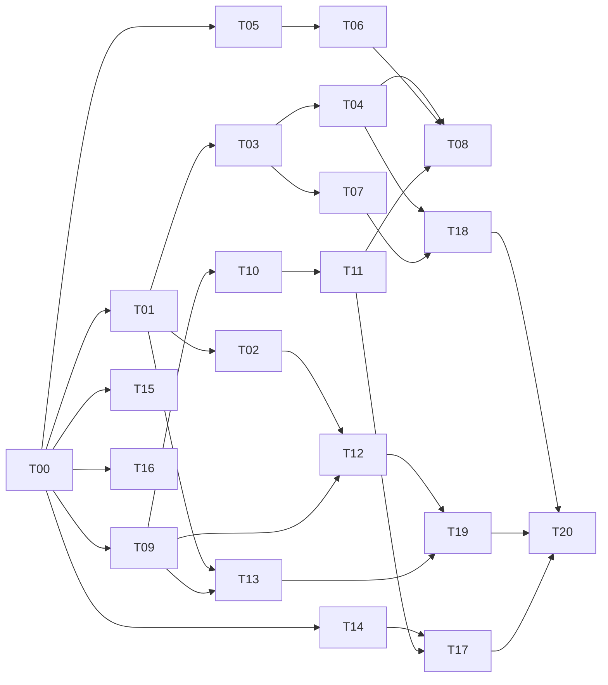

# 工作分解与多代理执行

> 读者：分派与领取工程任务的人｜状态：任务清单，状态以 work-plan.json 为准｜依据：`npm run routes:check` 与 `npm run test:routes`

本页是可分派任务清单。机器可读状态以 [work-plan.json](work-plan.json) 为准；T00 是既有研究与实验基线，其余是待实现工程任务。本次细化并不把这些未来能力标记为完成。

## 怎样领取工作

```sh
npm run routes:check
npm run routes:next -- --route beiming
npm run routes:next -- --route raea
npm run --silent routes:next -- --json
```

这些命令只检查计划、列出依赖已完成的任务及写入冲突，不执行任务、不启动渲染、不自动修改状态。`ready` 表示前置依赖满足，还需要负责人确认资产和验收输入齐备。`waiting` 列出未完成依赖及所属路线，即使依赖被当前路线筛选隐藏也会显示；`conflicts` 同时覆盖可领取与已领取任务，不因状态切换就取消写入冲突警告。

任务状态只能由实际进展更新。校验器要求 `done` 有证据记录，但证据内容仍需人工核对；它不会自动确认画面质量，也不会自动给 agent 分配 GPU。

## 多代理编排规则

1. 集成负责人独占根 README、ROUTES、AGENTS 和 work-plan.json 的状态更新；代理不互相覆盖这些入口。
2. 先按任务卡分配唯一写入范围。两个任务命中同一文件/目录时，先拆分或串行，不用后写覆盖前写。
3. 可以同时开展北冥校准、原生路线独立项目、QA 与工作台准备；北冥原生路线不等待北冥统一帧状态层。
4. 每个代理交付实际变更文件、验证命令及结果、未完成项和关键证据。不能只返回“完成”或把计划当代码。
5. 改变共享契约必须通知集成负责人，先统一字段/版本，再更新消费者；不在各代理中分别创造同名但不同义的参数。
6. 集成时先核对差异与依赖，再运行相关验收。完成标记要求证据，技术通过与创作通过分别判断。
7. 各路线手册的 A/R/V 编号表示局部实施步骤；本表 T 编号是跨路线调度与状态的唯一编号。
8. `blocked` 保留写入范围；移交前由集成人员调整范围，不以等待素材为由允许覆盖。修改 JSON 后同步本页任务卡，并运行 `npm run test:routes` 检查两者一致。

先按所需路线完成一个小样，只有需要相应能力时才领取后续任务；不要求先实现全部接口。下面六项表示依赖已满足，可按人员和任务范围选择，并非必须同时启动六位代理。

## 首批可以并行的工作

| 任务 | 负责人 | 目的 |
|---|---|---|
| T01 | 契约工程师 | 项目记录与结果契约的最小实现 |
| T05 | 风格工程师 | 建立北冥风格校准场景与变量实验 |
| T09 | 原生场景工程师 | RAEA 独立新作品目录与基础场景 |
| T14 | 工作站工程师 | 共享5090工作台互斥与运行证据 |
| T15 | QA 工程师 | 统一技术验收与结果报告 |
| T16 | 视觉验收负责人 | 风格与动作的人工验收记录 |

## 依赖总览



图为主要依赖；完整依赖以各卡及 JSON 为准。T08 是风格原生适配的独立试点，不阻止先完成 Three 版北冥路线验收。

## 任务卡

### T00 · 固定现有源码与实验基线

- 路线：`shared`；角色：集成负责人；状态：`done`。
- 依赖：无。
- 输入：现有 Three 样片与 RAEA 10 秒实验。
- 写入范围：`docs/raea/`。
- 交付：固定提交源码对照和历史运行证据。
- 验收：明确源码阅读、实跑验证和未完成能力。
- 详细指引：[README.md](../raea/README.md)。

### T01 · 项目记录与结果契约的最小实现

- 路线：`shared`；角色：契约工程师；状态：`done`。
- 依赖：T00。
- 输入：docs/routes/contracts.md；templates/project-*.json 与 render-result.json。
- 写入范围：`engine/production/project.js`, `tests/production/project.test.mjs`。
- 交付：字段校验与路径解析函数；版本不匹配/无效路径诊断。
- 验收：两条路线均可记录；不强制 RAEA 使用 FrameState；拒绝越界路径和不完整输出定义；不把计划 GPU 字段写成已执行 GPU。
- 证据：`engine/production/project.js`、`tests/production/project.test.mjs`；`node --test tests/production/project.test.mjs` 13 项通过；实现提交 `c16f0b7`。校验器只在测试中被调用，渲染器仍不读取项目记录。
- 详细指引：[contracts.md](contracts.md)。

### T02 · 统一资产身份与可回读验证

- 路线：`shared`；角色：资产工程师；状态：`planned`。
- 依赖：T01。
- 输入：现有 GLB 导出/回读脚本；自有二维底板和三维模型。
- 写入范围：`engine/assets/manifest.js`, `tools/assets/inspect.mjs`, `tests/assets/`。
- 交付：AssetManifest 和导出版本关系；坐标/单位/clip/材质检查报告。
- 验收：单位、前向、骨骼与片段可核对；不把屏幕后期当成 GLB 自带能力；修改文件内容后哈希与缓存失效可检出。
- 详细指引：[contracts.md](contracts.md)。

### T03 · 北冥镜头和帧状态纯函数采样

- 路线：`beiming`；角色：时间与状态工程师；状态：`planned`。
- 依赖：T01。
- 输入：engine/stage/film.js；engine/core/clock.js；src/main.js 与三镜头。
- 写入范围：`engine/production/shot.js`, `engine/production/state.js`, `tests/production/state.test.mjs`。
- 交付：半开区间镜头选择；FrameContext/FrameState 最小采样器。
- 验收：同一帧顺序/跳帧/倒退采样状态一致；全局和镜头局部时间不混淆；切镜头不重启持续游动相位；加入原版 setPose 在 look 调用前后切换 Euler 顺序的 CPU 回归；修复策略须验证旧片基准，不把存在 render(t) 等同随机访问已通过。
- 详细指引：[contracts.md](contracts.md)。

### T04 · 为现有 Three 镜头建立兼容适配

- 路线：`beiming`；角色：Three 集成工程师；状态：`planned`。
- 依赖：T03。
- 输入：原版主片固定帧；现有 update(t,f)/look(t)。
- 写入范围：`engine/backends/three/`, `examples/three-adapter/`。
- 交付：最小 Three BackendAdapter；旧镜头兼容示例与对照帧。
- 验收：原片 source 不被实验覆盖；既有全局时间语义保持；像素或可解释视觉差异记录齐全。
- 详细指引：[beiming-style.md](beiming-style.md)。

### T05 · 建立北冥风格校准场景与变量实验

- 路线：`beiming`；角色：风格工程师；状态：`planned`。
- 依赖：T00。
- 输入：src/toon.js 与 src/look.js；原版固定关键帧。
- 写入范围：`lab/style-calibration/`, `lab/style-calibration.js`, `docs/style-baselines/`。
- 交付：固定模型/相机/光照的校准页；色阶、阴影、rim、描边、笔触逐项变体。
- 验收：控制单个变量并记录实际参数；1080/4K 设计像素含义明确；每个保留风格有近中远景与运动证据。
- 详细指引：[beiming-style.md](beiming-style.md)。

### T06 · 从影片预设提炼视觉规范及参数版本

- 路线：`beiming`；角色：风格规范工程师；状态：`planned`。
- 依赖：T05, T01。
- 输入：校准场景和选定画风；contracts 的颜色和单位规范。
- 写入范围：`engine/style/`, `tests/style/`。
- 交付：版本化 StyleSpec；Three 参数映射及未知参数诊断。
- 验收：默认值与原片参数来源可追溯；线性/sRGB 转换点明确；新风格不覆盖旧风格基线。
- 详细指引：[beiming-style.md](beiming-style.md)。

### T07 · 二维人物关键姿态和完整动作事件

- 路线：`beiming`；角色：二维表演工程师；状态：`planned`。
- 依赖：T03。
- 输入：engine/paint；src/girl.js；4–6秒注意到鲲的事件表。
- 写入范围：`engine/performance/pose2d.js`, `examples/performance-2d/`。
- 交付：抬头、视线转移、手部松开的关键姿态；状态可采样的动作片段。
- 验收：三个动作节点可从静帧辨认；手/物体接触和遮挡正确；完整观看确认事件推进，非只有呼吸摆动。
- 详细指引：[beiming-style.md](beiming-style.md)。

### T08 · 北冥画风的 RAEA 执行适配试点

- 路线：`beiming`；角色：跨后端材质工程师；状态：`planned`。
- 依赖：T04, T06, T11。
- 输入：固定 FrameState 与相同 GLB；Three 风格校准场景。
- 写入范围：`engine/backends/raea/style/`, `examples/beiming-native-calibration/`。
- 交付：同镜头两侧渲染；色阶/阴影/轮廓/alpha/后期差异矩阵。
- 验收：不把 GLSL 字符串直接当 WESL；每项等价与不等价有关键帧证据；ID 墨线/Kuwahara 未实现时明确标缺。
- 详细指引：[beiming-style.md](beiming-style.md)。

### T09 · RAEA 独立新作品目录与基础场景

- 路线：`raea`；角色：原生场景工程师；状态：`planned`。
- 依赖：T00。
- 输入：examples/raea 已跑通例片；固定 RAEA runtime 与 SDK。
- 写入范围：`examples/raea-starter/`。
- 交付：不依赖原片鲲和底板的最小原生项目；独立 TSX/资源/声音/输出目录。
- 验收：能创建自己的视觉目标与素材；不必等待北冥 FrameState；明确 Composition 和脚本中时长/尺寸所有来源。
- 详细指引：[raea-native.md](raea-native.md)。

### T10 · 原生二维三维合成能力夹具

- 路线：`raea`；角色：原生合成工程师；状态：`planned`。
- 依赖：T09。
- 输入：Canvas3D/ImagePlane/Model SDK；自有透明底板和测试几何。
- 写入范围：`examples/raea-fixtures/layers/`。
- 交付：相机/透明/雾/字体/阴影的最小夹具；每项截图和运行状态。
- 验收：能区分层级排序、深度与 alpha 错误；字体在目标平台实际显示；缺失资源或 shader 错误不能靠输出文件存在判成功。
- 详细指引：[raea-native.md](raea-native.md)。

### T11 · 原生材质与后期扩展夹具

- 路线：`raea`；角色：WESL 材质工程师；状态：`planned`。
- 依赖：T10。
- 输入：ToonMaterial/ShaderMesh/FramePass；RAEA 源码已核对的绑定限制。
- 写入范围：`examples/raea-fixtures/materials/`。
- 交付：反照率/光照/轮廓/全屏 pass 逐层演示；原生自由画风示例。
- 验收：明确纹理和 uniform 的输入语义；材质、后期、compute 三个扩展点不混用；不要求采用北冥原版后期。
- 详细指引：[raea-native.md](raea-native.md)。

### T12 · RAEA 骨骼角色与目标约束事件

- 路线：`raea`；角色：三维表演工程师；状态：`planned`。
- 依赖：T09, T02。
- 输入：自有绑定角色和动作；Character/clip/goals 实际 API。
- 写入范围：`examples/raea-fixtures/character/`。
- 交付：手脚接触、视线、动作混合的4–6秒片段；绑定与动作重定向记录。
- 验收：角色与动作资产真实存在；手脚接触和目标空间转换稳定；不拿鲲眨眼替代真人物表演验证。
- 详细指引：[raea-native.md](raea-native.md)。

### T13 · RAEA 项目级运行包装与参数解耦

- 路线：`raea`；角色：原生运行工程师；状态：`planned`。
- 依赖：T09, T01。
- 输入：现有 tools/render.mjs/prepare.mjs；项目记录契约。
- 写入范围：`engine/backends/raea/run.mjs`, `tests/backends/raea/`。
- 交付：独立项目入口/尺寸/帧数/音频配置；一致的结果记录与失败退出。
- 验收：摆脱固定10秒/固定media清单；不影响现有10秒示例；实际 runtime、图形和编码路径分别记录。
- 详细指引：[raea-native.md](raea-native.md)。

### T14 · 共享5090工作台互斥与运行证据

- 路线：`shared`；角色：工作站工程师；状态：`planned`。
- 依赖：T00。
- 输入：现有 ComfyUI/利用率预检；目标机可用工具与进程查询。
- 写入范围：`tools/workstation/`。
- 交付：不终止任务的等待/拒绝与作业互斥协议；版本/适配器/占用/日志采集。
- 验收：队列未知与队列空区分；抢占竞争有明确策略且不kill；Windows脚本在目标机实际验证后才标完成。
- 详细指引：[validation-and-rtx.md](validation-and-rtx.md)。

### T15 · 统一技术验收与结果报告

- 路线：`shared`；角色：QA 工程师；状态：`planned`。
- 依赖：T00。
- 输入：两路线历史产物；ffprobe/FFmpeg 检查方法。
- 写入范围：`tools/qa/`, `tests/qa/`。
- 交付：完整解码/黑场/静帧/响度/音画检查；结构化技术报告。
- 验收：预期帧数来自当前项目而非固定240；指标失败有退出码和证据；技术通过不自动把创作验收标通过。
- 详细指引：[validation-and-rtx.md](validation-and-rtx.md)。

### T16 · 风格与动作的人工验收记录

- 路线：`shared`；角色：视觉验收负责人；状态：`planned`。
- 依赖：T00。
- 输入：选定视觉基准与visibleEvents；原片及迁移实验观察结果。
- 写入范围：`docs/creative-review/`。
- 交付：可见事件、空间、风格、剪辑检查表；逐项通过/失败与关键帧证据。
- 验收：每个镜头有信息变化；风格对齐与原生自由风格使用不同基准；失败镜头可定位到动作/模型/灯光/后期层。
- 详细指引：[validation-and-rtx.md](validation-and-rtx.md)。

### T17 · 同内容目标下的受控性能实验

- 路线：`shared`；角色：性能工程师；状态：`planned`。
- 依赖：T04, T11, T14, T15。
- 输入：可比较的镜头资产与画质目标；闲置工作台与已知编码路径。
- 写入范围：`tools/bench/`, `docs/benchmarks/`。
- 交付：冷启动/预热/渲染/读回/编码分段统计；性能与画质并列报告。
- 验收：共享负载与设备信息可复核；不同内容不能直接宣称倍数提升；Vulkan不标为NVENC或光追。
- 详细指引：[validation-and-rtx.md](validation-and-rtx.md)。

### T18 · 北冥路线30秒多事件验收段落

- 路线：`beiming`；角色：北冥路线集成负责人；状态：`planned`。
- 依赖：T04, T05, T07, T15, T16。
- 输入：锁定画风；至少两个连续叙事事件。
- 写入范围：`examples/beiming-sequence/`。
- 交付：30秒连贯镜头与工程；技术和创作双验收。
- 验收：不是延长游动循环凑时长；角色/道具/光照状态跨镜头连续；对照预告片画风并列出偏差。
- 详细指引：[beiming-style.md](beiming-style.md)。

### T19 · RAEA路线30秒独立作品验收

- 路线：`raea`；角色：原生路线集成负责人；状态：`planned`。
- 依赖：T10, T12, T13, T15, T16。
- 输入：自有视觉目标；原生场景与人物动作夹具。
- 写入范围：`examples/raea-sequence/`。
- 交付：30秒独立风格原生作品；可重建项目记录。
- 验收：不被北冥模板或固定10秒限制；动作和场景能力真实出现在画面；工程可在记录的目标机复现。
- 详细指引：[raea-native.md](raea-native.md)。

### T20 · 双路线发布与agent入口更新

- 路线：`shared`；角色：发布集成负责人；状态：`planned`。
- 依赖：T17, T18, T19。
- 输入：两个路线验收结果；源码、版本、参数与交付记录。
- 写入范围：`README.md`, `ROUTES.md`, `AGENTS.md`, `docs/releases/`。
- 交付：版本化入口和复现命令；完成状态与剩余问题清单。
- 验收：计划与已实现状态同步；两条路线都能从入口走通；不包含机器私有路径或未经确认的运行结果。
- 详细指引：[work-breakdown.md](work-breakdown.md)。
